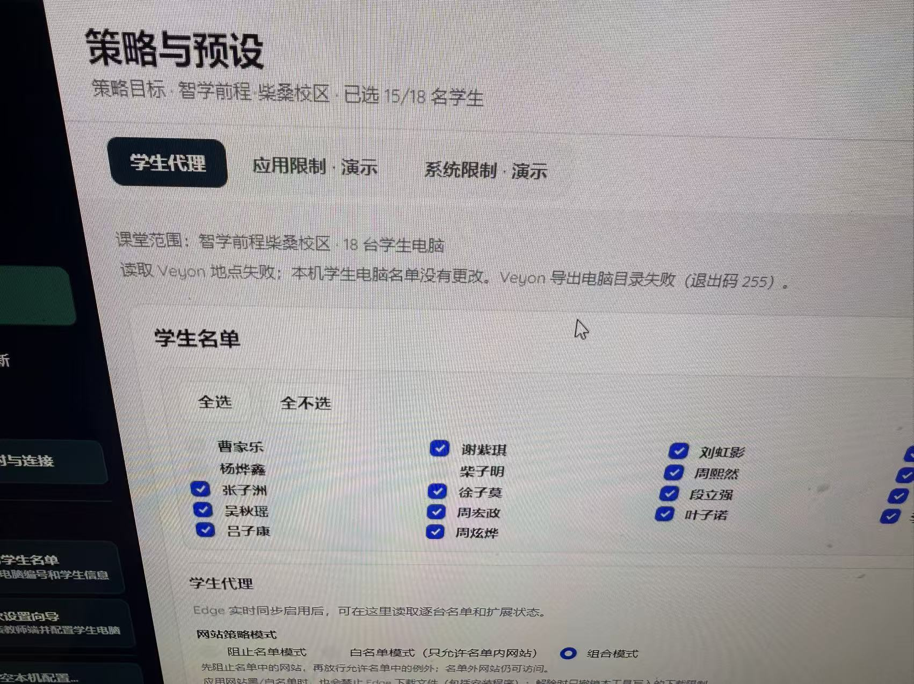

# Veyon Campus：教师端「地点」新增电脑写入 Veyon 与统一名单双向同步实施方案

**日期：** 2026-11-03（根据现场操作顺序修订）  
**用途：** 方案基线和实施追踪；Windows 教师端由用户在隔离环境手动验收  
**执行基线：** 以本机当前工作树为准；本轮基线和代码状态见[实施记录](maintenance/2026-11-03-device-directory-sync-implementation-log.md)  
**范围：** 所有学生电脑都有固定且唯一的 Windows 计算机名（如 `PC-01`、`PC-02`），Campus 直接将此名称作为 Windows Hostname 与 Veyon `Host`；Veyon `Name` 与 Campus 学生姓名双向同步，无姓名时使用固定 Hostname（PC-xx）作为默认显示名；不扫描 IP、不配置固定 IP、不维护 IP 映射。首要目标是修复 Campus「地点」新增电脑后自动写入 Veyon，通过真实 UUID 稳定关联座位，并让「策略与预设」等页面自动同步最新名单；学生姓名、电脑编号和座位字段独立管理；Name 同步只通过 Veyon UUID 定位设备，绝不改变 Host、Windows Hostname、电脑编号或座位关联。另排查 `networkobjects export` 退出码 255。**本轮已实现首批自动写入、UUID 读回关联和策略名单刷新代码；统一目录全量方案尚未完成。未操作 GitHub、生产云端或真实校区，也未运行测试或构建。**

**代码进度估算（2026-11-04）：** 完整协同范围约 **65%**；已有地点新增→Veyon 写入→读回 UUID→座位绑定→策略名单刷新的主链路约 **75%**。Windows 10/11 用户验收 **0%**；本轮未运行测试或构建，估算不代表代码通过编译或实机验证。实施细项见[实施记录](maintenance/2026-11-03-device-directory-sync-implementation-log.md)。

## 1. 问题与目标

### 1.1 用户真实操作顺序（本文件的事实基线）

1. **用户先在 Veyon Campus 教师端的「地点」管理页面，为已有校区/教室增加电脑**，电脑编号对应固定的 Windows 计算机名，例如 `PC-19`。
2. **Veyon Campus 没有将这台新电脑成功写入原生 Veyon 的「地点与计算机」目录**。用户不得不再打开 Veyon，**手动新增同一台电脑的信息**。
3. 即使 Veyon 中已经补录，返回 **Veyon Campus →「策略与预设」→「学生代理」→「学生名单」**，仍然**找不到这些新增电脑**。
4. 截图同时出现：`读取 Veyon 地点失败……Veyon 导出电脑目录失败（退出码 255）`。因此，**至少存在「地点新增写回不完整」与「策略页目录读取失败/未刷新」两条需要分别定位的链路**。不能只修其中一条。
5. 截图中地点有 **18 台电脑**，勾选 **15/18 名学生**，这是目录数量和策略勾选数量，**不能仅根据 15/18 断定缺失 3 台电脑**；必须以 Veyon 真实 UUID/Host 清单与 Campus UI 差异确定。
截图如图示：

> **关键纠正**：不是“用户一开始就在 Veyon 手动添加，而 Campus 没同步”。**新设备最初是在 Campus 的「地点」里添加的。** 根问题是 Campus 端的“新增电脑”操作没有形成可验证的 Veyon 写回闭环，之后策略页又没有从同一可信目录获取最新数据。

### 1.2 必须达到的用户体验

**正常流程应该只有一次录入：**

```text
教师进入 Veyon Campus → 地点 → 选择已有教室 → 添加新电脑
    ↓
选择固定电脑编号（对应 Windows Hostname；学生姓名可选）
    ↓
Campus 预检 Veyon 中的地点、对象 UUID、电脑名/Hostname 冲突
    ↓
自动执行原生 Veyon 电脑新增（无需用户再次打开 Veyon）
    ↓
重新读取 Veyon，验证电脑确实写入并得到真实对象 UUID
    ↓
提交/确认 Campus 座位与电脑绑定
    ↓
策略与预设、学生名单、设备概览和手机端自动刷新
    ↓
新电脑出现；默认不选中高影响策略，但可由教师立即选择
```

**对已经发生的现场问题，还必须提供一键修复：** 如果 Campus 地点已录入、新电脑后来又被手动添加到 Veyon，系统应识别为“待关联/疑似已存在”，提供**基于 UUID、Host、名称等辅助信息的明确预览与人工确认**，只补齐 Campus ↔ Veyon 对象关联，**不得重复创建第二个 Veyon 电脑**。

### 1.3 成功标准

1. **Campus → Veyon 自动写回**：从 Campus「地点」新增电脑，原生 Veyon 立即读回到该对象；不再需要用户补录。
2. **策略页自动可见**：Veyon 新增成功后，策略与预设的学生名单使用同一份已验证目录快照，立即显示该电脑，不用重启应用或重复添加。
3. **写入不假成功**：若 Veyon 因权限、CLI、导入或读回故障未成功，新电脑在 Campus 标为 `PendingWrite/WriteFailed/NeedsReview`，不得显示“已同步”。允许本地草稿保留，但必须清晰标明未进入 Veyon、不可作为已验证策略目标。
4. **名单双向发现**：Veyon 原生目录新增、改名或移动电脑后，Campus 刷新时按 UUID 对账；Campus 侧只在明确新增电脑时写入，不维护 IP 或地址映射。
5. **稳定关联**：通过 Veyon UUID 保持设备身份；学生姓名与座位编号独立管理；姓名按 UUID 与 Veyon Name 双向同步，座位调整不得改变设备绑定。
6. **错误可诊断**：`ExitCode=255` 不再只有数字，而是能查出具体失败命令与信息；读取失败保留可信旧快照并提示过期。

### 1.4 工程判断：不是“单纯刷新 UI”

**必须沿真实业务调用链排查**：`地点 → 增加电脑/保存座位 → Veyon 写入服务 → 原生目录读回 → Campus 关联保存 → 策略/预设名单加载`。重点确认：已有「检查并添加到 Veyon」是否只覆盖**创建新地点**，而**在已有地点中新增一台电脑**走了不同、仅写本地布局的路径。**这是优先核对的假设，不是已经确定的根因。**

## 2. 必须复用的现有实现

| 现有文件 / 类型                                                                                           | 已有功能                                                                                                                            | 本次应做什么                                                             |
| --------------------------------------------------------------------------------------------------------- | ----------------------------------------------------------------------------------------------------------------------------------- | ------------------------------------------------------------------------ |
| `src/VeyonCampus.Core/VeyonNetworkObjectDirectory.cs`                                                     | `ReadLocations()`、`ReadNetworkObjects()`、`ReadDirectorySnapshot()`、`networkobjects dump/export/import/add`、UUID、指纹及冲突检查 | 统一读取源、增强诊断、稳定快照和增量识别                                 |
| `src/VeyonCampus.Core/VeyonComputerRenameService.cs`                                                      | 历史 Veyon `Name` 修改事务                                                                                                          | 固定 Hostname 方案下不得调用；按 UUID 安全同步学生姓名与 Name，Host 不变 |
| `src/VeyonCampus.App/TeacherNetworkDirectory.cs`                                                          | Windows 读取 Veyon；macOS 使用校园档案生成模拟目录                                                                                  | 明确数据来源与可写能力，防止跨平台混淆                                   |
| `src/VeyonCampus.Core/ClassroomSeatGridStore.cs`                                                          | 稳定 SeatId、电脑编号、学生姓名、VeyonObjectId、VeyonLocationObjectId 关联                                                          | 保持原座位布局和设备绑定，补一致性对账                                   |
| `src/VeyonCampus.App/Presentation/Views/TeacherRoomView.axaml`、`TeacherViewModel.cs` 及地点/座位新增命令 | 教师端「地点」和已有教室编辑入口；需要核对调用链                                                                                    | **首查已有地点新增电脑是否只保存本地布局，未调用 Veyon 写回与读回**      |
| `TeacherViewModel.cs` / `TeacherPolicyView.axaml`                                                         | 策略目标和学生名单 UI                                                                                                               | 使用新增后统一快照，消除“地点有、策略无”的分裂数据                       |
| `src/VeyonCampus.App/MobileWeb/`                                                                          | 手机查看电脑并按地点操作                                                                                                            | 共享同一目录版本，不出现不同步目标                                       |
| `specs/classroom-seat-layout/design.md`                                                                   | 换座只改允许的 Veyon Name、保留 Host 和 ID                                                                                          | 严格兼容，不能用新同步逻辑破坏已有换座事务                               |

**强调：** 仓库已有 Veyon 导入和换座事务，但这不代表“已有地点新增电脑”入口已调用它们。**先对照两个入口：①新建地点并添加电脑；②进入既有地点新增电脑。** 若只有①会写 Veyon，就把②统一接入同一套安全写入服务，不要另造导入器。

## 3. 数据模型和责任划分

建议增加 `UnifiedDeviceDirectory`（或 `TeacherDeviceRegistry`）及不可变 `DeviceDirectorySnapshot`。按字段确认权威数据来源：

| 字段                         | 权威来源                                                    | 同步和修改规则                                                                  |
| ---------------------------- | ----------------------------------------------------------- | ------------------------------------------------------------------------------- |
| `DeviceId`                   | Campus 稳定本地 UUID                                        | 首次绑定后不因电脑显示名、座位变更而变化                                        |
| `VeyonObjectId`              | Veyon Computer UID                                          | 只读关联；对象被重建后不可仅凭旧名称自动继承身份                                |
| `VeyonLocationObjectId`      | Veyon Location UID                                          | 对象跨地点移动时更新父关系，保留稳定设备身份                                    |
| `VeyonComputerName`          | Veyon 显示名称                                              | 按 UUID 与 Campus StudentName 双向同步；空姓名使用 Hostname 作为默认值          |
| `HostAddress` / `MacAddress` | Hostname 以固定 Windows 计算机名为准；其他字段从 Veyon 读取 | Campus 新增电脑时 `Host = Windows Hostname = 电脑名`；不扫描 IP、不维护 IP 映射 |
| `SeatId`、行/列/编号         | Campus 座位布局                                             | 可以调整，不自动删除或重建 Veyon 对象                                           |
| `StudentName`                | Campus 学生/座位绑定                                        | 修改后按绑定 UUID 更新 Veyon Name；Veyon 外部改名经确认后回写此字段             |
| Agent 认证身份、公钥 Pin     | 既有 Student Agent trust store                              | 不能因为电脑名或 Hostname 相同就自动信任新机器                                  |
| 策略勾选状态                 | Campus 本地用户选择                                         | 新发现设备默认不勾选高影响策略                                                  |

可用以下 DTO 作为设计参考（最终名称按当前代码定）：

```csharp
public sealed record UnifiedDevice(
    Guid DeviceId,
    Guid VeyonObjectId,
    Guid VeyonLocationObjectId,
    Guid CampusProfileId,
    Guid? SeatId,
    string VeyonComputerName,
    string HostAddress,
    string? MacAddress,
    string? StudentName,
    int? ComputerNumber,
    DeviceDirectorySyncState SyncState,
    DateTimeOffset LastObservedUtc);

public enum DeviceDirectorySyncState {
    InSync, Discovered, ChangedInVeyon, PendingWrite,
    MissingInVeyon, Conflict, Stale, NeedsReview
}
```

**重要约束：** 固定 Windows 计算机名（如 `PC-01`）只作为 Windows Hostname 和 Veyon HostAddress；Veyon `Name` 与 Campus 学生姓名双向同步。Campus 改名和 Veyon 改名都必须先以 UUID 确认设备身份，更新后读回 UUID、Name、Host 与父地点；Name 变化不得改变 Host、Windows Hostname、电脑编号或座位绑定。外部 Veyon Name 与 Campus 姓名不一致时先提示确认，避免同步回写互相覆盖。学生姓名为空时，以 Hostname（PC-xx）作为 Veyon Name 默认值。

## 4. P0-A：修复 Campus「地点」新增电脑不写入 Veyon（第一优先级）

### 4.1 审计实际点击到持久化的调用链

Codex 必须追踪以下每一步，记录具体类/方法/触发位置，而不能只看到 Veyon 目录已有 `Add/Import` 就判为功能完成：

- 教师点击 **「地点 → 已有教室 → 增加电脑」** 时，事件 handler 调用哪些 ViewModel 方法？
- 输入的电脑名、Host、编号、学生姓名保存到哪里：`TeacherCampusProfile`、`ClassroomSeatGridStore`，还是 Veyon Builtin Directory？
- 此入口有没有执行 `ReadImportPreview`、`networkobjects add/import`，**并且在写入后 `ReadNetworkObjects` 读回 UUID**？
- 是否把 **「新建地点+添加电脑」** 与 **「已有地点+增加电脑」** 分成两条不对称流程？
- CLI 失败是否被吞掉、只修改 Campus 本地档案，或者 UI 显示了错误成功态？
- 写入成功后策略与预设是否收到目录刷新事件，还是使用旧的 `Targets` / 勾选名单缓存？

产出：调用链图、具体根因、最小修复点和至少一项覆盖**已有地点新增**的自动化回归测试。

### 4.1.1 本轮已确认的实际调用链

代码审阅确认，座位格编辑和地点写入是两条独立路径：

```text
点击座位格并保存
  → TeacherWindow.SeatCellClicked
  → TeacherViewModel.SaveSeatCell
  → ClassroomSeatGridStore.SaveSeat
  → 只写入教师端本地座位图；旧代码没有调用 Veyon 写入
```

Veyon 写入原先只由“创建地点和学生电脑”入口发起：

```text
TeacherRoomView → TeacherWindow.AddRoomToVeyon
  → TeacherViewModel.AddRoomToVeyonAsync
  → ElevatedWorkerClient(AddVeyonRoom)
  → PrivilegedWorkerDispatcher
  → VeyonNetworkObjectDirectory.AddLocation
  → Veyon 读回 → 保存地点档案 → 绑定座位 UUID
```

因此，在已有地点里添加座位并保存时，确实会出现“Campus 本机看得到、Veyon 未新增”。策略名单又由 `ReadWebsiteLocationsAsync` 单独读取，写入后没有强制刷新已加载的目标。已在代码中接入“保存未绑定且有姓名的座位 → 受控写入 → Veyon 读回 → UUID 绑定 → 刷新当前地点策略名单”的路径；具体验收见 [手动清单](maintenance/2026-11-04-device-directory-sync-manual-checklist.md)。

### 4.2 正确的新增事务（单次录入、自动写入）

```text
TeacherAddComputer(location, computerNumber, optionalSeat/student)
  → ReadCanonicalVeyonDirectory / RejectUnknownBackend
  → WindowsHostname = VeyonHost = PC-{computerNumber}; VeyonName = StudentName ?? PC-{computerNumber}
  → EnsureLocationUid / DetectComputerNameUuidCollisions
  → PreviewAdd (仅新增该电脑，不清空、不重建现有对象)
  → SaveLocalPendingIntent (不可标“已同步”)
  → ExecuteExistingVeyonAddOrImport
  → ReReadNetworkObjects + Check New Veyon UID/ParentUid/Host match PC-xx and Name matches StudentName or PC-xx fallback
  → BindSeatAndStudentToVerifiedVeyonObjectId
  → PublishUnifiedSnapshot + NotifyPolicyAndPresetViews
  → Committed
```

**交易语义必须明确：** Veyon 写入与 Campus JSON 不可能原生跨进程原子提交。因此使用持久操作意图 + 幂等重试/读回补偿：

- CLI 未执行成功或没有确认结果：保留 Campus 本地草稿，状态 `WriteFailed/NeedsReview`；不宣称已同步。
- Veyon 写入已成功但 Campus 保存失败：下次先以已验证 UUID/固定电脑名和日志读回进行**关联恢复**，不能直接重新添加。
- UI/进程中途退出：恢复同一 `operationId`，先重新读取 Veyon，判断目标是否已存在，再选择继续绑定或提示人工确认。
- Veyon 中已有相同固定电脑名的对象（包含教师事后手动补录）：**不盲目新增**；显示“已有对象，是否关联？”并核对 UUID/父地点/Host 与固定电脑名一致性。
- 座位没有姓名时同样允许添加物理电脑，只是 `StudentName` 为空；不要沿用“只有填写姓名才生成电脑”的旧新建机房限制。
- 写入需要提权时显示明确权限阻塞和恢复指引，不偷偷以管理员运行程序或禁用安全校验。

### 4.3 把写入成功和策略可见联动为一个用户完成态

一个“新增电脑成功”操作至少返回：

```text
CampusSeatSaved     true/false
VeyonObjectCreated  true/false
VeyonObjectVerified true/false
VeyonObjectId       <read-back UUID or null>
PolicyDirectoryRefreshed true/false
Status              Committed / PendingWrite / NeedsReview / Failed
```

只有 `VeyonObjectVerified=true` 且 `PolicyDirectoryRefreshed=true`，界面才提示“已添加到 Veyon，并同步到策略与预设”。如果目录读回暂时失败，应准确显示“Veyon 写入结果待核对”而非“全部成功”。

## 5. P0-B：排查 `networkobjects export` 退出码 255（第二条独立故障链路）

### 5.1 目前实际调用

`VeyonNetworkObjectDirectory.ReadLocations()` 当前执行：

```text
ResolveVeyonCliPath()
→ ProcessRunner.Run(veyon-cli.exe,
  ["networkobjects", "export", temporaryPath,
   "format", "%name%\u001f%host%\u001f%location%"])
→ 检查 ExitCode → ParseLocationsExport()
```

同时已经实现：

- `ReadNetworkObjects()`：使用 `networkobjects dump`，支持解析 Veyon UID 和父对象。
- `ReadDirectorySnapshot()`：使用 `config export`，读取完整目录和配置 SHA-256 指纹。

### 5.2 诊断任务

Codex 需输出结构化 `VeyonDirectoryReadDiagnostic`，记录：CLI 绝对路径和版本、工作目录、运行账号/提升状态、子命令、退出码、耗时、超时、stdout/stderr（限长和脱敏）、临时文件存在与权限、实际 Veyon 目录后端，以及最近成功读取时间。错误阶段明确区分：`CliNotFound / CliFailed / ExportFileMissing / AccessDenied / ParseFailed / Timeout / UnsupportedBackend / IdentityConflict`。

**不要只截取 `ExitCode=255`。** 要比较本机 `dump`、`networkobjects export`、`config export` 是哪一个失败。也不能假定退出码 255 就是权限问题。

### 5.3 读取回退与信任等级

1. 首先尝试 `networkobjects dump` 获取电脑 UID、地点 UID、Name、Host。
2. `dump` 失败时尝试现有 `networkobjects export`；仅有名称/地址的结果应标记 `PartialRead`，**不能作为按 UUID 写回的身份依据**。
3. 必要时使用现有 `config export` 获取完整 Builtin Directory 快照；原始全配置可能包含敏感字段，不应上传云端或写到普通日志。
4. 全部失败：保留上次已验收的 Campus 快照，标记 `Stale`；不删除设备、不自动扩容策略目标、不允许基于过期数据写回 Veyon。
5. LDAP/AD 等非 Builtin 目录后端：默认只读，明确提示“请到目录源管理”；不可用 Builtin `config import` 覆盖 LDAP。

教师机只读排查指令：

```powershell
$cli = Join-Path $env:ProgramFiles 'Veyon\veyon-cli.exe'
& $cli networkobjects help
& $cli networkobjects dump
"dump exit=$LASTEXITCODE"
& $cli networkobjects help export
$dest = Join-Path $env:TEMP 'veyon-directory-test.txt'
& $cli networkobjects export $dest
"export exit=$LASTEXITCODE"
if (Test-Path $dest) { Get-Item $dest | Select FullName,Length }
```

Veyon 官方支持 `networkobjects dump/export/import/add/remove`。**禁止为修复 255 执行 `networkobjects clear` 或 `config clear`。** 若从 Windows `.bat` 调用包含 `%name%` 的格式串，应按官方规则转义；C# 应用直接使用 `ProcessStartInfo.ArgumentList`，不要通过 cmd 执行。

## 6. P0-C：Veyon → Campus 自动发现与增量同步

```text
Read current Veyon objects
  → Validate UID/parent/Host/duplicates
  → Compare previous verified snapshot by UID
  → Build Added/Renamed/HostChanged/Moved/Missing/Conflict diff
  → Merge Campus seat/student bindings (never overwrite by name)
  → Atomically persist snapshot
  → Notify strategy/seat/monitor/mobile views with same version
```

- **Added**：创建待绑定对象；新发现电脑立即显示，但默认不勾选锁屏、应用/系统限制等高影响策略。
- **Renamed**：Veyon UUID 不变、Name 变化时标为待确认差异；教师确认后将 Name 同步为对应 StudentName，或在座位编辑中确认以 Campus StudentName 覆盖 Veyon Name。
- **HostnameMismatch**：UID 不变但 Veyon Host 与固定 Windows 计算机名不一致时标记冲突并阻止策略操作；Name 可为学生姓名，不用于连接或身份识别。
- **Moved**：同 UID 换父地点，保留 DeviceId；座位/教室归属有歧义时需要人工确认。
- **Missing**：UID 消失，标记 `MissingInVeyon`，保留本地绑定用于恢复，不自动删。
- **Conflict**：同一 Host 出现在多个地点、重复 UUID、父地点缺失或 Host 无效等，阻止不明确的策略发送和写回；重复 Veyon Name 本身不视为设备身份冲突。

**Campus「地点」新增电脑并读回成功后应立即发布快照变更，通知策略与预设的学生名单刷新**，不应要求教师离开页面、重新登录或重启应用。页面刷新、返回策略页、原生 Veyon 修改后手动刷新、应用重新启动也应触发只读检查；连续刷新需去重、限制频率。

若 Campus 地点有本地电脑但 Veyon 尚未验证，策略页可以展示“待写入 Veyon / 不可作为可信目标”，而不是静默消失或错误地作为可用策略目标。

## 7. Campus → Veyon 安全双向写回

**在 Campus「地点」中点击“新增电脑并保存”本身就是明确的教师操作，应该自动执行 Veyon 写回**，不得再要求教师额外打开 Veyon 或寻找另一个隐藏的“同步”按钮。Host 和固定电脑名不开放编辑；Campus 姓名修改经 UUID 同步到 Veyon Name。目录读取发现同一 UUID 的 Veyon Name 与 Campus 姓名不同，先提示确认同步方向，再更新学生姓名或 Veyon Name。

允许的教师操作包括：

- 新增地点 / 新增电脑：优先复用 `ReadImportPreview`、现有地点导入/新增实现，并读回 Veyon UID。
- 电脑编号固定对应 Windows Hostname；新增时 Veyon `Host` 使用此 Hostname，`Name` 使用学生姓名或 PC 编号默认值。不要提供 IP、固定 IP 或自定义 Host 映射入口。
- Campus 学生姓名修改后，按已绑定 UUID 更新 Veyon `Name`，并读回确认；Host、Windows Hostname、编号、座位和 UUID 不变。
- 读取 Veyon 时，如 Name 与已绑定座位学生姓名不一致，列出冲突并等待教师确认是否把 Veyon Name 同步到 Campus 姓名；应用后只修改 StudentName 和 Name 缓存，不回写 Veyon，避免循环覆盖。
- 删除绑定：默认仅解绑 Campus 座位；物理删除 Veyon 对象要独立危险操作确认。绝不误删含电脑的地点。

所有写操作必须具有下列事务：

```text
Inspect → PreviewExactDiff → CheckFingerprintAndUID
→ SaveProtectedBackupAndJournal → ApplyNarrowDiff
→ ReReadFullDirectory → VerifyOnlyApprovedFieldsChanged
→ Commit / RollbackAttempted / RecoveryRequired
```

1. 从当前 Veyon 导出读取真实 UUID、父对象、Host，保存原始配置指纹。
2. 展示新增前后差异（例如 `Computer[Uid].Name = 张三`、`HostAddress = PC-19`；空姓名时 Name 为 `PC-19`），用户确认。
3. 生成可恢复的本地加密备份（沿用当前用户 DPAPI），写入操作 journal。
4. 写入前再次比较完整目录/配置指纹；别人改了目录就中止，并要求刷新预览。
5. 导入之后读回目标 UUID、Name、Host、ParentUid；新增对象必须满足 `Host == Windows Hostname == PC-xx` 且 `Name == StudentName`（空姓名使用 `PC-xx`），并核对原有对象除获批 Name 同步外无改动。
6. 导入返回非零但读回已符合目标时可标记“读回确认成功”；结果不确定时只允许 **NeedsReview**，不要自动重复发送写入。
7. 修改失败可尝试受控恢复；回滚失败保留备份并提示现场修复。

**绝不可**通过清空所有电脑、重建目录的方法达到同步。电脑编号/Hostname 用于 Veyon 连接，不取代 UUID 作为稳定设备关联主键；学生姓名和座位编号也不能作为设备主键。

## 8. UI 和产品行为

### 8.1 统一入口

推荐使用 `设备概览 → 地点与计算机`；策略页保留简洁的“管理电脑/刷新名单”入口，避免在每个策略页单独维护设备数组。

地点概览：`掌学前程柴桑校区 · Veyon 18 台 · 已绑定 N 台 · 新发现 M 台 · 冲突 K 台`。设备行展示 `Veyon Name / Host / 地点 / 座位号 / StudentName / Agent 认证 / 同步状态`。

可执行动作：`刷新目录`、`添加电脑`、`绑定学生/座位`、`重新核对 Veyon 写入`、`查看诊断`。电脑名、Hostname 和 UUID 只读。**“添加电脑”完成后主动写 Veyon，不要把后续手动“同步到 Veyon”设计成完成新增所必需的第二步。**

在「地点」新增后展示分步骤结果：`Campus 已保存 → Veyon 已写入 → 已读回确认 → 策略与预设已更新`。任一步失败保留明确原因、恢复/关联按钮和最后成功读取时间。

### 8.2 双分组编辑

- **Veyon 属性**：显示 Veyon Name、固定 Hostname、所属地点与 UUID；Host 和 UUID 只读。
- **Campus 属性**：学生姓名、座位编号、备注；修改学生姓名会按 UUID 同步 Veyon Name。
- 换座只交换 Campus 学生姓名和对应 UUID 的 Veyon Name；Host、电脑编号、Windows Hostname、UUID 与设备座位绑定保持不变。

### 8.3 页面一致性

- 策略、学生名单、座位、监控、手机端必须使用同一个快照版本。
- 新发现设备立即显示但不自动成为高影响策略的选中目标。
- 活跃课堂期间只允许安全刷新；Hostname 与电脑编号不一致时阻止相关策略操作，移动地点需按 UUID 人工核对。
- 过期快照保留显示但标记“目录读取失败 / 最近可信读取时间”，不显示假成功。
- 手机端目标必须经教师当前授权范围、真实 Host、身份和冲突校验；不能依赖过时的名字映射。

## 9. Codex 连续实施任务表（以 Campus 新增写回为中心）

| 顺序      | 任务                                                        | 完成条件                                                                                           |
| --------- | ----------------------------------------------------------- | -------------------------------------------------------------------------------------------------- |
| **UD-01** | **P0** 审计「已有地点新增电脑」全链路，并与「新建地点」对照 | 找到真实缺失/失败调用点；列出文件、调用顺序、失败处理                                              |
| **UD-02** | **P0** 在 Campus 地点新增时自动写入 Veyon                   | 只录入一次；Host=Windows Hostname=PC-xx，Name=学生姓名或 PC-xx 默认值，读回真实 UUID；失败不假成功 |
| **UD-03** | **P0** 已经手工补录到 Veyon 的电脑安全关联恢复              | 不重复创建 Veyon 对象；教师明确确认匹配 UID/Host 后补齐绑定                                        |
| **UD-04** | **P0** 诊断 `networkobjects export` 255 并修复只读目录加载  | 能定位实际失败；必要时从 `dump` / 已验证配置快照回退                                               |
| **UD-05** | **P0** 统一地点与策略学生名单数据源、刷新事件               | Campus 新增后“策略与预设”立即出现同一电脑；旧选中状态不丢                                          |
| **UD-06** | **P0** 规范化 UUID 设备投影、稳定持久绑定与自动发现         | 改名/地址/地点变化不丢 DeviceId、StudentName、SeatId                                               |
| **UD-07** | **P1** Veyon Name 与学生姓名 UUID 双向同步                  | Name 双向同步；Host、Hostname、编号和绑定不变                                                      |
| **UD-08** | **P1** 固定 Hostname 规则与目录一致性核对                   | 新增时 Host 与固定电脑名一致；不提供 IP/Host 覆盖映射                                              |
| **UD-09** | **P1** 学生姓名、固定电脑名、编号、座位 UI                  | 字段分离；电脑编号只读且对应固定 Windows Hostname；Veyon Name 与学生姓名同步                       |
| **UD-10** | **P1** 重复/缺失/迁移/多教师并发冲突与缓存治理              | 无误删、无静默重复创建、过期快照不能作为真实同步状态                                               |
| **UD-11** | **P1** 自动化回归与 Windows VM 用户验收脚本                 | 覆盖“Campus 新增→Veyon→策略列表”的主链路及失败恢复                                                 |
| **UD-12** | **P2** 多教师机共享目录/权限来源策略                        | 明确 Builtin 与外部目录边界，禁止多人无锁覆盖                                                      |

**当前代码状态：** UD-01、UD-02、UD-04 为首批代码已完成（仍待用户验收）；UD-03、UD-05、UD-06 为部分完成。UD-08 的固定 Hostname → Veyon Host 已实现。现已接入按 UUID 的双向 Name/学生姓名同步：Campus 修改后受控写入 Veyon，读取目录发现差异后可经教师确认原子更新 Campus；换座也覆盖空座位与单侧绑定。统一目录自动对账与 UD-09～UD-12 尚未完成。Name 不再要求等于 Host，Host/UUID/电脑编号/座位绑定保持独立。旧 HostOverrides 仍仅用于旧档案兼容。具体边界和手测项目以[实施记录](maintenance/2026-11-03-device-directory-sync-implementation-log.md)及[手动验收清单](maintenance/2026-11-04-device-directory-sync-manual-checklist.md)为准。
要求每个 UD 都有最小可审查提交、自动化测试、变更说明。**源代码改动不等于 Windows 实测通过。** 与当前 Maintenance 更新协议和权限体系集成，而不是更换密钥或改造学生端安装器。

## 10. 测试验收矩阵

**执行限制：** 用户本轮明确要求不要运行测试或构建，教师机尚未开机。本轮仅审阅和修改代码；以下自动化及 Windows 验收步骤均待用户之后手动执行。

### 单元与契约测试（Codex）

- [ ] `networkobjects export` 返回 255、CLI 不存在、超时、文件不存在、UTF-8 中文、字段格式异常。
- [ ] `dump` 成功而 `export` 失败时能读取电脑；缺 UID 时不可冒险写回。
- [ ] **关键主链路：Campus 教师端「已有地点」新增第 19 台 → 自动写入 Veyon → Veyon 读回 UUID/Host → 「策略与预设」自动出现第 19 台；原有 18 台与策略勾选状态不受影响。**
- [ ] **失败路径：Campus 地点新增成功但 Veyon 写入失败 → 明确 PendingWrite / WriteFailed，不显示“已同步”；修复后能重试和读回。**
- [ ] **历史修复：Campus 本地已有电脑，后来人工在 Veyon 添加同名/同 Host → 显示可关联候选且人工确认，不再重复新建对象。**
- [ ] 原生 Veyon 手动新增第 20 台 → Campus 和策略页刷新为新发现（反向同步）；已有学生座位不变。
- [ ] 同一 Veyon UUID 外部改 Name 后，Campus 显示冲突并让教师确认；确认后 StudentName 更新，Host、电脑编号和绑定不变。
- [ ] 同一 Veyon UID 改 Host 或父地点时，仅 Host 不符才标记连接冲突；设备 UUID 与座位绑定稳定。
- [ ] UUID 重建、重复 Host、缺少父地点、LDAP 后端均安全拒绝危险动作；重复 Veyon Name 允许存在，因为设备身份按 UUID 确认。
- [ ] 写回前配置指纹变化、导入成功读回失败、导入失败但实际生效、回滚失败有准确状态。
- [ ] 中文姓名、空学生名、非连续电脑编号及 10/18/70/150 台大批量读取。
- [ ] 策略、预设、座位、移动端的目标 UUID/Host 一致；原网站黑白名单及到期解除无回归。

### Hyper-V 实测（用户）

1. 给教师机、学生机建立快照，备份已有 Veyon 目录；明确受测的是**已有地点**。
2. **只在 Veyon Campus → 地点 → 已有教室中添加第 19 台电脑**，不打开原生 Veyon 添加；核对操作状态为已写入/已读回。
3. 打开原生 Veyon Configurator，确认该教室**确实新出现第 19 台**，名称与 Host 正确、没有重复对象。
4. 打开 Campus → 策略与预设 → 学生代理 → 学生名单，**立即找到第 19 台**；可明确选择它进行授权策略操作，默认不被强制选中。
5. 模拟 Veyon 导入失败/退出码 255：Campus 地点新增不能宣称全部成功，策略页不误将本地草稿视为已验证电脑。
6. 模拟“Campus 本地已有一台，但教师后来又手动在 Veyon 中补录”：执行对账/关联修复，不产生第 2 个 Veyon 电脑对象。
7. 原生 Veyon 修改现有电脑名并刷新 Campus，`StudentName`、SeatId、DeviceId 保留。
8. 交换两名学生的座位，确认 Campus 姓名与对应 UUID 的 Veyon Name 同步交换；电脑编号、Host、Windows Hostname、UUID 和设备座位绑定不变。
9. 将 Veyon Name 外部改动为与学生姓名不同的值，确认目录读取显示待同步差异；按提示确认同步方向后再同步；将 Host 改成非固定 Windows Hostname，确认设备标为冲突并阻止策略。再检查移动地点、模拟删除、并发修改和中断恢复。
10. 在现有 18 台（以及 10/70 台模拟场景）验证策略、网站黑白名单/到期解除、Veyon 监控、手机端单机操作无回归。
11. VM 通过后只在非关键机房灰度；禁止未验证就面向全部校区写入。
**通过门槛：** 0 次误删其他电脑或地点；0 次对不确定 Host/Agent 身份实施策略；0 次把失败或陈旧缓存显示成“同步成功”。

## 11. 发布与安全边界

- 不自动改 Windows 真实主机名；不清空 Veyon Builtin Directory，不自动删除 Veyon 电脑。
- 不修改校区密钥、Agent 公钥 pin、Maintenance 更新事务或生产云端数据。
- 所有本地目录备份要加密并限权；错误诊断不暴露教师私钥、完整敏感配置或未脱敏学生名单。
- 当前用户希望拿到可手动实测版本；本轮不运行构建、自动化测试、Windows VM 或现场测试。正式 stable 晋级仍需独立验收。

## 12. 可直接交给 Codex 的总 Prompt

```text
请阅读并执行《VeyonCampus_统一设备目录_双向同步实施方案.md》（现场流程修订版）。

纠正问题理解：用户是在 Veyon Campus 教师端的「地点」中先添加电脑，
但新增对象没有写入原生 Veyon，导致用户不得不自己到 Veyon 再添加；
之后「策略与预设」依然读不到，并显示导出失败 ExitCode 255。
这是“Campus → Veyon 写入缺口 + Veyon → Campus/策略读取缺口”，
不能只做反向发现或单纯修复 255 就宣称解决。

首先查明「已有地点新增电脑」的真实 UI→ViewModel→座位持久化→
VeyonNetworkObjectDirectory 写入→读回→策略名单刷新调用链，
与「新建地点并添加电脑」路径对照；确认是否存在只改本地布局的入口。

按 UD-01～UD-12 连续实施：
1. 修正地点新增电脑为一次录入并自动写入 Veyon；失败保留待写草稿，
   不报成功；写入后必须读回 Veyon UID、Name、Host。
2. 给已有手动补录到 Veyon 的电脑提供可确认的关联修复，避免重复创建。
3. 修复 export 255 的诊断及只读回退，并使地点、策略与预设、
   设备概览、座位、监控和移动端引用同一可信目录快照。
4. 复用 VeyonComputerRenameService、已存在的受控导入和座位关联，
   做受控双向编辑、冲突处理、加密备份、指纹预检与读回恢复。

必须区分 Veyon 电脑名、学生姓名、Windows 主机名、座位和 Agent
身份。不得用 IP/名字自动继承设备 pin，不允许 networkobjects clear，
不能把未验证的新增电脑自动勾选进入高影响策略。

每项做可审核提交、自动测试、必要的编译构建并修复失败项。
优先证明“Campus 已有地点新增 → Veyon 实际新增 → 策略学生名单出现”
端到端路径；真实 Windows VM 与校区验收由用户另行安排。
不擅自修改生产 CloudBase、真实校区、stable 发布渠道。
```

## 13. 参考

- Veyon 官方 CLI：<https://docs.veyon.io/en/latest/admin/cli.html>。
- 当前仓库：<https://github.com/Ljc798/veyon-campus-deployment>；执行前按最新 `develop` 复核。
- 现有座位设计：`specs/classroom-seat-layout/design.md`。
