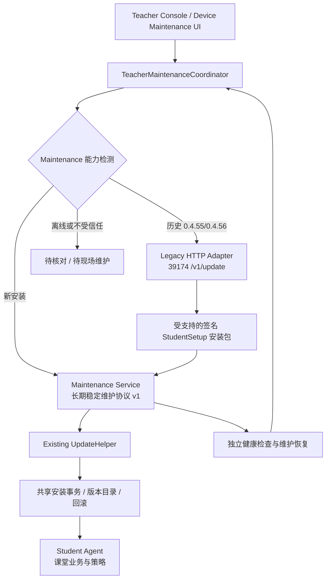

# Veyon Campus — Maintenance 最终实施计划（Goals · Plan · Issues 001–009）

> **最终版 · 2026-11-02 · 供 Codex 逐项执行** · 源码核对基线：`develop@930af1a516d51f9f1c35aa1d674f06ed568b1723`（2026-11-02）
> 目标：将「教师端更新 + 学生端更新 + 校区配置同步 + 故障修复」整理为可靠的维护体系；逐步引入独立于 Student Agent 的 Maintenance Service，保证后续课堂业务协议升级不再导致全校区人工重装。
> **性质：计划与验收规范，不代表以下功能已经实现或完成实机验证。**
> **合并范围：** 既有 Maintenance P0–P4 路线 + 用户提供的项目问题台账 `001–009`，包含稳定版升级版本错配、配置热更新、课堂验收、版本/恢复状态、失败回滚、连接诊断、切换前回执、未知目标版本和 AppLocker/Appx 覆盖。
> **状态约束：** 静态审查不等于 Windows 实机复现；`930af1a` 已有若干兼容修复，禁止把旧结论当成最新事实；任何修复以当前 HEAD 和真实测试结果为准。

---

## A. Goal：我们究竟要交付什么？

**终极目标（Project Goal）**：让已经部署的 Veyon Campus 学生电脑，在**不依赖 Student Agent 最新课堂协议**的情况下，仍能通过可信通道升级、修复、回滚和同步教师连接配置；让普通教师只需「检查并维护所选设备」，并准确知道每台电脑的真实运行与课堂管控状态。

### G1 — 历史版本可迁移

- 对确实具有**可信签名更新入口**的历史 Agent（重点 `0.4.55 / 0.4.56`），在 Windows VM 验证使用旧 `39174 /v1/update` + 历史可信发行格式，完成升级至包含新版 Agent 和 Maintenance 的完整 StudentSetup。
- **约束**：未安装 Maintenance 的旧 Agent 无法凭空获得新通道；历史版本没有可信更新能力、签名公钥不匹配、事务损坏时，应明确进入「需现场维护」，绝不跳过验签。
- **成功标准**：每个受支持历史基线都有可重复的端到端升级或明确且有证据的拒绝结果；不能仅凭兼容性单元测试宣称成功。

### G2 — 以后业务 Agent 怎么变，都不影响维护

- 新增独立 Maintenance Service，保留 UpdateHelper 和已有原子事务；维护通道与业务 Agent 的 WebSocket/课堂会话解耦。
- **成功标准**：主动停止 Student Agent、让新旧课堂通信协议不兼容时，仍能从独立 Maintenance 通道读状态、执行**受信任**升级或修复；Maintenance 自身也能安全更新和回滚。

### G3 — 一键维护必须是真正的「逐设备事务」

- 状态链：`Inspect → Identity/Capabilities → Plan → Update → Commit/Verify → SyncConfig → Verify → Completed`；任何 `PendingVerification / recoveryRequired / Unknown` 不进入下一项有副作用操作。
- **成功标准**：0 次「已发送=已生效」的假成功；0 次更新未完成时继续同步配置；每个完成状态附可信设备读回；教师端重启后可恢复原事务视图。

### G4 — 区分软件、通信与课堂功能是否真的可用

- 单独显示 Setup/Agent/Maintenance 的**安装及运行版本**、更新事务、WebSocket 认证连接、策略实际执行和最后验证时间。
- **成功标准**：教师可准确辨别「网站黑白名单正常，但课堂连接异常」「Setup 新但 Agent 旧」「恢复任务未完成」；诊断不能只写「等待连接」。
- **基线保护**：用户已确认的网站黑白名单 **推送 → 学生实际生效 → 到期自动解除**，以及已测 Veyon 功能，必须作为强制无回归项目。

### G5 — AppLocker 覆盖范围与真实系统行为一致

- 区分 Windows 桌面 EXE、Microsoft Store、已安装的 Appx/MSIX 游戏、商店安装限制和账户/系统支持边界。
- **成功标准**：在明确的 Windows 版本、Edition 和普通学生账户上，逐项验证能否安装、能否启动、撤销后是否恢复；不能把现有全放行 Appx 规则声称为「支持应用黑名单」。

### Non-goals（本轮明确不做）

- 不重写 Veyon 的屏幕监控，不重新实现一套原子事务引擎，不重置所有校区身份/策略密钥。
- 不为兼容性添加远程任意命令执行、任意 URL 安装、跳过签名或自动信任新教师证书。
- 不把所有课堂功能一次性重构；先完成可信维护底座和高影响功能验证，再简化界面。
- 不在未经过 VM 验证的情况下向所有校区自动推送安装/高风险系统策略。

### Project Milestones 与阶段出口

| 里程碑                       | 前置条件                                    | 可交付结果                                                 | 阻断条件                                   |
| ---------------------------- | ------------------------------------------- | ---------------------------------------------------------- | ------------------------------------------ |
| **M0：旧架构可靠**           | 解决 001、002、005、007、008，建立 003 基线 | 旧升级、回滚和配置同步无伪成功；风险有证据                 | 未解决的 `recoveryRequired` 或关键版本错配 |
| **M1：协调器可恢复**         | M0                                          | 逐设备状态机、持久化任务、诊断/版本独立展示，处理 004、006 | 教师端重启丢失事务或误下发                 |
| **M1-S：AppLocker 独立验收** | 003 测试基线、001/005 更新安全              | 009 的设计、受限实现和 Windows 兼容矩阵                    | 未验证即开启大规模阻断/全盘策略            |
| **M2：维护通道独立**         | M1                                          | Maintenance 与 Student Agent 解耦、独立签名操作            | Agent 停止导致 Maintenance 不可用          |
| **M3：维护自身可修复**       | M2                                          | Maintenance 自更新/看门狗/断电回滚                         | 唯一恢复链依赖维护进程自身                 |
| **M4：统一体验+灰度**        | M0–M3 + 课堂验收                            | 双入口 UI、设备分组 rollout、可审计发布                    | 未完成 VM、历史签名、安全及功能回归        |

---

## 0. 给 Codex 的执行约束（每次执行前必读）

1. **从当前本地工作区开始**：先运行 `git status`、`git rev-parse HEAD`、`git log -3 --oneline`，核对实际分支和提交。上述基线仅用于对比；若本地已有更新，先阅读差异，**不得强行 checkout 或覆盖用户未提交改动**。
2. **按依赖顺序逐项实施，但连续推进**（例如先完成 P0-01，再进入下一项）；不得将 P0～P4 打包为一次大重构。每项变更保持可审查，记录改动、设计取舍和风险；完成一项后继续下一项，不逐项停下等待用户确认。
3. **保留现有更新可信链**：校区身份与设备固定公钥、Developer Release 验签、安装包大小与 SHA-256 校验、命令时效与重放保护、原子事务日志、UpdateHelper、回滚和恢复任务。禁止为了兼容旧 Agent 关闭或绕过这些校验。
4. **不得假设旧 Agent 已经支持新协议**。0.4.55/0.4.56 的历史能力必须从对应 tag/提交和实际编译安装包验证；不能只根据新代码里的模拟能力映射得出结论。
5. **本地测试签名与正式签名隔离**：旧 Agent 不认识新 `local-test` Schema 4/新测试信任根时，明确提示无法直接升级。不得把测试私钥发到仓库或生产环境，也不得伪造旧 Agent 的信任链。
6. **维护服务不提供通用远程执行**：只允许固定的、具备强认证和授权的维护操作。禁止任意 shell/命令执行、任意 URL 下载运行、任意路径覆盖。
7. **故障默认保守**：无法确认身份、版本、事务结果或恢复状态时，标记“待核对/待恢复”，保留日志和旧版本；不能报告成功，不能直接清空事务或强制重装。
8. **重要变更要能回退**：新增服务须 feature flag/能力发现、渐进切换；在新服务稳定前保留受支持旧版 `39174` 更新入口。
9. **测试按用户安排执行**：当前用户已要求先持续实现 Maintenance，测试任务后续统一安排；安排前不得运行测试、构建、安装或 VM 验收，也不因源码完成推断测试通过。统一标记 `TEST-DEFERRED`，Windows/现场项目分别标记 `VM-PENDING` / `FIELD-PENDING`。获安排后再分开报告单元/契约、打包和独立 VM 端到端证据。**测试结果必须注明证据级别：现场已验证 / 有日志的现场故障 / 静态审查疑点 / 尚未验证。**
10. **不要引入不必要的基础设施**：优先复用现有 Core、Release、UpdateHelper 和 LAN 更新服务器，不为 Maintenance 复制第二套安装事务引擎。
11. **问题台账与计划互相链接但不互相覆盖**：先找到用户现有的「项目问题记录（001–009）」与 `开发路线与任务清单.md`；本文件是开发执行计划，问题台账保留原始证据、时间线和实际状态；修改完成后双向更新对应记录，不要重新生成冲突的另一份主表。
12. **准确分级**：`001`、`007` 是具体代码审查可定位的逻辑风险；`008` 在 `930af1a` **已部分防护**，须先复核而非重新报告为完全未修；`005` 是历史真实事故但新版本修复效果未验证；`003`、`006` 主要是现场验收/诊断缺口；`009` 的 Appx 基线范围由源码可查，但 Windows 实际阻断必须现场验证。
13. **不要做无证据的跨版本“修复”**：需要出具签名信任链、实际旧版二进制、运行时版本、事务状态和复现日志。若仍缺证据，报告 `NOT-REPRODUCED` 或 `BLOCKED-BY-ENVIRONMENT`，不要为了通过测试而修改安全协议。

### 推荐工作方式

对本任务书按顺序连续执行。进度记录采用以下字段；尚未测试时保留 `TEST-DEFERRED`，并直接继续下一项，不等待逐项确认：

```text
阶段：P? / 子任务编号 / 对应问题 ID（001–009）
实际基线 SHA：
改动文件与核心设计：
已有自动化检查证据（命令和日期；本轮未运行则写 TEST-DEFERRED）：
已有 Windows VM 测试（版本、结果、日志位置；未运行则写 VM-PENDING）：
尚未验证的场景与风险：
每条发现的证据级别及复现记录：
本次是否保留已验证的网站黑白名单与到期解除行为：
是否满足阶段退出门槛：是 / 否
问题台账更新（ID、状态、证据链接）：
紧接着推进的下一项：
```

---

## 1. 最新代码现状及必须保留的资产

### 1.1 已有的能力（不要重写）

| 位置                                                                       | 当前作用                                                 | Maintenance 改造策略                                                |
| -------------------------------------------------------------------------- | -------------------------------------------------------- | ------------------------------------------------------------------- |
| `src/VeyonCampus.Core/StudentMaintenancePlanning.cs`                       | 判断更新、配置同步、恢复/人工维护                        | 扩展为设备级维护决策，不在 UI 直接组织复杂事务                      |
| `src/VeyonCampus.Core/StudentApplicationUpdates.cs`                        | 远程更新指令、旧 HTTP 通道、下载与结果读回               | 保留历史兼容适配，逐步抽出通用更新执行接口                          |
| `src/VeyonCampus.Core/StudentUpdateAtomicTransaction.cs`                   | 更新状态机、事务日志、回滚、恢复                         | **保留为可信事务核心**；扩展到 Maintenance 组件场景前先评审事务边界 |
| `src/VeyonCampus.Core/StudentApplicationUpdateHandoff.cs`                  | UpdateHelper 切换 Agent、兼容历史目录                    | 保留既有历史处理；逐步补充 Maintenance 组件切换                     |
| `tools/VeyonCampus.UpdateHelper/`                                          | 按需启动的跨进程更新助手                                 | 保留，**不要替换成长期运行的服务**                                  |
| `src/VeyonCampus.Core/WebsitePolicyRuntime.cs`                             | 当前 SYSTEM Agent 的业务功能、旧更新接口、配置与健康检测 | 保留 `39174` 旧版更新兼容入口；未来逐步移出新版更新调度职责         |
| `src/VeyonCampus.Core/StudentAgentChannelProtocol.cs`                      | 新 Agent 到教师端的认证通道及 HTTP 兼容回退              | Maintenance 使用独立路由/连接状态，不能共用业务连接身份槽位         |
| `src/VeyonCampus.App/TeacherViewModel.cs`                                  | 更新、配置同步、维护入口和 UI 状态                       | 拆出独立 Coordinator 和 ViewModel；避免继续膨胀                     |
| `src/VeyonCampus.App/Presentation/Views/TeacherUpdatesView.axaml`          | 教师端更新、学生端统一维护、配置同步、进度               | 逐步精简为一个主操作 + 高级操作                                     |
| `installer/VeyonCampus-Student.iss`、`scripts/package-windows-offline.ps1` | 离线安装包与 Runtime、UpdateHelper 打包                  | 后续将 Maintenance Service 纳入同一可信 StudentSetup 安装包         |

### 1.2 最新提交已完成的历史兼容工作

本任务基线 `930af1a` 已有以下关键改动，应首先保留并回归测试：

- 对 `0.4.55`、`0.4.56` 历史 Agent 的签名更新通道适配（**仅在符合相应可信前提时可用**）。
- 教师端允许特定维护请求通过旧 HTTP `39174` 回退，而非强制要求新 WebSocket 连接。
- 正式版保留旧 Agent 可验证的 Schema 3 更新清单；新版教师端通过**独立验签并与 Setup 版本及 SHA-256 绑定的 Agent target sidecar**识别 Agent 目标版本。
- 对 `1.1.40` 旧配置指纹引入严格受限的兼容逻辑，对早期把 Setup 版本当作 Agent 目录版本的事务进行迁移处理。
- 本地 `local-test` Schema 4 与正式发行继续隔离；旧版不能自动信任新测试公钥。

**注意：以上为源码能力，尚不能视为 `0.4.55/0.4.56 → 最新版` 的实机全链路已验收。**

### 1.3 建议维护的协议/端口边界

| 通道                         | 现状或规划                                  | 备注                                                                                                 |
| ---------------------------- | ------------------------------------------- | ---------------------------------------------------------------------------------------------------- |
| `39174` HTTP                 | 旧 Student Agent 的签名状态、策略与更新入口 | 历史升级迁移使用，按身份和能力严格限制                                                               |
| `39175` HTTP                 | 教师端向学生端提供经过授权的安装包传输      | 复用现有 LAN 文件服务器及完整性校验                                                                  |
| `39176` 教师端 TLS/WebSocket | 新版 Student Agent 的主动连接               | 可复用 TLS 监听基础设施，但 Maintenance 必须是**独立路径与独立会话注册表**；不得依赖课堂会话正在进行 |
| Maintenance 通信             | **待实现**                                  | 尽量不新增学生端入站端口。由学生机主动连接教师端，独立认证、独立重连                                 |

### 1.4 最终 Issues 001–009（与用户问题台账保持同号）

> **重要：** `已确认逻辑风险` 不代表 Windows 复现；`部分修复` 不代表验收通过。以下状态是源码 `930af1a` + 用户现场记录在本计划编写时的认定，Codex 必须以实际本地 HEAD 复核并更新台账。

| ID      | 问题                                            | 目前证据与准确状态                                                                        | 对应子任务        | 通过条件                                                        |
| ------- | ----------------------------------------------- | ----------------------------------------------------------------------------------------- | ----------------- | --------------------------------------------------------------- |
| **001** | 稳定版更新使用错误的 Agent 暂存目标版本         | **可定位的源码逻辑风险**：已重设事务目标但旧局部变量仍用于 `StageAgentUpdate`；未 VM 复现 | **P0-03**         | 安装包内 Agent 版本=暂存/切换/事务目标/真实运行版本             |
| **002** | 配置同步后请求处理仍用旧快照                    | **审查发现，待并发/真实验证**；不能单独归因现场长连接异常                                 | **P0-05**         | 配置热更新、签名状态指纹、下载/更新指纹及重启一致               |
| **003** | 核心课堂与部分系统策略缺现场 E2E 证据           | **验收缺口**；网站黑白名单及到期解除是已验收例外                                          | **P0-06 / P4-04** | 每个功能独立 `FIELD-PASS/FAIL/NOT-TESTED`，不以发送成功冒充生效 |
| **004** | 单一「最新版本」无法表达组件及恢复状态          | **历史现场混合状态**；部分 UI 字段存在，完整性须复核                                      | **P1-04**         | Setup、运行 Agent、Maintenance、事务与连接分离展示              |
| **005** | 更新失败后回滚也可能失败                        | **用户历史故障证据**：`Access denied → Agent 路径缺失 → recoveryRequired`；现版未复测     | **P0-04**         | 故障注入后安全回滚或明确待恢复，不误报成功                      |
| **006** | 课堂连接故障诊断反馈不足                        | **历史现场证据**：地址空、根证书缺失，但仅显示等待                                        | **P1-05**         | 能区别缺配置、TCP/TLS、认证、协议、未监听与离线                 |
| **007** | 更新切换前 ACK 被按目标 Agent 版本校验          | **源码可定位的 P1/P2 逻辑风险**，未 VM 复现                                               | **P0-07**         | `202 Accepted` 验旧版身份/源版本，终态验目标版本                |
| **008** | 未知目标 Agent 版本被当作无需更新               | **`930af1a` 已部分缓解**：Setup 已达标且目标未知会转 Manual；其他组合/统一 UI 仍需测      | **P0-08**         | 目标未知≠已最新；不能静默跳过、误降级或自动误修                 |
| **009** | AppLocker 对 Store/Appx/MSIX 游戏未形成有效覆盖 | **源码范围缺口可查**：Appx 放行全体，EXE 策略不是打包应用限制；Windows E2E 未验收         | **P1-06 / P4-04** | 按版本/账户/包身份真实阻断、到期恢复，且保留系统必需应用        |

旧任务别名（仅用于搜索历史报告）：`REV-01 ≡ 001`、`REV-02 ≡ 002`、`QA-01 ≡ 003`、`QA-02 ≡ 已确认的网站策略正向回归`、`OBS-01 ≡ 004`、`OPS-01 ≡ 005`、`NET-01 ≡ 006`。新任务不得只引用别名而丢失原台账号。

**证据分级：** `FIELD-PASS`（某版本某现场真实执行成功）、`FIELD-FAIL`（现场失败，有日志或可复现步骤）、`CODE-SUSPECT`（静态审查可疑）、`PARTIAL-MITIGATION`（已有部分保护但尚未完整验收）、`NOT-TESTED`、`FIXED-CODE`（改动已提交未 VM 验证）、`FIXED-VERIFIED`（自动化 + Windows VM/现场指定用例通过）。每条必须注明构建 SHA、环境、日期和证据路径。仅编译或模拟函数返回不算 `FIXED-VERIFIED`。

### 1.4.1 九项问题的最小证据卡格式

每个 ID 在原问题台账中至少维护以下字段：

```yaml
id: '001'
severity: P0
status: CODE-SUSPECT
baseline: '930af1a'
observed_on: '源码审查 / Windows VM / 现场（准确填写）'
trigger: '输入版本、配置与操作顺序'
expected: '预期系统行为'
actual: '真实或推断的行为，区分证据'
source_locations: ['文件:函数 / 行范围（当前 HEAD）']
reproduction: '脚本/VM 快照/步骤'
fix_commits: []
automated_tests: []
vm_tests: []
regression_tests: []
owner: '待安排'
next_action: '只修复/验证本条'
```

### 1.5 当前课堂功能的验收基线（不得混为“全面不可用”）

| 功能                            | 现有证据                                  | 当前状态应如何记录                                          | 后续验收重点                             |
| ------------------------------- | ----------------------------------------- | ----------------------------------------------------------- | ---------------------------------------- |
| 网站黑白名单推送                | 用户现场确认已生效                        | `FIELD-PASS`（限定于验证过的现场与配置）                    | 多机、重启、离线恢复和维护升级后回归     |
| 到期自动解除网站限制            | 用户现场确认正常                          | `FIELD-PASS`（限定于验证过的现场）                          | 到期时间、系统时钟变化、教师离线、重启   |
| Veyon 基础控制                  | 用户反馈 Veyon 工作正常                   | `FIELD-PASS`（仅已测操作）                                  | 逐项记录屏幕监控、锁屏、解锁等实际测试   |
| 新 Agent → 教师端认证长连接     | 用户报告“等待教师端连接”、地址空/证书缺失 | `FIELD-FAIL`（历史现场）或新版本 `NOT-TESTED`，需按构建分开 | 连接建立、重连、身份、证书、无课堂时连接 |
| 教师与学生双向消息              | 尚无完整端到端验收证据                    | `NOT-TESTED` / 有具体失败再记 `FIELD-FAIL`                  | 双向到达、回执、断线恢复、重复投递       |
| AppLocker / 系统策略            | 用户报告尚未成功验收                      | `NOT-TESTED` 或按实测标为 `FIELD-FAIL`                      | 标准用户执行拦截、管理员边界、解除恢复   |
| 更新后 Setup + Agent + 事务恢复 | 曾有 `recoveryRequired` 事故              | `FIELD-FAIL`（历史事故）；新修复 `NOT-TESTED`               | 完整更新、回滚、二次升级、实际运行版本   |

原则：**不要降低已经正常运行的网站规则可靠性来交换新功能。** 每阶段复测网站黑白名单实际生效及自动解除；未测试 AppLocker 不等于证明其实现必然错误。

---

## 2. 目标架构与不变量



### 2.1 最重要的不变量

- **业务与维护分离**：Student Agent 故障、无法建立新版 WebSocket、课堂控制协议升级，不应阻断已部署 Maintenance 的维护通道。
- **事务唯一性**：同设备同一时刻仅有一个安装/恢复事务；所有入口（旧 Agent、新 Maintenance、人工修复）必须通过机器级互斥与原子状态机协调。
- **身份先于指令**：所有维护操作必须绑定校区、已固定的设备身份、具体更新目标、有效期、nonce/commandId；重连不降低信任要求。
- **发布可信性独立于传输**：通过旧 HTTP 或新 WebSocket 传输，不改变发行包验签与摘要校验规则。
- **故障可恢复**：服务本身和业务 Agent 均可故障；不可把服务本身作为唯一恢复执行者。恢复计划任务/独立 Helper 不依赖正在被替换的进程。
- **教师操作最少**：普通界面只需要“检查并维护所选设备”，但高级维护能力和诊断仍可单独访问。
- **按设备判断完成**：只有安装、版本、配置、健康检查及连接可用性符合该设备目标时才标记维护成功。不能仅以 HTTP 200、安装器退出码 0 或命令已发送来宣告成功。
- **配置的唯一真实来源**：运行时对当前配置的读取必须有一致性语义；新配置成功持久化并生效后，状态回执、签名校验、更新事务和健康指纹不能各自保留不一致的旧快照。
- **失败先恢复再继续**：安装或回滚未闭环时冻结该设备后续有副作用的操作；`recoveryRequired` 不可被“版本最新”覆盖。
- **功能可用性是独立维度**：网站策略可用不代表课堂消息/AppLocker 可用；每个能力有单独的真实执行读回和验收状态。

---

## 3. P0 — 先修现有统一维护流程，不引入新进程

**优先级：阻塞后续改造。** 这是最小风险的第一批改动。

### P0-01：修复“更新待验证时继续同步配置”

**问题定位（基线 `930af1a`）：** `TeacherViewModel.MaintainStudentDevicesAsync()` 先调用学生更新，再按非穷举的恢复目标集合决定是否同步配置；`PendingVerification`、普通失败及缺失结果没有统一门禁，可能与 Agent 切换/恢复并发。该问题已在 `13124e9` 完成代码级修正，现场行为仍待 Windows VM 验证。

**修改任务**

- [x] 将维护更新结果显式转换为每台设备的结构化状态，不再从 UI 文本推断成功/失败。
- [x] `PendingVerification`、`InProgress`、`RecoveryRequired`、`RollbackPending`、`Unknown` 全部禁止进入配置同步阶段；更新传输沿用有限时长的事务读回，未取得可信终态仍保持待验证/未知。
- [x] 仅在更新已确定提交、目标 Agent 健康且版本正确时继续配置同步；如果设备本来无需更新，则允许直接做配置核验/同步。
- [x] 终态 `RolledBack`、`Failed`、`IdentityChanged` 必须保持在待处理列表；不得报“维护成功”。
- [x] 不允许更新逻辑捕获内部异常后，仅设置 `StudentUpdateStatus`，外层却默认继续并显示完成。改用明确的 `StudentMaintenanceUpdateBatchResult` 返回。
- [x] 维护执行结束只汇报成功/无需更新与被门禁拦截的设备数量及状态，并保留逐设备更新结果。

**初步改动文件**

- `src/VeyonCampus.App/TeacherViewModel.cs`
- `src/VeyonCampus.Core/StudentMaintenancePlanning.cs`
- `tests/VeyonCampus.Checks/StudentApplicationUpdateChecks.cs`

**验收条件**

- [x] 模拟更新进入 `PendingVerification`：不会把该设备放入配置同步目标；更新结果 success 仅映射到已通过终态校验的结果。
- [x] 模拟已签名提交且健康/版本读回成功的更新结果：才允许该设备进入配置同步。
- [x] 模拟安装失败、教师端重启/取消后的缺失结果：失败与 `Unknown` 均不会标成成功或进入配置同步。
- [x] 批量夹具证明一台设备失败不会阻塞其他已确认设备；被拦截设备不在配置同步列表中，因此统一维护不会自动对其重发配置副作用命令。

**执行记录（2026-11-02）**：基线 `930af1a`；代码提交 `13124e9`。引入逐设备 `StudentMaintenanceUpdateBatchResult`，更新协调方法直接返回该结构化结果；只有 `NoUpdateRequired` 与 `CommittedAndHealthy` 可进入配置同步。未知事务状态按人工维护处理。目标学生机测试和真实 Windows VM 未在本次 macOS 环境执行，状态为 `NOT-TESTED`；本项当前证据级别为 `FIXED-CODE`，不能记作 `FIXED-VERIFIED`。

- 自动化检查：`/Users/alex/.dotnet/dotnet run --project tests/VeyonCampus.Checks -c Release --no-restore -- --student-application-update-fixtures`，退出码 0，输出 `PASS Student Agent capability matrix, version binding, rebase safety, and handoff rollback fixtures`。包含单台 `PendingVerification`、混合批量、未知/未回报、回滚、失败和切换状态回执映射。
- 教师端构建：`/Users/alex/.dotnet/dotnet build src/VeyonCampus.App/VeyonCampus.App.csproj -c Release --no-restore -p:VeyonCampusRole=TeacherConsole`，0 warning / 0 error。
- Windows VM：`NOT-TESTED`。本条代码与自动化门禁完成；真实学生 Agent 交错更新与配置同步的 VM 证据尚缺。

### P0-02：补全旧 Agent 的真实兼容性基线

- [ ] 使用**真实历史代码和安装器**分别搭建 `1.1.40 / 0.4.55`、`1.1.41 / 0.4.55`、`1.1.44 / 0.4.56` Windows VM 快照。实际版本以二进制读回为准，不根据 tag 名称盲推。
- [ ] 在每台 VM 验证旧 `39174` 签名状态、`/v1/update`、发行包可信公钥及安装事务能力。
- [ ] `stable` 旧 Schema 3 与 `local-test` Schema 4 分开测试。旧版不认识测试信任根时必须明确“测试包不可直接升级”，**不能绕过验签**。
- [ ] 验证 `1.1.40` 旧指纹的迁移、失败回滚时旧指纹恢复，以及旧 Setup 版本别名目录处理。
- [ ] 保存每台 VM 的初始/目标版本、签名通道、日志、事务文件、健康读回和最终结果；形成 `docs/maintenance/legacy-compatibility-matrix.md`。
- [ ] 确认本次 `930af1a` 增加的 CloudBase SQL 迁移、API `/v4/releases/latest`、发行构建 sidecar 在测试环境正确部署并验签。**未部署云端修改前不得宣称发行查询已可用。**

**执行记录（2026-11-03，未完成）：** 已新增[历史兼容性矩阵](maintenance/legacy-compatibility-matrix.md)，记录 tag 源码版本、公开发行页资产摘要、本地自动化证据及待验收项。源码中的 Agent 项目版本为 `1.1.40→0.4.55`、`1.1.41→0.4.55`、`1.1.44→0.4.56`。追加执行已下载并复算三个发行包的 SHA-256，但尚未从 Windows 安装后读回 Setup/Agent 二进制版本。

- 学生更新兼容夹具通过；CloudBase API 本地契约测试 `22/22` 通过，覆盖 mock v4、旧 v1–v3 响应和 migration 静态结构。默认 .NET 检查中的发布签名/摘要检查通过，但随后在 `IssueThirdRoundChecks` 因 `system policy guidance remains platform-specific` 失败，整套检查未通过。
- `v1.1.40`、`v1.1.41`、`v1.1.44` 标签源码均只接受发行 Schema 1/2/3、默认使用 Developer Release 公钥，并保留 `/v1/update`；这是历史源码证据，不能代替安装二进制读回或实机签名/事务验证。
- 本机没有可运行的 Windows VM，因此三个历史版本的安装器内部版本、39174 签名状态、`/v1/update`、事务回滚、1.1.40 指纹迁移/别名目录都没有真实 Windows 证据。初次用 `curl` 下载时 DNS 超时；追加执行通过仓库 Node DNS resolver 下载并匹配了三份公开摘要，但未运行安装器。
- [cloudbaserc.json](../cloudbaserc.json) 仅配置 production `envId`，没有独立测试环境 ID。追加执行已对 production 做只读查询；migration 与 v4 API 实际状态见下方记录。没有对 production 执行迁移或部署。
- **状态：`BLOCKED-BY-ENVIRONMENT`，不是通过。** 六项验收清单保持未勾选；真实 Windows VM/快照与独立 CloudBase 测试环境 `envId` 仍缺，完成前不进入 P0-03。

**追加执行记录（2026-11-03，按用户要求进行真实环境只读测试）：** 仅配置的 CloudBase 环境 `veyon-control-d3gs8hmuyd09c00a7` 已确认是 production。`tcb db pg migration list --remote-only --json` 返回远端 21 项、最新 `20261018100000`；本地 `20261021140000_create_file_update_release_catalog.sql` 和 `20261102120000_support_signed_student_agent_targets.sql` 均未应用。`veyon-api` 云函数 Active（Nodejs20.19），修改时间 `2026-10-30`。线上 `/v4/releases/latest?role=StudentSetup&architecture=win-x64` 返回 404；线上 `/v3/...` 返回 200，当前 StudentSetup 为 `1.1.44`、Schema 3，不含 Agent target sidecar。通过 production `/v3` artifact 实际下载 1.1.44 安装包，68,144,138 字节，SHA-256 与线上 manifest 一致；另从历史 GitHub Release 实际下载 1.1.40/1.1.41 安装包，两者摘要都与 GitHub Release API 一致。三个安装器 PE `VERSIONINFO.ProductVersion` 均匹配其发行版本；PE 证书表 RVA/size 均为 0，即文件未嵌入 Authenticode 签名，没有可读的内嵌发布者证书链。安装器没有运行，安装后的 Agent 版本仍未读回。本机工作区缺少 Developer Release 公钥，真实 RSA 发行签名未验证。没有应用迁移或部署代码。该生产只读结果证实新发行功能尚未上线，不满足“测试环境部署并验签”的验收要求，也不改变六项未勾选状态；Windows VM 证据仍缺。生产迁移/API 部署需另行审查和授权；完成 P0-02 前不进入 P0-03。

**执行补充（2026-11-03，按用户要求停止测试）：** 用户说明 Windows 设备尚未开机，要求不执行测试、由其自行测试。此后未连接 Windows App 中保存的主机、未运行 Windows 安装器或测试，也未向 CloudBase 写入。唯一新增的 CloudBase 操作为 `tcb db pg migration up --dry-run --json` 只读预演，结果为 `dryRun=true`、`executable=false`：两条目标 migration `20261021140000`、`20261102120000` 待应用；另报告本地旧 migration `20261010090000_add_daily_operations_reporting` 早于远端最新 migration。仓库部署脚本注明 OperationsReporting 仍禁用并排除此旧 migration；CLI `--include-all` 的实际选择集合未验证，因此新增问题 [012](../问题跟踪/README.md#012cloudbase-迁移顺序冲突缺少安全的选择性应用路径)。为解决这一前置阻塞，新增 [allowlist migration helper](../scripts/apply-cloudbase-release-migrations.sh)：只将两条目标 SQL 暴露给 CloudBase CLI 临时目录，先验证远端必需基线并拒绝已含禁用迁移的环境，默认只预演，拒绝仓库 production envId，应用时须二次确认 envId 和 migration ID，成功后读回远端 ledger；新增离线契约夹具并接入 API contract CI。脚本和夹具均未运行，隔离环境迁移选择/执行和 ledger 仍由用户按[自测清单](maintenance/P0-02-自测清单.md)验证。清单覆盖 Windows 版本读回、签名/39174、Schema 3、Schema 4 拒绝、事务回滚、1.1.40 指纹迁移、别名目录及 CloudBase 部署。P0-02 仍为 `BLOCKED-BY-ENVIRONMENT`，不进入 P0-03。

**本轮遇到的发行测试阻塞与用户指示（2026-11-03）：**

- 官网当前主流基线为 StudentSetup `1.1.44` / Agent `0.4.56`。该基线内置 Developer Release 公钥；本机新生成的临时测试密钥与它不匹配，官网版学生端不会信任其签名包。若要继续以官网版 `.56` 为基线，测试目标包必须使用与该内置公钥匹配的 Developer Release 私钥签名；若改用测试公钥，就必须先换装含该公钥的学生端基线，不能把它当成官网 `.56` 原地升级测试。
- GitHub/GitCode 上传令牌只授权上传，不是发行签名私钥。已检查本机常用发行密钥位置，未找到对应私钥文件；现有 GitHub 工作流引用受保护的 `VEYONCAMPUS_RELEASE_PRIVATE_KEY_PEM` / 口令 secret。不得把密钥内容写入仓库、提交、日志或聊天。
- 当前本地 StudentSetup `1.1.45` / Agent `0.4.57` 目标包尚无 Developer Release 签名的 `.exe.release.json` Schema 3 清单。因此即使 EXE 已构建，也不能据此判断官网 `.56` 可接受或把它作为可用测试更新包；教师端测试包同样只供代码路径准备，不代表更新已验收。
- `.github/workflows/windows-installers.yml` 的稳定标签流程会创建公开 GitHub Release，并继续向 production CloudBase 发布教师端和学生端元数据。不可用这个标签流程制作本机测试包。之前提出的 GitHub 草稿包方案尚未实施，也未创建草稿 Release。
- 已开始检查 P0-07：教师端根据 HTTP `202 Accepted` 区分重启待完成响应，但响应校验调用仍把 `source.TargetAgentVersion` 传入。需要继续核对历史 Agent 的 ACK 版本语义、命令/身份签名绑定及最终 committed 读回；本轮没有修改 P0-07。
- 用户最新指示：先按维护计划逐项实现后续代码；测试与 Windows/CloudBase 验收任务延后。为遵照该顺序，暂缓 P0-02 的实机/云端验收，继续代码实施不代表跳过或通过该门槛；P0-02 仍保持阻塞，正式发行仍须等所需验收完成。完成维护实现并满足发行门槛后，再发布正式稳定版供用户测试。本轮按用户要求在记录问题后暂停；没有运行测试、打包或发布。P0-01 已有代码完成记录，P0-03 当前有未提交工作区改动且 VM/分支验收未完成，其余维护子任务仍待实现；不得将这些状态概括为“Maintenance 已全部完成”。

### P0-03：修复稳定版 Agent 暂存目标版本错配（**Issue 001**）

**源码事实与风险路径**（`StudentApplicationUpdates.cs` / `StudentApplicationUpdateProcessor.ProcessAsync`）：

1. `manifest.StudentAgentVersion` 在正式 Schema 3 中允许为空；处理器据此较早计算 `targetAgentVersion`，可能沿用旧 Agent 版本。
2. 安装完 StudentSetup 后，读取真实 `bundledAgentVersion`，发现与事务记录不一致时调用 `RebaseTargetAgentVersion(...)`。
3. **风险定位于历史代码路径**：事务目标可能在安装后更新，但后续暂存仍使用旧的局部 `targetAgentVersion`，导致「事务目标」和「实际 Agent 暂存目录」不一致。当前工作区已将目标更新为已安装 StudentSetup 的内置 Agent 版本，并继续向暂存与交接传递该值。

**这是可以指出具体数据流的代码逻辑风险**，但不能把事故发生频率、真实 Windows 表现当作已复现。特别要复核：sidecar 只供教师端识别目标，不会凭空改变历史 Agent 接收到的 Schema 3 清单。

- [x] 在当前 HEAD 复核 `releaseAgentVersion → initial targetAgentVersion → bundledAgentVersion → RebaseTargetAgentVersion → StageAgentUpdate → Start/Helper → Commit`，记录每处赋值和校验。
- [x] 使用**经验证的内置 Agent 产品版本**作为安装后的唯一目标，事务 rebasing、暂存、任务切换和 Helper 参数都复用该版本；旧版事务别名继续由独立兼容分支处理。
- [x] 暂存源限定在固定 StudentSetup 安装目录；同时校验源程序集版本等于目标版本、受保护副本与源目录一致、暂存程序集版本仍等于目标版本。
- [x] 保留 `NoChange`、同 Agent 版本健康读回、旧 Agent 更高版本拒绝降级和未恢复事务门禁。
- [ ] 增加精确复现：`stable Schema 3 + 无 manifest.StudentAgentVersion + 内置 Agent 更新 + 旧 Agent`；包含已有 sidecar 与无 sidecar 两种教师端判断路径。
- [ ] 在 Windows VM 读回 `SetupProductVersion`、`bundledAgentVersion`、暂存目录、计划任务实际 EXE、运行 Agent 版本、事务最终状态；实际提交和健康通过才算完成。

**优先文件：** `src/VeyonCampus.Core/StudentApplicationUpdates.cs`、`StudentUpdateAtomicTransaction.cs`、`StudentApplicationUpdateHandoff.cs`、`StudentMaintenancePlanning.cs`、`tests/VeyonCampus.Checks/StudentApplicationUpdateChecks.cs`。

**验收门槛：** T17–T18、T30，至少一项真实 VM 稳定签名更新；修复不能改变旧 Agent 对签名/摘要的拒绝行为。

**2026-11-03 范围与进展：** 用户确认线上主流 Agent 为 `0.4.56`，本轮暂缓 `0.4.55`。工作区已修正内置 Agent 版本读回后的目标复用，并添加 `0.4.56 → 0.4.57`、签名目标冲突及降级拒绝夹具；定向夹具通过。该修复进入当前构建的 Agent `0.4.57`，不会直接改写线上 `.56`。用户截图中的 local-test 操作在教师端预检阶段已因缺少本机测试公钥而停止，不能作为 stable 更新失败或成功的证据。要完成 `.56` 首次 stable 升级验收，仍需正式发行流水线签名的 Schema 3 包及 Windows VM 读回，P0-03 继续开放。

**代码实施补充（2026-11-03）：** `WebsitePolicyAgentInstaller.StageAgentUpdate` 现在会在复制前核对固定 StudentSetup 目录内 Agent 程序集版本与目标版本一致，并在受保护副本校验后再次核对其程序集版本；任何目录名/事务目标与真实内置程序集版本不一致都会停止激活。按用户要求，本轮未运行测试或打包。此前记录的目标解析定向夹具仍是已有自动化证据；教师端 sidecar/无 sidecar 分支和 Windows VM 读回仍待后续测试，本项不能标记为 `FIXED-VERIFIED`。

### P0-04：更新移动失败与回滚恢复闭环（`OPS-01`）

**事故描述：** 历史现场曾出现安装时无法移动 `Student` 目录，随后回滚找不到目标 Agent，事务进入 `recoveryRequired`。旧 Agent 部分策略还能使用不代表系统已完整恢复。**此次提交是否已修复该事故尚无复测证据。**

- [ ] 按事故日志还原目录树、计划任务动作、旧版/目标 Agent 路径、更新 journal、UpdateHelper 启动参数和退出码；保存脱敏证据。
- [ ] 对文件锁（学生程序占用 EXE/DLL）、权限拒绝、目录重命名失败、安装器非零退出、UpdateHelper 意外退出、暂存目录缺失注入故障。
- [x] 审查 `StudentUpdateAtomicTransaction.PreservePreviousInstallation`、`Rollback`、`RecoverPending`、`StudentApplicationUpdateHandoff` 和 `WebsitePolicyAgentInstaller` 的版本目录约束；移动前先核对旧 StudentSetup 角色/程序集版本、旧 Agent 文件/程序集版本、SYSTEM 任务动作、受信配置指纹和健康接口；回滚路径再次核对旧 Agent 目录版本与程序集版本。
- [x] 失败后不删除原 Agent、可信配置、身份密钥或恢复日志。事务只有在旧 Agent 通过**版本、任务路径、配置指纹、健康接口**读回，且 StudentSetup 旧版角色/程序集读回一致后才标为 `RolledBack`；恢复失败保留 `recoveryRequired`。
- [ ] 无法回滚时保留 `recoveryRequired`、停止自动重发、给出受限的“重新检查/继续恢复/现场修复”入口；不能静默显示“最新”或“成功”。
- [ ] 批量场景单台故障不影响其余设备，但更新队列需要阈值熔断（相同失败连续发生时暂停扩大 rollout）。

**优先文件：** `StudentUpdateAtomicTransaction.cs`、`StudentApplicationUpdateHandoff.cs`、`StudentApplicationUpdates.cs`、`WebsitePolicyRuntime.cs`、Windows 故障注入检查。

**代码实施记录（2026-11-03）：** `PreservePreviousInstallation` 在重命名 Student 目录前校验旧 StudentSetup 版本与程序集、旧 Agent 固定版本目录与程序集、SYSTEM 启动任务动作、当前配置指纹及健康读回；预检失败时不移动安装目录。移动后再次校验旧 StudentSetup 角色与程序集。Agent 回滚/恢复入口检查旧版本目录与程序集版本一致，避免旧目录内放入错误版本二进制后仍改写 SYSTEM 任务。定向更新夹具新增程序集版本匹配/冲突检查并通过；真实锁文件、拒绝访问、重启中断及 UpdateHelper 故障注入仍待 Windows VM，不能标记现场通过。

### P0-05：同步后消除运行时旧配置快照（`REV-02`）

**审查疑点（P1 影响，放 P0 提前修正更新正确性）：** 教师地址/TLS 根已写入文件并通知连接管理器，但 Agent 的部分 HTTP 状态与更新处理路径仍可能持有启动时的 `WebsitePolicyAgentConfig config`。同进程对“当前配置”认知不同，可能回报旧指纹；更新后 Agent 重启读取新配置，导致旧指纹健康检查失败。**尚不能断定这是现场长连接失败的唯一或直接根因。**

- [x] 沿 `StudentAgentConfigurationSyncTransport` / Agent 配置同步处理、持久化写入、连接管理器通知、`WebsitePolicyAgent.RunAsync` 请求闭包与 `StudentUpdateAtomicTransaction` 逐条追踪旧对象的生命周期。
- [x] 明确原子替换和请求快照：每个 Agent 请求从原子替换后的磁盘配置读取不可变快照；更新下载后在共享机器锁内重新读取并绑定最新快照，确认与收到命令时快照的校区、公钥及策略身份相容后再创建事务；配置同步持有同一机器锁并拒绝活动更新事务，避免混合指纹。
- [x] 同步只接受签名的教师端点/TLS 根变化；校区公钥、学生设备身份、遥测/部署身份及应用/系统策略信任根必须与原快照一致。证书/信任根轮换仍须经认证安装流程。
- [x] 配置同步写入后读回磁盘对象和完整 SHA-256 指纹，将当前请求快照绑定为读回对象，并用 `/health` 的 `X-VeyonCampus-Agent-Config` 确认活动处理器已读到相同指纹后才签名确认。
- [ ] 注入“配置同步恰好发生于更新预检/下载/提交期间”，定义安全序列化行为：延后配置变更或将明确版本的快照绑定到事务，不能让事务使用混合指纹。
- [ ] 即使教师地址为空或 TLS 根缺失，也应准确显示“配置缺失”，不能误判为“运行时同步故障”。

**优先文件：** `WebsitePolicyRuntime.cs`、`StudentApplicationUpdates.cs`、Agent 配置同步处理及 `AgentReconfigurationChecks.cs`。

**代码实施记录（2026-11-03）：** 更新请求在下载前与下载后取得机器锁时均重读配置；只允许教师连接端点/TLS 根变化，校区、公钥、部署/应用身份、遥测及策略信任根变化则拒绝开始更新。教师连接配置同步在写后重新读取配置、比对配置指纹并等待本机 `/health` 头部读回一致后才确认成功。新增快照兼容性夹具，验证允许连接端点轮换、拒绝网站/应用策略公钥和部署身份变化；定向更新夹具通过。并发注入期间的 Windows VM 场景仍未测试。

### P0-06：真实课堂功能验收基线与保留回归（`QA-01`、`QA-02`）

- [x] 建立 `docs/maintenance/classroom-feature-acceptance.md`：按**构建版本、校区/VM、学生账号类型、教师端/Agent 版本、验证日期**分别记录 `FIELD-PASS`、`FIELD-FAIL`、`CODE-SUSPECT`、`NOT-TESTED`。
- [x] 录入用户**已现场确认**的网站黑白名单「下发→实际生效→到点自动解除」为历史限定场景 `FIELD-PASS`；版本和环境未知，明确不推导为当前版本通过，后续仍需逐构建复测。
- [ ] 分别验证网站策略、Veyon 基础控制、WebSocket 长连接、双向消息、课堂策略、AppLocker/系统限制、下课恢复和重启后策略恢复；不允许整体一个“课堂控制已通过”的笼统勾选。
- [ ] 对每个策略类功能同时取证：教师发命令、Agent 签名/状态回执、**标准用户真实操作的执行结果**、到期解除/下课解除后的真实恢复。仅收到 HTTP 200 或“命令已发送”不算通过。
- [ ] 不能在授课设备上首次启用未验收的输入禁用/AppLocker 等高影响限制；使用可还原 Windows VM + 普通用户先测。
- [ ] 验收结果进度可明确显示“已验收 / 实验性 / 未通过 / 未测试”；正式发布范围只宣传已有真实证据的能力。

**文档实施记录（2026-11-03）：** 已建立 `docs/maintenance/classroom-feature-acceptance.md`，按场景拆分 Veyon 基础控制、WebSocket、双向消息、课堂状态、网站策略解除、AppLocker/系统限制、Edge 刷新、下课恢复与重启恢复；仅将用户已报告的历史网站黑白名单完整链路录为限定 `FIELD-PASS`，其余均为 `NOT-TESTED`。没有当前版本、校区设备、账户和日期信息的历史通过项不会作为本次发布证据。真实 VM/现场验收仍待执行。

**本条退出门槛**：形成按功能分项的验收台账与已确认网站规则的回归记录。P0 整体出口统一见 P0-08 后的阶段退出门槛；不要在 007/008 未验收前进入下一阶段。

---

### P0-07：区分切换前 ACK 与切换后终态（**Issue 007**）

**原源码路径**：`StudentApplicationUpdateTransport.PushAsync()` 在 `202 Accepted` 后曾把 `source.TargetAgentVersion` 传给统一回执校验；进入 `committed` 分支又比较 `readback.Status.AgentVersion == verifiedUpdate.Payload.AgentVersion`。历史 `v1.1.44` 源码确认旧 Agent 会以当前运行版本生成 `AgentRestartPending=true` 的回执；该值是**源 Agent 版本**，提交后读回才是**目标 Agent 版本**。

- [ ] 审查历史 `0.4.55/0.4.56` 与新版 Agent 的 `Accepted` 回执签名字段，确认其版本到底是源版本、目标版本还是「切换中」语义。**不能仅修改 `==` 为 `!=` 或删除版本检查。**
- [x] 将回执校验拆分为 `ValidatePreSwitchAcknowledgement(sourceVersion, ...)` 与 `ValidateSynchronousResult(expectedRunningVersion, ...)`；不改变已有签名 DTO。
- [x] 保留 CampusId、签名验真并以固定身份匹配作为成功条件、CommandId、时间窗与版本校验；终态继续通过事务、实际 Setup/Agent、健康状态读回核验。
- [x] 202 只作切换前确认；没有终态时继续显示 `PendingVerification`，不报告升级成功，也不触发配置写入。
- [ ] 覆盖 旧→新、同版本无切换、错误旧版本 ACK、错误目标版本终态、回滚到旧版、Agent 身份变化、延迟/重复回执。

**验收门槛：** T31–T33；旧版 202 ACK 合法时不会因与目标版本不相等而误报，错误签名/身份/版本仍严格拒绝。

**连续实施记录：** 已核对历史 `v1.1.44`（Agent 0.4.56）中 202 回执用 `currentAgentVersion`、`AgentRestartPending=true`。教师端现在按 HTTP 202 校验源版本；同步完成的 HTTP 200 另按预期运行版本校验。提交终态不再与切换前回执的 AgentVersion 做跨阶段相等比较，而由 `MatchesCommittedVersions`、固定身份和健康读回裁决。新增回执正反向夹具，定向自动检查通过；0.4.55 与新旧版本 Windows VM 场景仍 `NOT-TESTED`，P0-07 尚未达到实机验收门槛。

### P0-08：目标 Agent 版本未知时不得宣告软件达标（**Issue 008**）

**注意基线的部分修复：** `930af1a` 的 `StudentMaintenancePlanner.Create()` 已在 `TargetAgentVersion == null && setupComparison >= 0` 时返回 `ManualRequired`。这说明“Setup 同版本、Agent 目标未知却始终标记最新”**在这一分支已被防护**。问题台账应先记 `PARTIAL-MITIGATION`，不要将旧 review 原样当成当前仍存在的 bug。

- [x] 对 planner 罗列矩阵：`Setup == target / < target / > target` × `TargetAgentVersion null / stable signed target / local-test target` × `Agent 旧/相同/高于候选`；对应自动化夹具通过。
- [x] `null` 由 nullable 分支独立表达；Setup 已达标时明确 `ManualRequired`，Setup 落后时只允许受信任完整 Setup 包进入安装后内置版本核验，不允许无目标证据执行 Agent 降级。
- [ ] 先核查新签名 sidecar 的生效范围：正式版查询 `/v4/releases/latest`、已发布旧版 sidecar 绑定与无 sidecar 的历史发行；检查缺失 sidecar、签名无效、目标版本大于/小于实际内置版本。
- [x] Teacher maintenance 的 `ManualRequired` 结果展示 Agent 目标未知并阻止任何安装器或配置同步下发，不显示「软件已达标」。
- [x] 自动化矩阵反证未知目标不会被当作版本相等；代码状态为 `FIXED-CODE` / `UNIT-PASS`，不是 `FIXED-VERIFIED`。没有为问题新增无关重构。

**验收门槛：** T13、T34–T35；未知目标不能导致静默跳过、错误成功或降级。

**连续实施记录：** 将未知 Agent 目标从数值 `0` 改为 nullable 比较；Setup 已达标但目标未知时停在 `ManualRequired`，Setup 落后时可使用受信任完整安装器，由 P0-03 在安装后读回 Agent 并防止降级。若当前 Agent 高于签名候选且 Setup 仍落后，先人工核对，避免安装候选包覆盖更高 Agent。stable/local-test 与 Setup、Agent 低/等/高规划矩阵的定向检查通过；v4 target sidecar 的隔离 API 联验和 Windows VM 仍 `NOT-TESTED`。

**P0 阶段退出门槛（更新）**：001/002/005/007 的已确认风险完成修复和适当 VM/故障注入；008 有全矩阵证据（已修或证实无需改）；003 的实际功能范围已建立；旧黑白名单/到期解除无回归。P0 未闭环前不得推进 P2 服务部署或生产批量更新。

---

## 4. P1 — 抽出教师端 MaintenanceCoordinator（仍不新增学生端服务）

**目标：** 先把 UI 与设备级事务分离，使现有更新/配置同步可恢复、可重试、可测试。

### P1-01：定义设备级维护状态机

建议新增到 `src/VeyonCampus.Core/Maintenance/`：

```text
Maintenance/
├── MaintenanceDeviceIdentity.cs
├── MaintenanceCapabilities.cs
├── MaintenancePlan.cs
├── MaintenanceRun.cs
├── MaintenanceResult.cs
└── MaintenanceJournal.cs
```

推荐状态：

```text
Discovered
  → IdentityVerified
  → CapabilitiesVerified
  → PlanReady
  → UpdateOffered
  → Updating
  → WaitingForCommit
  → AgentHealthVerified
  → ConfigurationSyncing
  → Completed
```

允许旁路分支：

```text
PlanReady → NoChanges → Completed
任意危险/不确定状态 → PendingVerification | RecoveryRequired | ManualRequired | Failed
```

- [x] 设备身份主键使用 `campusId + pinned device identity fingerprint`，IP/电脑名只作为当前路由地址；身份变化必须中止并等待重新核对。
- [x] 维护计划包含 Setup/Agent/Maintenance 当前组件版本、目标 Setup/Agent 版本、身份绑定的已验签能力摘要、目标发行摘要、配置摘要、选用通道与原因。
- [x] 对每台设备使用稳定 `operationId`，并保留 Agent 更新专用 `commandId`。journal 对活动设备身份强制单操作，并拒绝一个 operation 绑定第二个 command。
- [x] 建立结构化 `MaintenanceResult` 和不可变 run 状态历史；每个状态转换保存 UTC 时间、原因和可审计确认摘要。
- [x] 设计幂等性：相同 operationId 重试返回已有 run；状态/journal 只接受单调延续，终态不会重新启动安装。

**代码实施记录（2026-11-03）：** 新增 `src/VeyonCampus.Core/Maintenance/` 设备身份、组件版本、签名能力、维护计划、run 状态机、结果和 journal 模型。稳定键只由校区与固定 Agent 身份指纹构成，路由地址可更新；计划绑定能力载荷摘要、Setup/Agent 目标、稳定/本地测试通道及发布/配置 SHA；状态门禁校验身份、能力、plan 和 command 证据。journal 限制每个固定设备只有一个活动 operation，更新只接受同一 operation 的状态历史前缀扩展。JSON journal 往返与重复操作/状态状态机定向夹具通过；真实 Agent 签名采集由 P1-02 adapter 接入，尚不能标记设备现场通过。

### P1-02：编排器与存储

建议新增：

```text
src/VeyonCampus.App/Maintenance/
├── TeacherMaintenanceCoordinator.cs
├── LegacyAgentMaintenanceAdapter.cs
├── MaintenanceProgressMapper.cs
└── MaintenanceRunStore.cs
```

- [ ] Coordinator 提供 `InspectAsync`、`PlanAsync`、`ExecuteAsync`、`ResumeAsync`、`GetResultsAsync`，取消信号只停止等待/新下发，不破坏已经开始的 SYSTEM 安装恢复。
- [ ] `LegacyAgentMaintenanceAdapter` 复用 `StudentApplicationUpdateTransport`、现有签名身份/HTTP `39174` 兼容逻辑和 `39175` LAN 文件服务器。
- [ ] 教师端维护日志持久化（原子写文件或本机 SQLite，结合已有依赖选最轻方案）；恢复时先从学生端签名状态和真实事务核对，不能仅信任教师端缓存。
- [ ] 维护状态按校园和设备身份隔离。避免不同校区或改 IP 后误匹配旧事务。
- [ ] 支持每台机器独立超时、重试预算、失败隔离；禁止并发修改同台设备的配置与安装。
- [ ] 多教师端或教师端重启后的事务冲突必须由**学生机上的机器级锁/事务日志**最终裁决，教师端本地锁只是辅助。

### P1-03：将 `TeacherViewModel` 减薄

- [ ] 保留现有 UI 绑定适配，业务动作只调用 Coordinator；把 `MaintainStudentDevicesAsync` 迁移为薄入口。
- [ ] 将 `DeployStudentUpdateAsync` 与 `SyncStudentConfigurationAsync` 的实际执行能力抽到可注入服务，不依赖 ViewModel 互相调用。
- [ ] 保留“仅更新软件”“仅同步配置”“重新查询结果”为高级操作，共用相同身份检查和状态机。
- [ ] 尽量不改变课堂策略执行路径，不在此阶段修改独立 Windows 服务安装行为。

**验收测试**

- [ ] 旧 Agent 无 WebSocket，但 `39174` 可用：规划旧兼容升级；不会因为 `HasConnectedBefore` 历史记录而硬阻断受允许的旧更新。
- [ ] 更新中教师端关闭并重启：能够查询旧事务并恢复显示，不自动重复安装。
- [ ] 新版 Agent 正在重启：不并行同步教师连接配置。
- [ ] 完整维护运行可独立通过模拟适配器测试；ViewModel 无需真实网络才可测试规划逻辑。

### P1-04：分别显示组件版本、更新事务和连接健康（`OBS-01`）

- [ ] 使用独立字段读取并展示 `StudentSetupVersion`、**实际运行** `AgentRuntimeVersion`、Agent 程序集产品版本、`MaintenanceVersion`（部署后）、目标发行 sidecar 版本，以及最近一次更新命令/事务状态。
- [ ] 每台机器至少区分：`安装包版本符合目标`、`Agent 二进制符合目标`、`Agent 运行中且健康`、`维护事务已提交`、`课堂连接已认证`、`策略已生效`。其中任何一项未知或失败，**不能仅凭 Setup 版本显示整体“已是最新且正常”**。
- [ ] 事务 `recoveryRequired` / `PendingVerification` 必须占据显著的维护状态，提供重新查询事务及受控修复入口，不用一个全局绿色勾遮蔽。
- [ ] 有 `StudentSetup 1.1.44` + 运行 Agent `0.4.55` + 事务 `recoveryRequired` 的诊断夹具；界面必须显示不一致，而非“全部最新”。
- [ ] 状态必须附最后验证时间与证据来源，过期健康回执不得当作在线事实。

**主要修改：** `TeacherViewModel.cs`、设备状态 DTO / Device Health、`TeacherHealthView.axaml`、`TeacherUpdatesView.axaml`、`StudentApplicationUpdateChecks.cs`。

### P1-05：建立逐设备课堂连接故障诊断（`NET-01`）

- [ ] 在**学生端本地**对教师端地址数组、TLS 根证书、证书链/域名校验、Agent 身份、协议版本、DNS/IP 可达、教师端监听与握手错误分别记录明确状态；区分 `MissingEndpoint`、`MissingRootCertificate`、`DnsFailure`、`TcpConnectFailure`、`TlsValidationFailure`、`AuthenticationRejected`、`ProtocolMismatch`、`TeacherNotListening`、`Connected`。
- [ ] 显示最后连接成功时间、最后失败时间、受限错误码、最近一次教师端地址更新及其配置指纹；严格脱敏，**不能把私钥、完整令牌、证书私密材料或学生个人信息上传云端**。
- [ ] 当前 Agent 连不上教师端时，如何把**本机诊断**传回教师端？先用经过身份认证的旧 `39174` 状态接口读回；待 P2 后使用独立 Maintenance 通道。不能要求故障中的 WebSocket 通道先建立才能报告错误。
- [ ] 教师端按设备显示具体下一步：“同步教师连接配置”“核对身份”“教师监听检查”“证书更新待核验”“需要现场修复”，不同错误不得一律提示“等待教师端连接”。
- [ ] 配置为空和证书缺失的现场场景作为专用回归；还需验证证书无效、教师端 IP 变化、断网/重连、课堂未开启时连接、网络能达但身份被拒绝。
- [ ] 不以简单端口 TCP 成功就认为业务长连接健康；必须验证认证握手、心跳及双向消息回执。

**主要修改：** `StudentAgentTeacherChannelClient.cs`、`StudentAgentChannelProtocol.cs`、`WebsitePolicyRuntime.cs`、`TeacherMobileControlServer.cs`、设备健康和教师端诊断 UI。

### P1-06：AppLocker / Store / Appx-MSIX 覆盖与 Windows 适配（**Issue 009**）

**范围已由源码限定**：`ApplicationPolicy.cs` 生成的 AppLocker XML 中，`Type="Appx"` 目前用 `PublisherName="*" / ProductName="*" / BinaryName="*"`、`Everyone Allow` 作为打包应用放行基线。原实现只打算限制桌面 EXE。`StudentSystemPolicy.cs` 的 `RemoveWindowsStore` 是另一项系统策略，不等于禁止运行已安装游戏。

**界面范围已澄清（2026-11-03）**：教师端现在明示 AppLocker 只约束 EXE；Appx/MSIX 全放行意味着已安装的商店游戏仍可能启动。软件安装限制的 UI 也明确区分 Store 隐藏/常规非管理员安装限制和“阻止已安装 Appx/MSIX 运行”；后者当前不支持。此处是能力边界说明，不代表 Windows Edition、Store 设置或 EXE 规则已做实机验证。

**本项属于课堂策略安全与产品覆盖范围问题，不是 Maintenance Service 的前置实现细节；可在 P0 和基本回滚保护完成后作为独立任务推进。**

- [ ] 建立 Windows 10/11 **Edition、版本、账户类型、服务和策略支持矩阵**，实机核对 AppLocker 的有效性与日志；不对所有 Windows 版本做不实承诺。
- [ ] 明确两个不同目标：①阻止学生打开/从 Store 安装应用；②阻止已经安装的特定 Appx/MSIX 游戏启动。分别列出可用机制、能力要求及可回滚性。
- [ ] 使用实际包身份（Package Family Name / Publisher / Product / 版本等可核查属性）构建精准、受范围约束的规则，**仅约束学生账户或受控组**；管理员维护账户和必要 Windows 系统包必须保留能正常启动/恢复的路径。
- [ ] `Everyone Allow *` 与新增限制规则的优先级、规则集合与默认策略要经过 Windows 策略引擎实测。不能仅生成 XML 就声称效果已生效。
- [ ] 对已装纸牌类应用、Store 下载、离线安装/包更新、普通用户/管理员切换、到期解除、下课解除和重启后的残留策略进行实测。
- [ ] 使用 AppLocker 相关事件日志、策略最终有效状态及标准用户真实启动尝试作为证据；若该系统 Edition 不支持，UI 应显示「不支持」而非「已阻止」。
- [ ] 考虑将 Appx 限制作为实验性可选能力，灰度验证前不默认启用；必须保留系统/维护进程和紧急解除操作。

**优先文件**：`src/VeyonCampus.Core/ApplicationPolicy.cs`、`StudentSystemPolicy.cs`、策略执行与恢复服务、`ApplicationPolicyChecks.cs`、Windows 策略测试记录、教师端策略状态 UI。

**验收门槛**：T36–T40 与 P4-04 对应课堂回归；未真实通过不得把 AppLocker 功能列为稳定能力或声称已控制全部游戏。

**阶段退出门槛**：P0 所有保护保持；Coordinator 完整驱动现有 Agent 更新/同步/故障读回；教师端重启不会产生错误重复下发。版本/事务/连接状态独立且可追溯；缺教师地址/TLS 证书可在 UI 精确定位。

---

## 5. P2 — 引入独立 Maintenance Service（以后不再依赖业务 Agent 升级）

**目标：** 不让 Student Agent 的课堂通信协议变化或崩溃影响维护通道。**本阶段不移除旧 Agent 更新接口。**

### P2-01：增加独立的系统组件

建议新增：

```text
src/VeyonCampus.MaintenanceService/
├── VeyonCampus.MaintenanceService.csproj
├── Program.cs
├── MaintenanceWorker.cs
├── MaintenanceConnection.cs
├── MaintenanceCommandDispatcher.cs
└── MaintenanceHealthReporter.cs

src/VeyonCampus.Core/Maintenance/
├── MaintenanceProtocolV1.cs
├── MaintenanceCommandCryptography.cs
├── MaintenanceUpdateExecutor.cs
├── MaintenanceTrustStore.cs
└── MaintenanceRecovery.cs
```

- [ ] Windows Service 使用独立 SCM 服务名（建议 `VeyonCampusMaintenance`），以受限设计的 SYSTEM 权限运行；不可与 Student Agent 共享进程或依赖其启动成功。
- [ ] 使用与业务 Agent 分离的配置和身份持久化边界，设计可信的旧 Agent → Maintenance 首次身份移交（经同一已签名安装包、校区身份验证、证书或公钥固定，不自动接受任意新密钥）。
- [ ] 优先采用**学生端主动连接教师端**，复用既有 `39176` TLS 服务基础设施，但使用单独 WebSocket 路径、独立会话注册表/心跳状态、独立认证和重连。
- [ ] 连接准入与**课堂是否开始**解耦；维护连接断开不应自动结束事务，重新连接后可查询真实状态。
- [ ] 服务在教师端不可达时仍可执行已授权本地恢复；教师端在线后重新报告状态。
- [ ] 学生机不应为此新增未经必要性审查的公网或 LAN 任意命令执行端口。

### P2-02：制定长期稳定的最小协议 `MaintenanceProtocol.v1`

只定义少量固定操作，推荐：

| 操作                        | 作用                             | 关键约束                                     |
| --------------------------- | -------------------------------- | -------------------------------------------- |
| `GetHealth`                 | 维护服务本身版本、运行状态和自检 | 无副作用、具备可信身份回执                   |
| `GetCapabilities`           | 所支持协议/安装角色/恢复能力     | 不根据业务 Agent 版本猜测                    |
| `GetInstalledVersions`      | Setup、Agent、Maintenance 版本   | 读回具体程序集/安装文件，不依赖目录名        |
| `OfferSignedUpdate`         | 提交受信任安装目标               | 角色白名单、校区设备身份绑定、签名与摘要验证 |
| `GetTransactionStatus`      | 查询事务/健康/回滚结论           | 绑定 `operationId` 和命令 ID，允许安全重查   |
| `RecoverPendingTransaction` | 恢复明确的历史事务               | 不允许随意抹除/跳过事务或覆盖其他身份        |
| `SyncTeacherEndpoint`       | 核验并同步教师端连接配置         | 需校区授权，证书更替有独立信任过程           |

协议设计要求：

- [ ] 使用 `protocolVersion` + `capabilities` 协商，而不是用 Agent 版本号决定“能否升级”。
- [ ] 固定**长期可识别的升级信封 v1**，为可选字段预留演进能力；未知关键字段显式拒绝，非关键扩展不得无端破坏协议。
- [ ] 校区签名、设备固定身份、时间窗口、命令 nonce、重放防护、发布清单签名以及 SHA-256 均必须验证。
- [ ] 维护层的发行与业务 Agent 的发行角色分开，角色受约束；不支持下载安装任意 EXE。
- [ ] 定义可信密钥轮换、过期与泄露后的恢复策略。**长期兼容不等于永久信任有漏洞的旧算法/公钥。**
- [ ] 所有网络输入设置明确长度、超时、并发和速率限制；无用户交互的维护操作不能弹 UAC。

### P2-03：复用现有事务，而不是复制一套

- [ ] `MaintenanceUpdateExecutor` 调用现有可信安装能力、UpdateHelper、角色白名单和安装事务机制；如需增加组件角色，先重构事务 API 的角色边界并补回归测试。
- [ ] 明确区分：`StudentSetup`（完整包）、`StudentAgent`（可由已验证 Setup 安装）、`MaintenanceService`（自身更新）；避免 Setup 与 Agent 版本混用。
- [ ] 更新 Agent 时，Maintenance 不退出；UpdateHelper 停止/切换 Agent 后 Maintenance 仍可查询结果、发起有限恢复。
- [ ] 更新 Agent 期间业务中断属于预期事件，应展示维护状态；不能因业务 Agent 的临时离线把 Maintenance 判定为离线。
- [ ] 必须保持当前受保护校区配置、设备身份和策略密钥；新组件不得重置既有身份。

### P2-04：将服务纳入完整 StudentSetup

- [ ] 修改 `scripts/package-windows-offline.ps1` 和 `installer/VeyonCampus-Student.iss`，只从经过校验的同一构建产物安装 Maintenance。
- [ ] 安装前确认 .NET 运行时、架构、二进制签名/来源和路径权限；Windows Service 安装与首次启动需可重试，已有服务不可直接无条件覆盖。
- [ ] 明确 Service binary 的 ACL、SCM 管理权限、工作目录、受保护的配置/密钥目录；普通学生用户不能修改它们。
- [ ] 旧 Agent 完成可信升级时能自动安装新服务，但**只有新服务健康、身份匹配后**教师端才把该设备标记为“Maintenance 已接管”。
- [ ] 若服务首次安装失败，应回滚或明确标记该角色未就绪；不得因为 Setup 成功而把独立维护能力标为可用。

**验收测试**

- [ ] 主动停止 Student Agent：Maintenance 仍在线，能读回状态并通过受信任流程修复/更新业务 Agent。
- [ ] 修改业务 WebSocket 协议导致旧业务 Agent 连接失败：Maintenance 通道仍能维护设备。
- [ ] 关闭教师端后重新启动：Maintenance 自动重连，不依赖已开启课堂。
- [ ] 用错误设备身份、错误签名、过期命令、重放命令、错误摘要、未知安装角色测试，必须全部拒绝。
- [ ] 新安装包首次安装和旧版覆盖安装都保持原有 Veyon、课堂策略、配置与教师身份绑定。

**阶段退出门槛**：在真实 Windows VM 上证明“业务 Agent 完全停止时 Maintenance 仍可独立修复它”，并通过安全拒绝测试。否则不得删除旧更新入口。

---

## 6. P3 — Maintenance 自我更新、看门狗与断电恢复

**目标：** 不把原来的“Agent 更新不了”替换成“Maintenance 更新不了”。

### P3-01：Maintenance 自身更新

- [ ] 定义独立的、经过签名验证的 Maintenance 发行角色与最低兼容协议；新版教师端只使用旧 Maintenance 已支持的协议发起更新。
- [ ] 本地签名验证后才暂存新版服务；通过独立 UpdateHelper（不能由目标 Service 直接覆盖自身 EXE）完成停止、切换、重新启动和健康核验。
- [ ] 保留上一版服务文件及配置；失败后使用独立恢复任务/更新助手恢复旧版本，不能依赖已损坏的 Maintenance 服务自己恢复。
- [ ] 服务版本化目录与 Setup/Agent 版本目录分开；禁止误用 StudentSetup 版本充当 Maintenance 版本。
- [ ] 升级期间保留原有信任根、设备身份、已接受事务与待处理状态；设计密钥轮换双信任窗口及最终退役条件。

**实施进度补记（2026-11-03，未验收）：** 已有 MaintenanceService 独立签名发行角色（schema 5）与 API/migration 源码；新增独立服务版本、`MaintenanceService\Versions\<version>` 安装目录、独立 Inno 安装器和打包脚本。StudentSetup 现在按 Maintenance 项目自身版本嵌入服务文件，并在升级时保留已独立管理的服务；其服务控制命令会按受管 SCM `ImagePath` 定位当前服务版本。Maintenance 单独包会把 UpdateHelper 与服务放在同一版本目录。P3-01 新增专属签名命令、SYSTEM 私有暂存、版本切换、健康核验和旧服务回滚；Teacher provider/adapter 已接入 Coordinator/journal 与 Workflow，高级维护操作新增“仅更新 Maintenance 服务”入口，可单独执行该升级；发送前检查签名能力列表是否声明更新与事务查询命令，不兼容的旧服务不会收到新命令。当前仍是单一 Maintenance 更新事务，成功后没有自动接续 StudentSetup 更新的多阶段 operation。协议只接受当前 v1，尚未完成旧教师协议的最低兼容协商及密钥轮换。CloudBase migration 未部署；本轮按用户要求不构建、不测试、不打包，故无可安装测试包。状态：`WORKFLOW-WIRED; TEST-DEFERRED; VM-PENDING; FIELD-PENDING`。

**实施进度续记（2026-11-03，本机 MaintenanceService 测试候选，未验收）：** 教师端本机测试来源新增独立 MaintenanceService 安装器选择；验证本机 `.exe.release.json`、固定 Developer Release 公钥、Schema 5、`local-test` 通道、SHA-256 与当前协议 v1 后，复制到本机受信暂存目录并经现有独立 SYSTEM 事务发送。新增离线 signer 只写本机签名 sidecar，不调用 CloudBase；Stable 发行查询仍只走 stable。服务端发行清单验证允许固定 Developer Release 密钥签名的 schema 5 `local-test` 包，安装器角色、协议、摘要、版本和固定 LAN 传输校验保持不变。此改动为 P3-01/P5-04 本机候选准备；未运行 signer、构建、测试或 VM，实际接收/升级/回滚仍 `TEST-DEFERRED; VM-PENDING`，尚未实现与 StudentSetup 合并成单一多阶段 operation。

### P3-02：恢复任务和健康自检

- [ ] 使用 SCM 恢复选项、必要时独立 SYSTEM 恢复任务，确保服务启动失败、意外退出、主机重启后可恢复。
- [ ] 恢复任务必须有上限、超时和退避，不能造成循环启动、CPU/磁盘占用异常或无限重试。
- [ ] 恢复任务检测真实系统状态后决定恢复、回滚或停止待人工检查；所有决策可审计。
- [ ] 需要验证在更新任一关键阶段断电/强杀进程后的事务状态一致性，尤其是“文件已替换但日志未提交”“服务已停但新服务未健康”等边界。

**实施进度补记（2026-11-03，未验收）：** SCM 失败动作仍为 5/15/30 秒三次重启；新增 SYSTEM 开机任务，使用受保护 Task Scheduler XML，执行 Maintenance 版本目录中的独立 UpdateHelper。恢复器在共享安装锁内读取服务更新事务、检查正在运行的 Helper、目标/旧版本文件版本及 SCM/SYSTEM 健康；最多三轮并退避，成功时提交或回滚事务，失败时保留记录并写受保护日志。StudentSetup 与独立 Maintenance 安装流程均会注册任务，服务卸载流程删除任务。尚未构建或实机验证计划任务 ACL、更新各阶段断电、服务二进制损坏后的旧版恢复和 task scheduler 重试行为；状态：`BOOT-RECOVERY-CODE; TEST-DEFERRED; VM-PENDING`。

### P3-03：故障注入矩阵

- [ ] 服务停止 / 进程崩溃 / 服务无法注册 / 被拒绝访问 / 配置损坏。
- [ ] 网络断开、教师端退出、DNS/IP 改变、证书到期、身份变化。
- [ ] 下载中断、数据篡改、磁盘空间不足、安装器退出码非 0。
- [ ] UpdateHelper 在切换前、中、后被终止；Windows 强制重启。
- [ ] 多次点击同一更新、两个教师端并发维护同一设备。
- [ ] 每项都必须验证不会出现“UI 成功但设备实际上不可用”。

**阶段退出门槛**：业务 Agent 与 Maintenance Service 都能独立安全更新；Maintenance 失败时至少有一条经过真实验证、不依赖其自身的回滚/恢复路径。

---

## 7. P4 — 统一入口、渐进部署与精简导航

### P4-01：设备与更新页面精简

将现有 6 个顶层子导航收敛为：

1. **设备概览**：设备状态 + 需要处理 + 学生电脑；异常作为筛选/告警，不再独立一页。
2. **学生端维护**：一键检测 + 兼容升级 + 配置核验/同步 + 维护进度/历史；高级操作折叠展示。

其余内容归位：

- **教师端更新** → 应用「设置 / 关于 / 软件更新」，不占设备管理导航。
- **维护工具与诊断记录** → 设备详情/高级诊断折叠区域。
- **全班通知、学生消息** → 课堂工具栏，不属于设备维护。

交互约束：

- [ ] 默认主操作只显示“检查并维护所选设备”；设备身份变化时始终单独要求核对。
- [ ] 设备列表统一使用一份选择状态，不再出现多个相互独立且容易误解的勾选来源。
- [ ] 每台设备显示：`Legacy Agent` / `Maintenance Online` / `Maintenance Offline` / `Updating` / `PendingVerification` / `RecoveryRequired` / `ManualRequired` 等真实状态。**组件版本、事务状态、业务 Agent 健康和认证长连接状态独立展示；不要以安装版本覆盖异常。**
- [ ] 错误提示指出具体阻断原因，例如“旧 Agent 不信任本机测试公钥”“教师端地址未配置”“TLS 根证书缺失”“签名身份不匹配”“更新事务待恢复”，而非笼统的“无法连接 TCP”或“等待教师连接”。
- [ ] 保留“仅更新软件”“仅同步教师连接配置”“重新查询事务结果”“导出诊断记录”为高级功能。
- [ ] 修复和更新进度必须来源于真实事务阶段；禁止用计时模拟百分比冒充安装进度。

**实施进度补记（2026-11-03，未验收）：** 教师“设备与更新”页的六个内部跳转已缩为“设备概览 / 学生端维护”两个区段；教师端在线/离线软件更新移至独立“关于与软件更新”页；设备选择改为设备概览的单一 `WebsitePolicyTargetChoices`，课堂策略和学生维护读取同一选择；学生维护区不再提供另一套勾选框；身份核对入口移入高级维护折叠项，主操作只保留检查并维护所选设备。维护工具与诊断仍位于设备概览已有的折叠区。源码变更未构建或做 UI 视觉验收；逐设备状态层级与诊断文案仍需后续复核。状态：`PARTIAL-CODE; UI-REVIEW-DEFERRED; TEST-DEFERRED`。

### P4-02：灰度部署计划（适用于多校区）

- [ ] **Ring 0**：本机双 VM + 历史版本快照；完整更新、回滚、自更新和断网注入。
- [ ] **Ring 1**：单台非关键学生机、非授课时间；观察多次重启和策略恢复。
- [ ] **Ring 2**：一个校区的单间教室，先少量机器，再整间教室。
- [ ] **Ring 3**：多校区分批发布；并发上限、带宽控制、失败暂停、人工回退方案必须明确。
- [ ] 已在线且健康的 Maintenance 设备可直接通过新维护通道；历史旧 Agent 使用受验证旧接口执行一次迁移；无可信升级入口的设备标记现场维护。
- [ ] 离线设备记录“目标版本/待处理”，上线后重新验证身份和事务再尝试，不能简单重放旧过期命令。
- [ ] 不自动把“可达端口”当作设备可信。校区迁移、换教师机、IP 变化及重装必须重新验证信任绑定规则。

**逐级晋级门槛与暂停条件（执行待用户安排）：**

| Ring | 范围 | 晋级前必须具备 | 暂停/回退条件 |
| --- | --- | --- | --- |
| 0 | 可还原双 Windows VM；至少包含当前官网下载基线，以及计划支持的旧 Agent 基线 | 记录 StudentSetup、Agent、Maintenance 起始版本；教师/学生端构建摘要；目标包摘要与目标机实际信任根；完成更新、配置同步、Maintenance 自更新、重启恢复、回滚和网站黑白名单到期解除验证 | 任一签名/设备身份不匹配、事务不终结、版本读回不符、回滚后服务/Agent 不健康、网站规则或到期解除回归，立即停止；保留快照和 journal，不清事务后重试 |
| 1 | 一台非关键学生机，非授课时间 | Ring 0 必需用例全部通过；目标机可还原；已有管理员恢复方式；现场确认测试包的签名根与该机既有信任配置匹配 | 任一设备进入 `NeedsReview`、`RecoveryRequired`、身份变化、课堂连接/策略异常或关键结果缺失，停止该机和后续扩展，先恢复并保留证据 |
| 2 | 单间教室，先 3–5 台，再评估整间 | Ring 1 结果完整且无未关闭问题；明确目标名单、教师端、维护窗口和并发上限；先完成少量设备并逐台核对 Setup/Agent/Maintenance、事务与课堂基线，再决定是否继续 | 出现共同故障、失败聚集、策略回归、事务未闭环或无法确认真实版本时暂停整批，不向剩余设备继续发起 |
| 3 | 多校区分批次 | Ring 2 完整通过；每校区有负责人、批次清单、暂停联系人、维护窗口、回退包/配置恢复途径及审计记录 | 任一校区触发停止条件即冻结后续校区；不通过自动重试扩大影响，不把其他校区的通过结果替代本校区验收 |

隔离测试只要求目标机能够依据其现有信任链验证所选测试包；本机/VM 验证不要求包先公开正式发行。每个 Ring 使用独立记录：测试日期与环境、目标设备和起始版本、教师端/学生端构建摘要、所用签名根类型、操作与事务 ID、逐组件签名读回版本、实际课堂效果、网站规则及解除结果、失败/恢复日志、结论和未关闭风险。只有所有必需用例都有明确证据且没有未关闭的安全/恢复问题，才可申请晋级；测试未安排时状态为 `TEST-DEFERRED`，现场 Ring 执行保持 `RING-PENDING`，不能用计划文档代替验收。

**实施进度续记（2026-11-03，P4-02 晋级门槛细化，未执行）：** 增补 Ring 0–3 的范围、准入证据、熔断与恢复条件，并区分隔离测试包的目标信任链要求和正式公开发行。用户尚未安排测试；没有运行 VM、安装或现场灰度。此项仅完成可审阅的晋级/暂停规则，Ring 0–3 实际执行仍待验收。

### P4-03：运维与可观察性

- [ ] 维护事件按 `campusId + deviceIdentity + operationId` 关联，包含目标版本、实际版本、协议模式、开始/结束时间、失败阶段、最终状态。
- [ ] 故障报告支持匿名导出，自动去除设备秘密、私钥、令牌和学生个人信息。
- [ ] 日志具有容量、保留时间和清理策略；云端只上传业务需要的**聚合/必要状态**，优先保持局域网维护数据本地化。
- [ ] 教师端可集中看到“已接管 Maintenance / 仍为 Legacy / 需现场维护”数量，并能对失败设备定向重试。

**实施进度补记（2026-11-03，部分代码，未验收）：** Maintenance journal 写入时增加终态 run 清理，最多保留最近 500 条且不早于 180 天，活动事务不清理；高级维护操作增加本机匿名事件 JSON 导出（最多 500 条、512 KiB），剔除 campusId、固定设备身份、路由、operationId 和错误自由文本；当前批次状态可汇总已验证 Maintenance 服务、签名 Legacy Agent、需现场维护及未分类数量。报告内用短期 device alias 关联同一导出中的多条事件，不保留可跨导出关联的原始身份。**截至本次续记之前**，设备概览全局问题列表和单条失败行定向重试尚未接入。清理仅在写 journal 时触发，Desired/Reported/Pending 配置记录保持原样。未构建、测试或 UI/隐私审计；P4-03 仍 `PARTIAL-CODE; TEST-DEFERRED; UI-REVIEW-DEFERRED`。

**实施进度续记（2026-11-03，未验收）：** 设备概览的“维护工具与诊断记录”增加本机 journal 运维概览，按当前校区每台设备最近一条事务分类，列出近期未完成/失败/回滚记录并显示版本与失败阶段。只对具有已验证能力且仍属于当前设备名单的 Failed/RolledBack 设备开放单台重试；活动事务使用既有 operationId 恢复，ManualRequired 不提供自动重试。该统计只覆盖本机 journal 已出现的设备，不代表所有校区或全体设备的实时状态；未构建、测试和 UI 验收，P4-03 仍为部分实施。

### P4-04：课堂功能发布门槛与现场回归闭环（`QA-01`、`QA-02`）

- [ ] 将 P0-06 建立的功能验收台账纳入发布检查，给每一项能力明确 `已验收 / 实验性 / 未通过 / 未测试`，**仅在对应目标版本及环境实际复测通过后更新状态**。
- [ ] 网站黑白名单：在真实普通用户学生机验证下发、生效、到期自动解除、下课解除、重启及掉线后的期望行为；这些是已确认正常功能的**强制无回归用例**。
- [ ] 双向消息：教师→学生和学生→教师分别测送达、已读/确认（如功能定义有）、多设备隔离、断网重连、重发幂等与权限。
- [ ] AppLocker/系统策略：分别测 **EXE、Store 打开与下载、Appx/MSIX 已安装游戏的实际运行**，检查策略设置、实际阻断、恢复、更新时的连续性和失败回滚；若不能真实通过，界面不得提示“已生效”，只能显示“已发送/待验证/失败”。
- [ ] 每项从教师下发、Agent 收到/执行、操作系统真实效果、状态读回直到解除恢复完整留证；分清连接失败、权限不足、策略执行失败与报告缺失。
- [ ] 不在真实课堂期间进行首次全量功能验收；失败注入在 VM 中完成，校区仅执行获批准的无破坏性灰度检查。

**实施进度补记（2026-11-03，现场验收待执行）：** 既有[课堂功能现场验收台账](maintenance/classroom-feature-acceptance.md)作为当前逐能力证据记录；网站黑白名单历史限定记录继续保留原范围，其余未填现场版本和效果证据的项目维持 `NOT-TESTED`。用户要求测试稍后统一安排，因此本轮未尝试把源码或历史记录升级成当前构建的现场通过结论。

**实施进度续记（2026-11-03，P4-04 源码修正，未验收）：** 应用限制逐台结果此前固定使用绿色成功样式，并以“成功 x/n”概括已验签的 Agent 回执，容易被理解为 Windows 已实际阻止应用。现在改用信息提示样式，标为“Agent 签名确认 x/n”，逐台标出已确认的是 Agent 签名回执，并始终提示 Windows 实际效果待现场核验。AppLocker 仅约束 EXE、Appx/MSIX 全签名应用放行等既有范围说明保持不变；现场效果、解除恢复与受支持 Edition 仍 `FIELD-PENDING; VM-PENDING; TEST-DEFERRED`。

**阶段退出门槛**：普通教师只需一个维护入口，后台按设备能力自动选路；真实校区验证连续维护、回滚和恢复后才扩大投放；发布说明与真实课堂能力证据一致。

---

## 8. 跨版本验收矩阵（必须真实执行）

> 每行都记录“测试时间 / VM 快照 / Setup 版本 / Agent 版本 / Maintenance 版本 / 测试签名或正式签名类型 / 原始与目标摘要 / 日志路径 / 结果”。未测记为 `NOT TESTED`，不得记为通过。

| 测试    | 初始安装                                              | 升级入口                          | 预期结果                                                                                  |
| ------- | ----------------------------------------------------- | --------------------------------- | ----------------------------------------------------------------------------------------- |
| T01     | `1.1.40` + Agent `0.4.55`                             | 历史签名 HTTP                     | 在受信任发行条件下完成迁移或准确报告阻断；验证旧指纹处理                                  |
| T02     | `1.1.41` + Agent `0.4.55`                             | 历史签名 HTTP                     | 版本、旧事务、配置、健康均通过                                                            |
| T03     | `1.1.44` + Agent `0.4.56`                             | 历史签名 HTTP                     | **无需旧 Agent 先支持新 WebSocket**；成功装入新版 Agent 与 Maintenance                    |
| T04     | 已有新 Maintenance，故意停止 Agent                    | Maintenance 独立通道              | 能恢复/升级业务 Agent                                                                     |
| T05     | 已有新 Maintenance，改变业务 WebSocket 协议           | Maintenance 独立通道              | 业务连接失败但维护功能仍可用                                                              |
| T06     | Maintenance 旧版 → 新版                               | Maintenance 自更新 + UpdateHelper | 备份、切换、健康、提交成功                                                                |
| T07     | Maintenance 自更新中断                                | 独立恢复机制                      | 恢复旧版本或进入可核对恢复态                                                              |
| T08     | 已更新但回执丢失                                      | 查询原事务                        | 不重复安装、不误判失败/成功                                                               |
| T09     | 设备离线后上线                                        | 持久化待办与重新协商              | 安全恢复，不重放过期命令                                                                  |
| T10     | 设备身份、公钥或校区不匹配                            | 任意通道                          | 全部拒绝、无安装副作用                                                                    |
| T11     | 旧 Agent 收到 `local-test` 新公钥 Schema 4            | 旧 HTTP                           | 拒绝不受信任发行，不绕过安全校验                                                          |
| T12     | 发行签名/摘要/安装角色错误                            | 任意通道                          | 验证失败且不触碰现有安装                                                                  |
| T13     | Setup 已是目标版本，但 Agent 过旧                     | 签名 sidecar / 已验真包           | 不因 Setup 版本相同而错误跳过                                                             |
| T14     | 两个教师端并行维护同一机器                            | 并发冲突                          | 机器级互斥 + 明确冲突/事务回读                                                            |
| T15     | 用户取消或教师端关闭                                  | 状态机                            | 已开始安装继续安全恢复；UI 重开正确读回                                                   |
| T16     | 10～70 台教室模拟分批更新                             | 限流批量维护                      | 单台失败隔离、状态一致、带宽不失控                                                        |
| T17     | 稳定版 Setup 升级且 Agent 产品版本更高                | `001` 稳定版分支检查              | 验证目标版本/sidecar/真实二进制/提交路径一致                                              |
| T18     | 稳定版 Setup 升级但 Agent 相同                        | `001` 修复路径                    | 不误跳过必要修复、不误触发 Agent 降级或错误回滚                                           |
| T19     | 旧 Agent 下发教师端地址/TLS 新配置                    | `002` 原子生效                    | 请求处理、状态指纹、内存/磁盘配置、重启后一致                                             |
| T20     | 配置同步与软件更新同时发生                            | `002` 竞态测试                    | 有明确串行/快照规则，不发生混合配置指纹造成假失败                                         |
| T21     | 安装阶段 `Student` 目录移动被占用                     | `005` 故障注入                    | 旧安装与任务可恢复、无孤儿目录、状态诚实                                                  |
| T22     | 更新失败且旧 Agent 恢复路径缺失                       | `005` 故障注入                    | 保留事务和恢复材料、提示人工恢复，不假报成功                                              |
| T23     | Setup 1.1.44 / 运行 Agent 0.4.55 / `recoveryRequired` | `004` UI/状态                     | 三个状态独立显示，不能整体显示“已是最新且可用”                                            |
| T24     | 教师端地址为空、TLS 根证书缺失                        | `006` 诊断                        | 精确指出 `MissingEndpoint` / `MissingRootCertificate`，即使长连接不可用仍可查看           |
| T25     | 教师 IP 改变、证书失败、教师端未监听                  | `006` 分类                        | 分别定位失败阶段，恢复后记录最后成功连接时间                                              |
| T26     | 现场已验证网站黑白名单                                | `003` 已确认正向回归              | 学生真实受限、到期自动解除，无 Maintenance 改造回归                                       |
| T27     | AppLocker/系统策略                                    | `003/009` E2E                     | 标准用户真实阻断且解除恢复；未测不能标记稳定                                              |
| T28     | 教师学生双向消息                                      | `003/009` E2E                     | 双向实际送达、读回、断线恢复与权限通过                                                    |
| T29     | 单台更新失败后继续下一台                              | `005` 批量故障                    | 故障隔离+同类错误阈值熔断，不扩大到整个机房                                               |
| **T30** | Schema 3 无 Agent 声明，内置 Agent 更高               | **Issue 001**                     | `StageAgentUpdate`、UpdateHelper、journal 和真实运行 Agent 指向同一产品版本，无旧目录混用 |
| **T31** | 源 Agent 返回 `202 Accepted` 旧版本回执               | **Issue 007**                     | 通过源版本 + 签名 + commandId 验证，进入待提交，不提前要求目标版本                        |
| **T32** | Agent 切换成功、终态 `committed` 为新版本             | **Issue 007**                     | 读回按目标二进制/Setup/事务判断，不与切换前 ACK 旧版本错误比较                            |
| **T33** | 错误身份、错误版本、回滚或缺失终态                    | **Issue 007**                     | 严格拒绝错误回执；回滚/待核对不误标成功                                                   |
| **T34** | Setup 已到目标版本，缺少可信 Agent 目标声明           | **Issue 008**                     | 明确 `TargetUnknown / ManualRequired` 或有证据的已达标，不以 0 比较冒充相等               |
| **T35** | Setup 低/高于目标 + sidecar 缺失/无效/版本冲突        | **Issue 008**                     | 保留可信版本关系；禁止降级或静默误修；有证据时才更新                                      |
| **T36** | Windows 10/11 标准账户打开 Store                      | **Issue 009**                     | 记录实际策略是否支持、实际打开结果和 Windows Edition                                      |
| **T37** | Windows 10/11 标准账户下载 Store 游戏                 | **Issue 009**                     | 与「禁止打开 Store」分开验收；失败信息真实                                                |
| **T38** | 已安装 Microsoft Solitaire/其他 Appx 游戏             | **Issue 009**                     | 精准阻止已知包，系统必需应用及维护账户保持可用                                            |
| **T39** | Appx 策略到期/下课/重启/撤销                          | **Issue 009**                     | 已限制应用恢复，日志完整，无不可逆残留                                                    |
| **T40** | 不支持相应策略的 Windows Edition                      | **Issue 009**                     | 明确显示 `Unsupported`，无假成功，不破坏现有网站策略                                      |


---

## 9. CI、发布与回滚规范

- [ ] 运行仓库已有的 App checks、API contract checks 和 Windows installers；新增测试应进入当前检查体系而非只写 README 声称通过。
- [ ] 检查 `930af1a` 引入的数据库迁移 `cloudbase/migrations/20261102120000_support_signed_student_agent_targets.sql`、`/v4/releases/latest`、Student Agent 目标版本 sidecar；测试环境先部署、再验收，生产发布前做迁移及回滚预案。
- [ ] 每次变更记录受影响的持久化格式、配置兼容、所需最低版本、是否允许旧接口降级、受信任签名根及版本升级路线。
- [ ] 发行门槛增加：历史更新事务故障注入、实时配置同步一致性、版本/连接独立展示、网站黑白名单及到期解除回归；系统限制/聊天功能按真实验收状态披露，未验证功能不应默认显示“已生效”。
- [ ] 新 Maintenance 协议必须维护版本矩阵，旧兼容接口的退役应以实际装机占比和测试证据判断，不能随着新业务版本随意删除。
- [ ] 生产发布严格采用正式发行凭据；不得将本地测试签名、新测试根证书或私钥加入生产安装包。
- [ ] 用户拒绝重试、机器需人工维护或事务恢复未闭环时，提供完整错误原因和明确现场操作说明，不自动清除用户数据/校区配置。

**P5-01 实施进度补记（2026-11-03，未运行 CI）：** 已有 App checks、API contract 和 Windows installers workflows。Windows installer workflow 新增独立 Maintenance Service 安装器打包步骤及隔离 artifact；Student/Teacher 发布 artifact 与生产发布明确继续只使用 StudentSetup、TeacherConsole。Workflow 未运行，不能视为安装包构建或服务安装验收通过。

**P5-02 / Issue 011 实施进度补记（2026-11-03，源码接线，签名阻断）：** 新增 Authenticode 签名/验证脚本与受 `production-release` 环境保护的 Windows release-signing job；发布标签须配置 Authenticode PFX Base64/密码、期望证书指纹和 RFC 3161 时间戳 URL。脚本限制处理两个版本匹配安装器，核对私钥、Code Signing EKU、有效期、thumbprint，执行 SHA-256 SignTool 签名/验证和 Windows Authenticode 状态读回，产出含最终 SHA-256/发布者/时间戳证书的 JSON，并由 `SHA256SUMS` 保护。GitHub publisher 向后兼容旧资产集合，并在新签名发布时校验和发布签名清单。代码签名密钥/证书及 runner 权限尚未配置；没有运行 SignTool、PowerShell、workflow 或发布。缺任一凭据时有意阻断正式/预发布标签，状态为 `SIGNING-BLOCKED; RUN-DEFERRED`，不将 Student Agent RSA release sidecar 当作 Authenticode 签名。

---

## 10. Codex 执行计划（按依赖连续实施）

**执行方式：按依赖连续实施；完成一项后直接继续下一项，不逐项等待用户确认。** 用户已明确本轮先推进实现，测试任务后续统一安排；因此在用户安排测试前，不运行测试、构建、安装或 VM 验收，每项都如实记录为未测试。遇到 Windows VM、隔离云环境或发行签名等外部条件时，记录阻塞并继续不依赖该条件的代码与文档工作。不得因此跳过安全门槛、伪造验收或触碰生产环境。AppLocker 009 与 Maintenance 可在依赖允许时持续推进，风险较高的系统策略改动仍要保留 VM 验收门槛。

|   序号 | 子任务                                        | Issues                  | 目标交付物（代码＋测试＋证据）                | 启动条件/通过门槛    |
| -----: | --------------------------------------------- | ----------------------- | --------------------------------------------- | -------------------- |
| **01** | P0-01：防止更新待验证时并发同步配置           | 005 相关                | 结构化结果；待验证隔离；单机与批量测试        | 无                   |
| **02** | P0-02：历史 Agent + 发行可信链真实矩阵        | 001/005/007/008         | 旧 VM、签名、sidecar、兼容报告                | 01 完成              |
| **03** | **P0-03：修稳定版暂存版本错配**               | **001**                 | 目标版本统一、Schema 3 兼容用例、VM 验证      | 02 完成              |
| **04** | **P0-07：修 ACK 和终态版本校验**              | **007**                 | 源/目标版本分层验证、202→Committed/回滚测试   | 03 完成              |
| **05** | **P0-08：核对未知目标 Agent 版本的部分修复**  | **008**                 | 完整版本矩阵、反证或最小修复、状态标签        | 04 完成              |
| **06** | **P0-04：恢复事务和回滚失败**                 | **005**                 | `Access denied`、文件缺失、重启、失败恢复注入 | 05 完成              |
| **07** | **P0-05：配置同步后运行时一致性**             | **002**                 | 原子配置快照、指纹/健康/更新并发测试          | 06 完成              |
| **08** | **P0-06：课堂功能现场验收台账**               | **003**（含既有通过项） | 各能力及环境证据、网站黑白名单回归            | 07 完成              |
| **09** | P1-01：维护状态机和版本/能力 DTO              | 004/008                 | Core 类型、真实终态转换/未知目标状态          | M0 通过              |
| **10** | P1-02：MaintenanceCoordinator + journal       | 004/005                 | 设备级持久化协调器、独立时序测试              | 09 完成              |
| **11** | P1-03：Thin ViewModel / 高级操作复用          | 004                     | UI 调用薄层，不影响原更新服务                 | 10 完成              |
| **12** | **P1-04：分开展示组件版本、事务、连接**       | **004**                 | 设备健康 DTO、界面/历史事故夹具               | 11 完成              |
| **13** | **P1-05：长连接失败原因读回**                 | **006**                 | 地址/TLS/网络/认证诊断，旧 HTTP 可读          | 12 完成              |
| **14** | **P1-06：AppLocker Appx 与 Store 的精确限制** | **009**                 | 支持范围矩阵、实验性策略、真实阻断/恢复测试   | 08/05 完成，VM 隔离  |
| **15** | P2-01：独立 Maintenance Windows Service       | G2                      | 服务可单独启动/停止、SCM/权限测试             | M0/M1 通过           |
| **16** | P2-02：维护协议 v1 + 独立通道                 | G2                      | 身份、签名、重放防护、能力协商                | 15 完成              |
| **17** | P2-03：复用 UpdateHelper 与事务               | G2/005                  | Agent 故意停止仍可维修更新                    | 16 完成              |
| **18** | P2-04：StudentSetup 安装 Maintenance          | G1/G2                   | 可覆盖升级、首次安装、卸载/恢复 VM 测试       | 17 完成              |
| **19** | P3-01：维护服务自更新                         | G2                      | 维护角色版本化切换与验签                      | 18 完成              |
| **20** | P3-02：看门狗和离线恢复                       | G2                      | 独立恢复任务、断电后可重试                    | 19 完成              |
| **21** | P3-03：故障注入安全矩阵                       | G2/G3                   | 强杀/断网/锁文件/身份错等完整验收             | 20 完成              |
| **22** | P4-01：6 个导航精简为 2 个                    | G3/G4                   | 设备概览 + 学生端维护；教师更新回设置         | M1–M3 稳定           |
| **23** | P4-03：集中诊断/匿名运维                      | G4                      | 设备问题列表、事件/隐私保护                   | 22 完成              |
| **24** | **P4-04：课堂能力按真实效果发布**             | **003/009**             | 网站规则回归、Appx/系统策略/消息验收          | 08/13/14 完成        |
| **25** | P4-02：Ring 0→3 分批灰度                      | G1–G5                   | 验收与回滚记录，未测功能不推广                | 上述关键门槛全部通过 |

### 每个子任务的固定工作程序

1. **READ**：检查 `git status`/HEAD、原问题台账对应 ID、已有测试、涉及的源码、最近修复；只提出一条本任务的具体故障机制。
2. **REPRODUCE / REVIEW**：先用源码和现有证据定位故障机制；有测试授权时再运行自动化复现。Windows 专有行为保留 VM 快照记录，不能伪造运行结果。
3. **CHANGE**：按依赖连续实现必要代码和文档；保持签名、校区身份与回滚边界。工作包之间保持改动可审查，不以任务边界要求用户确认。
4. **VERIFY-LATER**：测试尚未获安排时不运行测试、构建或安装，统一标记 `TEST-DEFERRED`；Windows VM/现场事项标记 `VM-PENDING` / `FIELD-PENDING`。测试安排后补齐相关自动化、契约、构建和 VM 证据，彼此不得替代。
5. **RECORD**：更新对应问题台账和 `docs/maintenance/implementation-progress.md`，分别记录代码、自动化、VM、现场和发行状态；完成一项后继续下一项。生产 CloudBase、stable 发布、真实校区推送仍按各自授权门槛执行。

### 连续实施 Prompt（替代早期逐项停下的说明）

```text
阅读本最终计划、问题台账和当前实现进度，按任务依赖持续完成 Maintenance 的代码与文档实现。
用户明确要求测试后续统一安排；在其另行安排前，只做源代码审阅、代码与文档修改，不运行测试、构建、安装、打包或 VM 验收。
每项记录代码状态、TEST-DEFERRED、VM-PENDING、FIELD-PENDING 和未解决的安全/集成边界；完成后直接进入下一项，不逐项等待确认。
不得触碰生产 CloudBase、正式发布或真实校区推送；保留既有签名、设备身份、更新事务、UpdateHelper 和恢复边界。
```

### 连续推进规则

- 不要求用户逐项发「继续」；按表中依赖推进，环境受阻的验证留待后续，同时继续其他可执行工作。
- 未通过 Windows VM 关键门槛的项目不得标为验收完成；代码实施状态与 VM/现场状态分开记录。
- 用户明确调整优先级时按新指示调整；不以该条规则擅自进行生产发布、云端写入或真实校区推送。

---

## 11. 最终 Definition of Done（整体交付条件）

所有条件满足后，才能宣布 Maintenance 架构完成：

- [ ] 在受支持历史版本与信任条件下，`0.4.55/0.4.56` 能无需逐台先手动安装最新 Agent，完成**经过真实 VM 验证**的迁移。
- [ ] 最新 Student Agent 完全停止或通信协议不兼容时，Maintenance 仍能独立接收授权更新任务并恢复业务 Agent。
- [ ] Maintenance 本身可安全升级，并有独立于当前服务进程的真实回滚/恢复路径。
- [ ] 更新/配置/恢复共享设备级状态机，`PendingVerification` 不会进入下一有副作用阶段；教师端重启可追踪原事务。
- [ ] 所有受信任发行链与设备身份约束保持有效；不增加任意命令执行面。
- [ ] 教师主界面只需“设备概览”和“学生端维护”，高级操作仍可用于排障。
- [ ] CI、真实 Windows VM 验收和至少一个非关键教室的灰度运行分别记录证据。
- [ ] 稳定版更新/Agent 修复分支有证据化复现或排除；新旧配置指纹切换一致、安装/回滚任一关键故障有明确恢复状态。
- [ ] 设备详情独立展示 Setup、运行 Agent、Maintenance、原子事务及课堂连接状态，异常不被“最新版本”掩盖。
- [ ] 课堂长连接故障能从缺地址/证书、握手、认证与网络等环节定位，即使业务 WebSocket 失效仍可通过可信维护路径获取诊断。
- [ ] 已经在现场生效的网站黑白名单与到期解除无回归；AppLocker、系统策略、双向消息等分别按真实 E2E 证据披露状态。

- [ ] **Issue 001**：正式 Schema 3 安装包内 Agent 目标、实际 staging、Helper、运行版本一致；不再沿用 stale `targetAgentVersion`。
- [ ] **Issue 007**：切换前 ACK 验旧版本/身份与命令绑定，提交后验新版本，不以跨阶段版本相等作为成功条件。
- [ ] **Issue 008**：未知 Agent 目标经 sidecar 或明确 `TargetUnknown` 表示；当前已存在的 `ManualRequired` 防护完成全矩阵验证。
- [ ] **Issue 009**：AppLocker/Store/Appx-MSIX 仅按真实 Windows Edition/普通用户操作证据声明支持，撤销恢复实测，系统和维护应用未受误伤。

**设计原则：兼容层解决“如何迁移已经装好的旧软件”；独立 Maintenance 解决“以后业务 Agent 再怎么变化都不影响升级”。二者缺一不可，但必须按阶段落地。**

一定要好好设计一下maintenance
