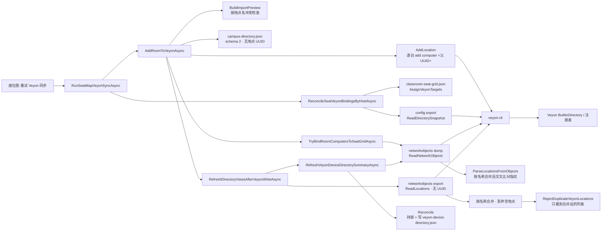

# Veyon Campus 技能评估实验 — 分析与实施方案

> 分支：`experiment/skills-evaluation`　Worktree：`F:/github/veyon-campus-skills-evaluation`
> 基线：`origin/develop` @ `0f67214a8ae9e279c6d6f868909fd30e17226d6e`（2026-11-05 远端最新）
> 日期：2026-11-05　状态：**分析阶段，未合并、未推送、未触碰生产环境**

## 0. 执行约定

- 本分支与 worktree 独立于主工作区；主工作区 `develop` 上的未提交改动不会被本实验读取或覆盖。
- **不修改任何生产环境配置 / 云函数 / 发布产物；不向 `develop`、`main` 提交或推送；不合并。**
- 所有改动分阶段独立提交；每阶段执行可运行的构建与断言夹具。
- 兼容性红线：**不新增持久化字段、不改 schema 版本、不改 JSON 形状、不改公开方法签名、不改 CLI 调用协议、不改 UI 事件与绑定名**。新增能力一律以「可空 init 属性 + 新的纯函数」形式提供，旧调用点行为保持不变。

## 1. 四个 Skills 的实际用法

| Skill | 使用模式 | 在本实验中的具体作用 | 产出 |
|---|---|---|---|
| `graphify` | 静态图谱构建 + 引用路径核对 | 把地点/设备目录同步链路的 32 个节点、42 条调用/读写边锚定到源码符号，脚本逐条验证符号仍存在并输出行号 | `build-graph.py`、`location-sync-graph.json`、本文 §3 的 Mermaid 图 |
| `security-audit` | **Guidance mode**（只读源码审查，不跑六阶段、不生成审计 artifacts、不执行目标代码） | 聚焦同步链路的信任边界：身份键、不可逆写、整份配置覆盖写、跨进程互斥、注册表回退 | 本文 §5 的发现与最小修复建议 |
| `ponytail` | `full`（默认） | 决定改动规模：只做能闭合根因的最小 diff；不抽新接口层、不加配置、不改 schema；每个新分支逻辑配一个断言 | 本文 §7 的范围裁剪、阶段 2 的纯函数与夹具 |
| `impeccable` | 设计上下文 + `critique` / `audit` 通用原则（**不套用 Web 专用实现手法**） | 评审座位图/机房页的认知负载与文案，给出两处零功能风险的 UI 改动 | 本文 §2、§6 |

> `security-audit` 的完整审计流程要求目标代码只在 OS 强制沙箱内执行；本实验按用户明确要求，在常规本地环境执行**工程构建与自建断言夹具**，该部分不属于审计的「目标控制代码复现」，不混用两套验证语义。

## 2. Design Context（impeccable 前置要求）

项目没有 `.impeccable.md`，因此上下文取自**项目自己的设计意图文档 + 用户明确反馈**，而不是从代码推断：

- `docs/ui_rule.md:13` — 使用者是**非技术背景的课堂教师**，不应需要理解 Agent、证书、端口、签名策略或注册表。
- `docs/ui_rule.md:17-21` — 五项原则：结果优先 / 高频突出 / 状态可信 / 操作安全 / 轻量一致；明确「不因界面美化误报成功」。
- `docs/ui_design.md:28-38` — 严格禁止：更换框架或引入 WebView/Electron、修改持久化格式、全局重写 `TeacherViewModel`、一次提交覆盖全部页面、添加不能编译的外部字体/图标/UI 库。
- 用户此前的明确反馈（2026-11-05）：解释性文字过多、只有一个校区时下拉多余、不要高级维护操作、要「点一下就完成」。

**技能适配结论（重要）**：Impeccable 的 `oklch()`、`clamp()`、容器查询、Web 动效等实现手法只适用于 HTML/CSS；本项目是 **Avalonia 12 / AXAML 桌面应用**，且 `ui_design.md` 明确禁止引入 Web 前端与不可编译的外部资源。因此本实验只采用其**通用设计评审原则**（去噪、每个词有价值、渐进披露、状态可信、可访问性），实现为 AXAML 属性与文案调整，不引入任何新控件、资源字典或视觉体系。

## 3. 知识图谱（graphify）

完整可查询数据在 `location-sync-graph.json`（`source_ref` 为基线提交，`nodes[].line` 为脚本回查到的源码行号）。运行 `python docs/experiments/skills-evaluation/build-graph.py` 可增量重跑；符号找不到会进入 `summary.unverified_nodes` 而不是静默通过。

图谱暴露的核心错位：**地点身份在 `config/dump` 侧是 UUID，但流过 `ReadLocations` 与 `ParseLocationsFromObjects` 之后退化成显示名；本机 Room 档案完全没有地点 UUID，只能从座位绑定反推。**

## 4. 架构根因（本实验优先解决）

### A1 地点身份不是一等对象，全链路以显示名连接

- `src/VeyonCampus.Core/VeyonNetworkLocation.cs:3-9`：`VeyonNetworkLocation` 只有 `Name / Targets / TargetDisplayNames`，无 UUID。
- `src/VeyonCampus.Core/TeacherCampusDirectory.cs:14-40`：`TeacherRoomProfile` 无地点 UUID；`campus-directory.json` 为 schema 2。
- `src/VeyonCampus.Core/VeyonNetworkObjectDirectory.cs:271-299`：`ParseLocationsFromSnapshot` 按 `entry.Location`（名称）分组、同名合并、`.Where(Targets.Count > 0)` 丢弃空地点。
- `src/VeyonCampus.App/TeacherViewModel.cs:4222-4241`：重复地点保护作用在这个**已按名称合并**的列表上，因此同名不同 UUID 的两个 Location 根本不会被发现。
- 现场后果：同名地点被合并成一条、创建时按名找不到地点再 `add location` 一次、按名恢复档案选错对象（`docs/maintenance/2026-11-04-location-sync-field-feedback.md`）。

### A2 三套互不等价的读取源并行，写回与读回不在同一份身份快照上

| 读取 | 命令 | 是否含 UUID | 主要用途 |
|---|---|---|---|
| `ReadLocations` | `networkobjects export` | ❌ 三列 CSV | 策略/课堂页名单、指纹 |
| `ReadNetworkObjects` | `networkobjects dump` | ✅ `ObjectId` / `ParentObjectId` | 写回核对、设备目录、座位绑定 |
| `ReadDirectorySnapshot` | `config export` | ✅ 完整配置 + 指纹 | 删除前后读回、注册表回退 |

`TeacherViewModel.cs:4316-4318` 把 CSV 指纹与 dump 指纹交叉比对来决定「名单是否可信」；任一解析器偏差都会让整份名单被判不可信。`SafeReadNetworkObjects` 的 `PartialRead` 回退明确「不能作为按 UUID 写回的身份依据」。

### A3 同步是跨 4 个文件、跨进程的多段非原子写入

一次「重试 Veyon 同步」依次写：`classroom-seat-grid.json` → Veyon CLI → `campus-directory.json` → `classroom-seat-grid.json` → `veyon-device-directory.json`，没有跨文件事务。`VeyonDeviceDirectoryStore.Reconcile` 名字像纯对账，实际持 `.lock` 文件锁并写盘（`VeyonDeviceDirectoryStore.cs:80,222`）。`DeleteSeatComputerFromVeyonAsync` 先做不可逆 Veyon 删除，再写本机座位（`TeacherViewModel.Classroom.cs:1643,1663`）。

> `docs/maintenance/2026-11-05-seat-directory-refactor-review-patch-v2.2.md` 已规划 S0–S5 全量重构，其中 S2-b 要求 `TeacherRoomProfile` 加 UUID 并把 schema 2→3。本实验**不执行 S2-b**：`TeacherCampusDirectoryStore` 使用 `UnmappedMemberHandling.Disallow`，旧版本程序读取带新字段的档案会被直接拒绝，与「严格保持数据兼容」冲突。该步留待用户确认迁移与双版本共存策略后另开实验。

## 5. Security Audit（Guidance mode，聚焦发现）

| ID | 状态 | 发现 | 证据 | 最小修复 / 处置 |
|---|---|---|---|---|
| S-01 | **confirmed（源码级）** | 同名不同 UUID 的重复地点不会被阻断，保护挂在「已按名合并」的 CSV 投影上；自动应用/删除可能落到错误地点 | `TeacherViewModel.cs:4222-4241`、`VeyonNetworkObjectDirectory.cs:271-299`、现场反馈文档 :99 | 用 dump 的 UUID 投影做**只读检测并阻断**（本实验阶段 2），不做自动修复 |
| S-02 | **confirmed（源码级）** | 删除链路先执行不可逆 Veyon `remove`，再写本机座位；本机写失败时 Veyon 对象已消失 | `TeacherViewModel.Classroom.cs:1643,1663`；代码注释自承 irreversible | 需要「持久操作意图 + 幂等重试」的跨文件事务，超出最小改动；列为后续项，需实机回归 |
| S-03 | **confirmed（源码级）** | `config import` 是整份配置覆盖写，无法证明目标条目以外字段未被改写；自动去重 + 自动回滚等于两次不确定写入 | `VeyonComputerRenameService.cs`、`v2.2 §B.1` | 维持 v2.2 判定：只检测、只阻断、不自动 `import`、不自动回滚 |
| S-04 | **needs_validation（无实机）** | 注册表快照回退（基线 `0f67214`）只读展示名单，注释声明不能作为按 UUID 写回的身份依据；其输入长度上限、ACL 与 `@@JsonValue` 解码边界需实机核对 | `VeyonNetworkObjectDirectory.cs`（`TryReadConfigurationFromRegistry` 段） | 不在本实验改动；建议隔离 Windows VM + Veyon 4.11.2 验证 |
| S-05 | **设计边界（非漏洞）** | `VeyonDirectoryMutationGate` 是同机命名 mutex，`ProcessRunner` 是进程内信号量；不同教师机之间没有共享写锁 | `VeyonDirectoryMutationGate.cs:12`、`ProcessRunner.cs:13` | 文档化，不改动；多教师机并发写仍属未覆盖场景 |
| S-06 | **兼容性风险** | 三个 store 均用 `UnmappedMemberHandling.Disallow`，任何新增落盘字段都会让旧版本程序拒绝读取同一份档案 | `TeacherCampusDirectory.cs:128-134`、`ClassroomSeatGridStore.cs:87-93`、`VeyonDeviceDirectoryStore.cs:44-51` | 本实验不新增任何持久化字段；schema 演进必须走显式版本迁移 |

> Guidance mode 下不生成 `findings.json` / `REPORT.md` 等审计产物，也不派 hunter/verifier 子代理；上表为聚焦源码审查结论，未做目标代码复现，因此除标注 confirmed 的源码级事实外不宣称漏洞已验证。

## 6. UI 评审（impeccable critique 原则）

| ID | 观察 | 依据 | 本实验动作 |
|---|---|---|---|
| U-01 | 「确认交换座位」对话框一段 100+ 字技术解释，把 UUID、固定连接地址、绑定冲突一次性压给教师 | `ui_rule.md:17` 结果优先 / `:21` 轻量一致；用户「解释性文字过多」 | 压缩为一句，保留唯一需要用户判断的约束（只交换姓名与显示名，冲突会先要求核对） |
| U-02 | 座位图两个「重试」按钮没有说明会写 Veyon，教师无法判断后果 | `ui_rule.md:18` 高频突出 / `:19` 操作安全；impeccable 渐进披露 | 加 `ToolTip.Tip`，不改布局、绑定、事件与可见性条件 |
| U-03 | `SeatMapStatus` 被 `CanRetryInitialSeatGridImport` 用 `StartsWith("无法从 Veyon 自动导入")` 做字符串判定 | `TeacherViewModel.Classroom.cs:150-152` | **明确不改**这批文案前缀，避免把 UI 优化变成功能回归 |
| U-04 | 现有「已添加 N 个桌位 / 待编号 N」是中性状态，未把空座位渲染成错误 | `ui_rule.md:19` 状态可信；v2.2 P-06 | **明确不改**，保持 P-06 语义 |
| U-05 | 不引入 Web 设计体系 | `ui_design.md:30-38` | 见 §2 适配结论 |

## 7. 实施范围（ponytail 裁剪）

**做**：

1. `VeyonNetworkLocation` 增加 `Guid? ObjectId { get; init; }` —— 不改构造签名，四个现有构造点零改动。
2. 新增纯函数 `BuildLocationsById(objects)` —— 按 UUID 分组、同名不合并、保留 0 台电脑地点；无 UUID 时回退按名称分组并置 `null`。**不改动** `ParseLocationsFromObjects` / `ParseLocationsFromSnapshot`，避免破坏现有指纹比对与名单显示。
3. 新增纯函数 `SelectLocationObject(objects, expectedLocationId, locationName)` —— 有写回 UUID 时按 UUID 精确选地点，否则回退原按名逻辑。
4. `TryBindRoomComputersToSeatGridAsync` 用写回回执里的 `ParentObjectId` 走 `SelectLocationObject`（R21 防漂移）；`RefreshVeyonDeviceDirectorySummaryAsync` 用 `BuildLocationsById` 做同名不同 UUID 的只读阻断（S-01 / R19 / R20）。
5. `VeyonCampus.Checks` 新增断言夹具并纳入默认套件：R19 / R20 / R21 / 空地点 / 无 UUID 回退。
6. UI：U-01、U-02 两处最小改动。

**不做（需用户确认后另开实验）**：schema 2→3 与 Room UUID 落盘、`AddLocation` 返回 UUID 持久化、15 处按名查找全量替换、`config import` 自动去重与回滚、跨文件操作 journal、多教师机共享写锁、任何生产配置/云函数/发布产物变更。

## 8. 验证策略

- 64 位 SDK：`"C:/Program Files/dotnet/dotnet.exe"`（PATH 上的 32 位 `dotnet` 无 SDK；`global.json` 要求 10.0.100，已装 10.0.401，`rollForward: latestFeature` 可用）。
- Release 构建：`dotnet build VeyonCampus.slnx -c Release`。
- 自动化：`VeyonCampus.Checks` 新增开关 + 相关既有开关（dump 解析、目录读取、座位布局等），并记录默认全量套件中因本地沙箱 `sc.exe` 受限导致的既存失败，区分「本轮引入」与「基线既存」。
- 兼容性回归：既有 `ParseLocationsFromObjects` / `ParseLocationsExport` / `BuildImportPreview` / `TeacherCampusDirectoryStore` 断言必须继续通过；三个 JSON 文件的序列化形状逐字节不变（本轮不写盘字段）。
