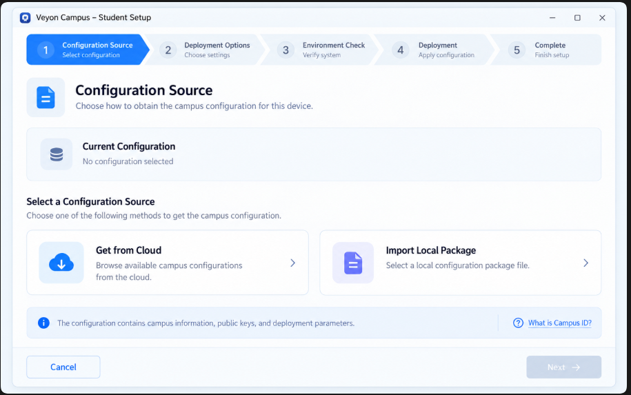

# Veyon Campus — Codex UI 重构执行任务清单

**任务代号：** UI-REFRESH-2026-10  
**目标分支：** `develop`  
**代码基线：** 提交 `471123b84945` 或执行时 `develop` 的实际最新提交  
**技术栈：** Avalonia 12.1.3 / .NET 10 / C# / AXAML  
**执行原则：** 小步重构、行为保持、先验证后继续。

## 0. 全局执行规则（所有任务必须遵守）

Codex 在开始修改前必须阅读 UI 设计规范和当前实现。

### 必须保留的行为

- 当前课堂会话、教室 ID 与设备目标快照。
- 单教室自动展示与多教室切换。
- 普通网站策略更新独立于 InputGuard 键鼠状态。课堂快捷管控切换模式时，仍按账本核验并解除本工具拥有的旧模式。
- 已拥有策略的安全解除和签名回执。
- 离线学生上线后的有效网站策略补发。
- InputGuard 20 秒租约与 5 秒续租机制。
- 设备健康轻量轮询、退避、异常去重与缓存。
- AppLocker 的长期软件保护与精确软件限制。
- 学生姓名映射规则与设备身份分离。
- 手机 HTTPS、配对证书、审批、凭据和撤销。
- 现有聊天 Enter、Shift+Enter、中文输入法行为。
- 普通构建与试点构建的功能门控。

### 严格禁止

- 为美化 UI 修改 Student Agent 命令协议。
- 更换框架或引入 WebView/Electron。
- 删除已有测试、诊断与管理员恢复入口。
- 修改设备身份、策略所有权、租约和持久化格式。
- 把 Agent 已回执直接改写成“Windows 已验证生效”。
- 在普通构建中开放仅试点可用的管控命令。
- 全局重写 `TeacherViewModel` 业务逻辑。
- 一次提交覆盖全部页面。
- 添加不能在目标项目中编译或部署的外部字体、图标、UI 库。

### 每阶段完成标准

每个阶段应：
1. 说明修改的具体文件。
2. 提交本阶段独立变更。
3. 运行可以执行的构建和检查。
4. 说明旧行为是否保持。
5. 给出 UI 截图及验收观察项。
6. 明确尚未验证的 Windows 实机行为。
7. 如验证失败，修复当前阶段，不直接推进下一阶段。

---

## Task UI-00：建立基线与回归保护

**优先级：P0**

### 目标

在重构前锁定当前行为和视觉状态，避免界面改完之后不知道哪里退化。

### 检查文件

- `src/VeyonCampus.App/App.axaml`
- `src/VeyonCampus.App/TeacherWindow.axaml`
- `src/VeyonCampus.App/TeacherWindow.axaml.cs`
- `src/VeyonCampus.App/TeacherViewModel.cs`
- `src/VeyonCampus.App/TeacherMobileControlWindow.axaml`
- `src/VeyonCampus.App/TeacherMobileControlWindow.axaml.cs`
- `src/VeyonCampus.App/VeyonCampus.App.csproj`
- `src/VeyonCampus.App/TeacherClassroomQuickControlService.cs`
- `tests/VeyonCampus.Checks/`

### 执行任务

- [ ] 记录 Git HEAD、当前工作区状态与各项目版本。
- [ ] 确认项目启动角色与 TeacherConsole 编译条件。
- [ ] 清点 `App.axaml` 和 `TeacherWindow.axaml` 内的硬编码样式。
- [ ] 识别全局 Button Hover 样式覆盖与控件样式优先级问题。
- [ ] 列出每页的 UI 事件、绑定、命令及依赖服务。
- [ ] 确认所有数据来源和定时器所属模块。
- [ ] 记录当前四个主要页面与手机配对窗口截图。
- [ ] 建立关键状态矩阵：空、正常、未知、失败、缓存、部分成功、禁用。
- [ ] 运行当前 Release 构建及现有可用检查，保存结果。
- [ ] 对不能运行的 Windows 专项检查记录环境限制，不得写为已通过。

### 交付

`docs/ui-refactor/00-baseline.md`

记录现有页面、文件、事件绑定、构建结果、截图和风险点。

### 验收

无生产逻辑修改；基线信息完整可复现。

---

## Task UI-01：建立全局设计系统

**优先级：P0**  
**依赖：UI-00**

### 目标

集中管理颜色、字号、间距、圆角、按钮和状态样式。

### 建议新增文件

以下是建议路径，Codex 应根据现有资源组织调整：

- `src/VeyonCampus.App/Presentation/Theme/Colors.axaml`
- `src/VeyonCampus.App/Presentation/Theme/Typography.axaml`
- `src/VeyonCampus.App/Presentation/Theme/Spacing.axaml`
- `src/VeyonCampus.App/Presentation/Theme/Controls.axaml`

### 执行任务

- [ ] 保留现有 `FluentTheme` 基础。
- [ ] 建立资源字典，录入设计文档定义的颜色 Tokens。
- [ ] 统一字体、按钮最小高度、圆角和 Focus 样式。
- [ ] 将主要共享按钮样式迁入统一主题。
- [ ] 创建 Primary、Secondary、Ghost、Danger 四级按钮外观。
- [ ] 确认所有按钮 Hover、Pressed、Disabled、Focused 表现。
- [ ] 统一卡片与状态标签样式。
- [ ] 保留旧样式名的兼容映射，避免一次性修改所有页面。
- [ ] 验证 TeacherConsole 和 StudentSetup 资源打包不冲突。
- [ ] 不新增运行时主题切换或暗色模式功能。

### 验收

- 应用启动没有资源查找错误。
- 旧页面未丢失样式或按钮可用性。
- 全局颜色可集中修改。
- 键盘焦点清晰可见。
- 不误伤特殊危险操作样式。

---

## Task UI-02：创建基础展示组件

**优先级：P0**  
**依赖：UI-01**

### 建议组件

- `SectionCard`
- `AppPageHeader`
- `StatCard`
- `StatusChip`
- `DeviceListRow`
- `EmptyState`
- `LoadingState`
- `ConfirmationContent`
- `SideDrawerHost`

### 执行任务

- [ ] 优先尝试 Avalonia 样式和 DataTemplate 复用。
- [ ] 仅在确有复杂结构需要时新建 `UserControl`。
- [ ] 组件通过参数/绑定接收状态，不主动发起网络请求。
- [ ] StatusChip 接收明确的状态模型，不根据颜色反推状态。
- [ ] 组件支持长中文文本、换行及省略显示。
- [ ] 保留键盘操作、辅助文本和 Focus 状态。
- [ ] 测试加载、禁用、失败及文本较长时的布局。
- [ ] 不为组件引入新的业务层或持久化数据格式。

### 验收

在独立预览页面或现有页面的局部区域展示组件组合，并验证 100%、125%、150% DPI。

---

## Task UI-03：重构主窗口导航与布局

**优先级：P0**  
**依赖：UI-02**

### 目标

把当前庞大的主窗口布局逐渐拆成易维护的页面结构。

### 涉及文件

- `TeacherWindow.axaml`
- `TeacherWindow.axaml.cs`
- `TeacherViewModel.cs`

### 建议新增

- `Presentation/Views/TeacherSidebarView.axaml`
- `Presentation/Views/TeacherHeaderView.axaml`
- `Presentation/Views/ClassroomControlView.axaml`
- `Presentation/Views/DeviceHealthView.axaml`
- 其他页面视图按实际迁移阶段创建。

### 执行任务

- [ ] 重新设计侧栏、Logo 区和当前选中状态。
- [ ] 统一四个主要导航入口的图标、高度与间距。
- [ ] 保留隐藏的首次设置、学生名单和帮助入口。
- [ ] 保留「手机配对与连接」可访问入口。
- [ ] 把全局页头与页面内容分开。
- [ ] 规划单独页面宿主，不再让所有页面永久处于一个超长的视觉树。
- [ ] 页面抽取期间保留原有 DataContext 及事件处理链。
- [ ] 若某段 View 无法安全抽取，先保留在 Window，不能为完成架构拆分而迁移业务。
- [ ] 不触发新的网络请求、轮询或业务命令。
- [ ] 保证普通构建和试点构建的控件启用条件一致。

### 验收

四个入口均可访问，原有所有界面事件可用，侧栏折叠和页面切换不影响课堂会话。

---

## Task UI-04：课堂控制页重设计

**优先级：P0**  
**依赖：UI-03**

### 涉及

- `TeacherWindow.axaml` 原课堂区域
- `TeacherWindow.axaml.cs` 原事件处理函数
- `TeacherViewModel.cs` 已有课堂属性
- `TeacherClassroomQuickControlService.cs` 只读参考，不作行为修改

### 执行任务

- [ ] 压缩顶部课堂状态区域。
- [ ] 保留开始/结束互动与重新读取设备名单。
- [ ] 使用四个紧凑状态指标替代散落的文本。
- [ ] 统一当前网站预设卡片。
- [ ] 统一网站限制、键鼠锁定两种模式的卡片样式。
- [ ] 保留现有按钮事件与操作确认。
- [ ] 改善一键解除操作的按钮层级。
- [ ] 将逐台执行进度改成紧凑行式列表。
- [ ] 支持查看详细结果而不占据主界面大量高度。
- [ ] 使用既有的学生姓名映射，不破坏设备 ID。
- [ ] 显示等待 Agent、执行中、已回执、冲突和未知。
- [ ] 限制文本重复，删除可以从上下文推断的说明。
- [ ] 将复杂解释移入 tooltip 或帮助区域。
- [ ] 不增加任何自动启用限制的行为。

### 重要验收情景

- [ ] 0 台设备。
- [ ] 1 个教室。
- [ ] 多个教室。
- [ ] 正在课堂但未启用管控。
- [ ] 网站限制已启用。
- [ ] 键鼠锁定已启用。
- [ ] 有设备等待上线。
- [ ] 操作部分成功。
- [ ] 普通构建禁用试点。
- [ ] 解除按钮仍安全可用。

**本任务严格限定为 UI 重构，不在此阶段增加“任意选中部分学生执行快捷管控”的新业务功能。**

---

## Task UI-05：设备健康页面重设计

**优先级：P0**  
**依赖：UI-03、UI-02**

### 涉及

- `TeacherWindow.axaml`
- `TeacherViewModel.cs`
- `TeacherDeviceHealthCacheStore.cs`（只读参考）
- `DeviceRuntimeSummaryProtocol.cs`（只读参考）

### 执行任务

- [ ] 改造五项健康概览为统一 StatCard。
- [ ] 读取进度压缩成一条简洁状态栏。
- [ ] 将内部性能指标放入诊断详情。
- [ ] 优化设备搜索和状态筛选。
- [ ] 把设备列表统一为虚拟化友好的行式布局。
- [ ] 展开异常详情时保持原设备上下文。
- [ ] 缓存记录显示明确的“本地缓存·待更新”。
- [ ] 首次读取立即显示占位设备行。
- [ ] 保留原有异常严重性和多异常语义。
- [ ] 健康列表只更新发生变化的内容，不每轮清空。
- [ ] 有缓存时不得允许依据缓存执行危险修复。
- [ ] 不更改现有轮询间隔、并发限制、失败退避和健康分类逻辑。

### 验收

- 连续自动刷新 30 秒以上不清空或闪烁列表。
- 失败设备和未知设备不假报在线或正常。
- 保留滚动位置、搜索词、状态筛选、选中设备及展开状态。
- 60–70 台负载下能维持基本操作响应，记录实测数据。

---

## Task UI-06：学生聊天抽屉与通知弹窗

**优先级：P1**  
**依赖：UI-03**

### 目标

将课堂页的巨大聊天区改成跨页面可用的全局聊天抽屉。

### 执行任务

- [ ] 在主窗口顶栏加入消息图标与未读提示。
- [ ] 实现右侧聊天抽屉宿主。
- [ ] 将现有学生选择、消息历史和输入框迁入抽屉。
- [ ] 保留现有消息发送、接收和学生聊天上下文。
- [ ] 在抽屉内保留学生搜索、切换和当前连接状态。
- [ ] 支持不同学生草稿缓存（仅 UI 生命周期，不写入新持久化格式）。
- [ ] 页面切换时保持抽屉状态。
- [ ] 小窗口使用覆盖式抽屉，不挤压课堂控制。
- [ ] 保留 Enter 发送与 Shift+Enter 换行。
- [ ] 确保中文输入法候选确认不会提前发送。
- [ ] 加入空聊天记录、断线和发送失败状态。
- [ ] 将学生通知改为按钮 + 弹窗，保留现有目标、时效及确认逻辑。
- [ ] 保留现有消息隐私、审计和身份授权要求。

### 必须测试

- [ ] 同时收到多个学生消息。
- [ ] 切换课堂页面仍能聊天。
- [ ] 收起后再次展开保持正确会话。
- [ ] Enter 只发送一次。
- [ ] Shift+Enter 正常换行。
- [ ] 中文输入法候选词确认不会触发发送。
- [ ] 无活动课堂时入口不产生未授权操作。
- [ ] 消息断线或失败时不误报已送达。

---

## Task UI-07：手机配对界面升级

**优先级：P1**  
**依赖：UI-01、UI-02**

### 当前入口

- `TeacherMobileControlWindow.axaml`
- `TeacherMobileControlWindow.axaml.cs`
- `TeacherMobileControlManager`

### 第一阶段

- [ ] 保留独立窗口和全部功能。
- [ ] 重构为标题 / 服务状态 / 新设备配对 / 待确认 / 已配对列表结构。
- [ ] 二维码与连接码放在同一主要配对卡片。
- [ ] 待确认手机单独突出。
- [ ] 已连接设备用统一列表项展示。
- [ ] 证书、地址、指纹和审计数据归入高级展开区。
- [ ] 避免大片空白容器和不可区分的灰色按钮。
- [ ] 独立窗口在最小尺寸下保持所有必要操作可达。

### 第二阶段（仅在第一阶段验收后）

- [ ] 评估迁移至主窗口设置页面或侧面板。
- [ ] 抽取配对界面与宿主窗口之间的纯展示逻辑。
- [ ] 若迁移引入生命周期风险，保留独立窗口方案。
- [ ] 不修改配对、证书、网络、身份与授权接口。

### 必须测试

服务关闭/启动、二维码生成、连接码到期、等待审批、允许、拒绝、已连接手机、撤销、断网、窗口关闭以及重开。

---

## Task UI-08：策略、预设、更新与运维视觉统一

**优先级：P1**  
**依赖：UI-01、UI-02**

### 执行任务

- [ ] 将页面标题和说明统一为 PageHeader。
- [ ] 网站、应用、系统限制采用一致的分区布局。
- [ ] 长篇技术说明默认收起。
- [ ] 保留软件运行保护无需扫描的主入口。
- [ ] 程序目录与手工规则入口移动到高级区域。
- [ ] 改善表单对齐、输入框宽度、禁用原因和确认反馈。
- [ ] 更新进度和逐台更新结果使用统一 DeviceRow。
- [ ] 保留所有更新阶段和诊断导出能力。
- [ ] 系统限制与课堂快捷解除保持不同的视觉位置和确认语义。
- [ ] 不更改 AppLocker、系统限制或更新服务接口。

### 验收

现有应用策略和系统策略管理功能均保持可访问；不能因为视觉改动丢失高级恢复入口。

---

## Task UI-09：性能、虚拟化与低配置优化

**优先级：P0（发布前必须完成）**  
**依赖：UI-04、UI-05、UI-06**

### 目标

支持低配 Windows 电脑和 10–70 台学生设备。

### 执行任务

- [ ] 检查健康列表、快捷管控列表、更新列表、聊天列表是否存在无界滚动布局。
- [ ] 对较长列表使用实际生效的虚拟化机制。
- [ ] 避免列表外围额外包裹无界纵向 ScrollViewer。
- [ ] 保留行的稳定身份与现有增量更新机制。
- [ ] 排查全局按钮样式和大量嵌套视觉树对布局的影响。
- [ ] 缓存静态画刷、图标数据和无需频繁重建的样式对象。
- [ ] 调整只有视觉作用的计时器，页面不可见时停止。
- [ ] 禁用或降低低配置环境中的高开销动画。
- [ ] 检查聊天抽屉反复打开关闭的订阅与内存释放。
- [ ] 记录内存、CPU、GC、UI 响应、渲染与滚动观察结果。
- [ ] 不降低现有 Agent 身份、签名、限速和状态读取安全要求。

### 验收规模

| 场景 | 测试目的 |
|---|---|
| 4 台 | 完整交互回归 |
| 15 台 | 常见机房布局 |
| 24 台 | 中等课堂持续刷新 |
| 60–70 台 | 大规模机房界面负载 |
| 教师机 8GB RAM | 检查响应、内存及后台负载 |

无法在当前开发环境实际测试的场景，必须留为待现场验收，不能标记通过。

---

## Task UI-10：一致性、可访问性与视觉验收

**优先级：P0（发布前必须完成）**  
**依赖：UI-01 至 UI-09**

### 执行任务

- [ ] 检查四个主要页面的统一性。
- [ ] 检查标题、按钮、卡片、提示、边框和图标是否全部遵循 Tokens。
- [ ] 检查状态视觉不会误导教师。
- [ ] 检查在不同缩放比下不会裁切。
- [ ] 检查长姓名、长异常信息和大字体。
- [ ] 检查键盘焦点及常用快捷键。
- [ ] 检查聊天抽屉、弹窗和主要界面的焦点恢复。
- [ ] 截取改版前后相同尺寸的对比图。
- [ ] 运行当前仓库全部可用的构建、静态检查及回归测试。
- [ ] 分别构建 TeacherConsole 和 StudentSetup，排除共享资源变更造成的角色问题。
- [ ] 检查普通版和试点版的快捷管控功能门禁。
- [ ] 用真机结果确认没有课堂、健康、网站策略及 InputGuard 行为回归。
- [ ] 汇总未通过和未测试项目，阻止不满足条件的正式发布。

### 交付

- `docs/ui-refactor/10-visual-acceptance.md`
- `docs/ui-refactor/11-performance-report.md`
- 重构前后截图。
- 自动检查结果。
- 未验证项目和剩余风险表。
- 发布前回退流程。

---

## 11. 目录调整建议

建议逐步组织为：

- `src/VeyonCampus.App/Presentation/Theme/`
- `src/VeyonCampus.App/Presentation/Components/`
- `src/VeyonCampus.App/Presentation/Views/`
- `src/VeyonCampus.App/Presentation/ViewModels/`（仅在安全拆分时使用）
- `docs/ui-refactor/`

不要一次搬迁原有所有源码。`TeacherViewModel` 当前业务耦合较多，先抽出只读展示映射和明确无副作用的视图状态，后续再逐步拆分业务。

任何新加入的 Teacher 专属 AXAML、C# 文件，应核对项目当前的 `TeacherConsole` / `StudentSetup` 条件编译和资源包含规则，避免 StudentSetup 意外包含教师专用窗口。

## 12. 推荐执行顺序

| 批次 | 任务 | 核心交付 |
|---|---|---|
| 第一批 | UI-00、UI-01、UI-02 | 基线、Tokens、统一组件 |
| 第二批 | UI-03、UI-04 | 侧栏、课堂控制首页 |
| 第三批 | UI-05 | 设备健康重设计 |
| 第四批 | UI-06 | 全局聊天抽屉和通知 |
| 第五批 | UI-07、UI-08 | 手机配对、策略和更新界面 |
| 第六批 | UI-09、UI-10 | 性能优化、回归与验收 |

每一批独立提交，独立检查。不得将“代码构建通过”等同于 UI 实机和业务验收全部通过。

---

## 13. 可直接发送给 Codex 的启动指令

你是 Veyon Campus 项目的 UI 重构开发者。

目标仓库：`Ljc798/veyon-campus-deployment`，工作分支为 `develop`。请先读取本任务清单与完整 UI 设计规范，对照实际代码确认当前基线。若仓库已经发生新的提交，请以最新代码为准并说明差异。

工作方式：

1. 先检查 Git 状态；不得覆盖未提交的用户修改。
2. 检查 Avalonia 12.1.3 的实际 API、样式加载与控件能力，不能假定其他版本的用法适用。
3. 对当前 App.axaml、TeacherWindow.axaml、ViewModel 与配对窗口进行结构核对。
4. 实现新的统一主题与基础组件，保持现有业务、绑定、事件、数据结构及网络协议不变。
5. 保留课堂快捷管控试点编译门、长期系统策略、签名回执和安全恢复行为。
6. 对新样式进行组件状态检查：默认、悬停、按下、焦点、禁用、错误和加载。
7. 运行 TeacherConsole、StudentSetup 的相关构建及当前环境可执行的测试。
8. 不得编造构建或实机测试结果。
9. 如有错误，先在当前阶段修复。
10. 完成后提交独立 commit，并报告修改文件、设计变化、检查结果与剩余问题。

**总原则：界面可以重构，课堂控制行为必须保持兼容，设备安全不能退化。**

图片中虽然没有聊天页面，但是聊天其实应该可以跨页面传递，你可以设计成在右侧可以展开和收起的抽屉，也可以变成直接收起到右下角变成一个小圆圈，同时展示未读信息的条数小红点在右上角
