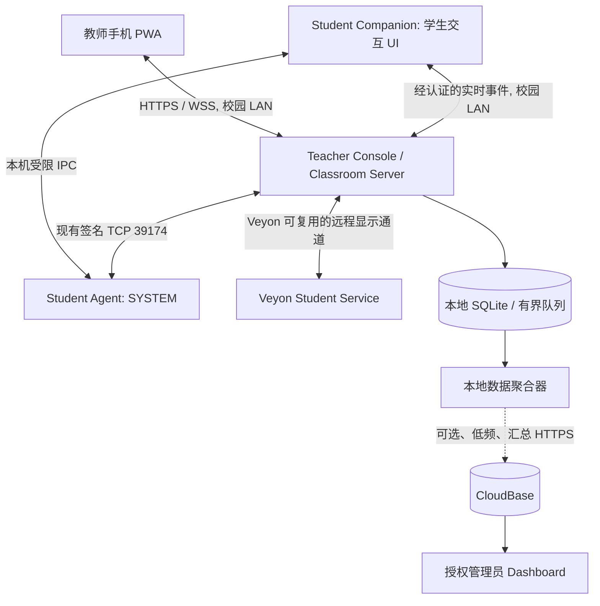

# Veyon Campus — 产品功能与云端数据开发路线图

> **版本**：规划稿 v1.0｜**日期**：2026-10-09  
> **适用分支**：[`develop`](https://github.com/Ljc798/veyon-campus-deployment/tree/develop)  
> **定位**：从「Veyon 部署与设备管控工具」逐步发展为 **Local-first Smart Classroom Platform（本地优先的轻量级智慧课堂平台）**。  
> **本文件是新增功能规划，不替代现有的 [`docs/开发路线与任务清单.md`](https://github.com/Ljc798/veyon-campus-deployment/blob/develop/docs/开发路线与任务清单.md)。** 开发前先与主任务表核对状态。

## 0. 核心决策（先读）

1. **课堂实时交互走校区 LAN**：教师电脑负责本地课堂服务，学生电脑和教师手机在局域网内互通；互联网中断不应影响上课。
2. **CloudBase 只承担跨校区价值**：配置/发行、版本与设备健康、故障汇总、汇总后的课堂使用统计、经授权的模板同步。**不转发聊天、实时屏幕、课堂指令**。
3. **先稳定，再新增**：目前项目进入 Beta 集成与实机验收阶段。先完成 Windows、Android/iOS 与网络环境验证，再开展大规模新功能。
4. **先互动，后视频**：优先做学生举手求助、师生消息和一键课堂模式；手机多屏实时监视先验证性能与 Veyon 复用可行性，再产品化。
5. **复用现有设施**：保留 TCP `39174` 策略签名通道、教师端 Kestrel HTTPS `39176`、已有校区密钥/身份核验与 Veyon 的监视、广播、文件功能；不因引入 WebSocket 而重写已有可靠协议。
6. **权限及数据最小化**：Student Agent 负责系统权限与可信操作；新 Student Companion 负责登录会话中的学生交互；云端默认只存必要的汇总数据。

### 状态说明

- `✅ 已有代码`：develop 中已有实现，**不表示实机验收通过**。
- `🧪 待验收`：需要真实设备/校区网络验证。
- `🆕 待开发`：新需求；不应误判为已上线。
- 优先级 `P0 > P1 > P2 > P3 > P4`。相同优先级内按依赖与建议顺序排列。
- 难度 `1–5` 是相对工程量估计，**不是工期承诺**。

### 2026-10-12 实施状态校准

以下状态以 `develop` 中的专项规格、实现记录与代码为准；`✅ 已有代码` 只说明实现存在，不代表 Windows、手机或真实校园网络已验收。今天的发布候选位于独立的 `release/basic-v1` 分支，后续路线图工作留在 `develop` 派生分支，不回灌到该候选。

- 更新诊断、本地课堂 Session、Student Companion、签名课堂事件与求助/全班通知、课堂模式、座位布局 Demo、倒计时、共享链接、课堂任务进度及单帧屏幕预览均已有实现。各专项任务仍列有 Windows、手机、LAN、安全恢复或性能现场验收项。
- 更新诊断代码任务完成；Session 数据目录 ACL/恢复互斥、Companion 登录/托盘安装、事件通道真实断网与并发、课堂模式策略恢复、屏幕预览性能仍需实机验证。
- 低敏运维统计已有代码和管理页；生产共享环境、部署备份及数据口径仍需单独核对。
- 通用师生私聊、在线测验和离堂反馈尚无用户可用流程。在线测验已有 Core 内存状态机、独立签名契约、教师服务 API 和 Session/目标变化清理；Agent/Companion 接入、桌面/手机界面及现场验收仍待完成。

### 2026-10-16 产品方向更新

- 当前“学生互动”页面及 Student Companion 求助/通知流程明确标记为 **Demo**，不作为正式聊天能力宣传；Veyon 已提供的控制能力优先复用 Veyon。
- 手机电脑策略页应以教师电脑保存的策略预设为主，支持一键同步预设、一键应用和即时解除；状态细节与自选域名编辑默认收起。
- 手机端后续补齐“一键上课”：使用教师已保存的网站/应用临时预设及其时长开始课堂，教师可随时下课并恢复本堂课仍由本工具拥有且未被外部修改的策略；应用限制继续保留逐台审核确认。
- 后续学生聊天目标为教师与**单个学生**一对一实时双向聊天，使用教师端 LAN 服务上的认证 **WSS**，按课堂、学生设备身份和当前会话授权；消息不经 CloudBase 中继。
- 学生聊天客户端需登录后常驻后台，不向学生提供退出入口；进程异常退出后由受管理的启动/恢复机制重新启动。后台常驻不得运行在 SYSTEM 权限下。
- 教师控制台关闭窗口时转入 Windows 系统托盘继续运行；只有从托盘菜单选择“退出 Veyon Campus”才停止后台服务。
- 帮助与反馈提供 GitHub 和 GitCode 两个 Issue 入口。

### 2026-10-17 手机巡视与策略控制更新

- 手机屏幕巡视仍是 PoC。普通巡视的租约覆盖本堂全部已关联座位（最多 150 个），手机按座位号显示卡片并只采集当前可见画面；提供省流/标准/清晰和 3–60 秒刷新档位，服务端有并发、缓存、尺寸、请求速率和租约取消限制。
- 手机应用与长期系统策略预设按目标电脑保存本地学生账户 SID；桌面清单按电脑名和账户名显示，默认不选，教师确认选择后才保存映射。保存窗口会显示电脑映射名称、数量及账户覆盖情况，并可展开核对已选账户，名称缺失时不展示 IP 或 SID。Teacher 在签名/发送前校验本次目标映射完整，手机只收到预设摘要。旧版共用 SID 预设仍可读取，但只允许用于单台电脑。
- 手机单台查看沿用教师端屏幕截图接口，约每 3 秒更新，不打开教师电脑上的 Veyon 监看窗口；不上传 CloudBase、不保存录像。
- 代码与接口文档已完成；Windows Veyon、Android/iOS、校园 LAN、画质体验和多座位资源表现还没有现场验收。验收通过前，不把它称为正式巡视能力。

## 1. 当前基线：哪些功能不要重复做

| 现有组件/能力 | 当前状态 | 后续重点 |
|---|---|---|
| Teacher Console、Student Setup、Worker、Student Agent | ✅ 已有代码 | 部署、升级、异常恢复和权限场景的实机回归 |
| Veyon 机房目录与屏幕监视、远程控制等 | ✅ 借助 Veyon | 验证可复用的 CLI/API/协议能力，避免自建重复产品 |
| 网站黑白名单（浏览器级） | ✅ 已有代码 | 浏览器实测、到期/解除、跨版本兼容 |
| AppLocker 应用限制与审核 | ✅ 已有代码 | Windows 版次、学生 SID、实际命中与撤销验收 |
| 六项长期系统策略 | ✅ 已有代码 | 权限、壁纸、用户配置和安全回滚验收 |
| Mobile PWA：配对、设备策略状态、策略启停 | ✅ 已有代码 | Android/iOS 证书信任、局域网及身份核验实测 |
| CloudBase：配置包、版本、校区心跳、匿名设备统计 | ✅ 已有代码 | 先复用数据库和现有 API，再扩展运维指标 |
| 教师/学生签名更新机制 | ✅ 已有代码 | 生产签名发行、安装/回滚、断网场景验收 |
| 学生互动 Demo、课堂 Session、求助/回复/全班通知、课堂模式 | 🧪 Demo | 复用 Veyon 已有控制能力；正式单学生一对一聊天需认证 WSS、学生客户端后台常驻与恢复机制 |
| 更新诊断、座位布局 Demo、倒计时、共享链接、课堂任务进度 | 🧪 Demo / 待验收 | 座位布局仅供演示；其余功能完成对应 ACL、桌面、手机与 LAN 现场验收 |
| 手机课堂屏幕巡视 PoC | ✅ PoC 代码与文档 | Windows Teacher/Veyon、Android/iOS 与校园 LAN 的画面、稳定性和资源实测仍待完成；正式巡视仍需另行立项 |
| 单学生一对一聊天、在线测验、离堂反馈 | 🆕 待开发 | 聊天需使用认证 WSS、按单个学生授权、LAN 直连；在线测验已有 Core 内存状态机、签名契约、教师服务 API 和 Session 清理，客户端流程仍待完成 |

**版本快照**：本次状态校准时 `develop` 的项目版本为 `0.4.74`；独立稳定候选 `release/basic-v1` 为 `1.0.3`。发布版本与开发分支版本不同，后续请以各分支项目文件及主任务表为准。
参考：[README](https://github.com/Ljc798/veyon-campus-deployment/blob/develop/README.md) · [架构与实施边界](https://github.com/Ljc798/veyon-campus-deployment/blob/develop/docs/veyon_architecture_summary.md) · [手机控制规格](https://github.com/Ljc798/veyon-campus-deployment/blob/develop/specs/mobile-teacher-control/requirements.md) · [数据库表说明](https://github.com/Ljc798/veyon-campus-deployment/blob/develop/docs/CloudBase数据库表用途说明.md)

---

## 2. 总优先级清单

| 顺序 | 优先级 | 功能 / 工作项 | 状态 | 难度 | 价值与理由 |
|---:|:---:|---|:---:|:---:|---|
| 1 | **P0** | Beta 真机验收与稳定性门禁 | 🧪 | 4 | 没有稳定控制链路，新互动功能没有可靠基础 |
| 2 | **P0** | 更新结果/错误码规范与本地诊断 | ✅ 代码完成 | 2–3 | 专项代码任务完成；更新故障的 Windows 实机覆盖仍需纳入发布验收 |
| 3 | **P0** | 本地课堂会话模型（Session / Room / Target） | ✅ 代码完成；🧪 ACL/恢复验收待办 | 3 | 后续互动、统计、课堂模式的共同数据模型 |
| 4 | **P1** | Student Companion 轻量学生界面 | ✅ 代码完成；🧪 Windows 登录/安装验收待办 | 3 | 学生交互入口，与管理员部署 GUI 解耦 |
| 5 | **P1** | 双向课堂事件通道（HTTPS 长轮询） | ✅ 代码完成；🧪 双机/LAN/现场负载待办 | 3 | 举手、教师回复和通知已有通道；无需为状态而改写成 WSS |
| 6 | **P1** | 学生举手求助 + 教师回复 + 已解决闭环 | ✅ 代码完成；🧪 现场验收待办 | 2–3 | 低成本、高频刚需、最明显的教学收益 |
| 7 | **P1** | 教师全班通知；扩展通用私聊 | 部分实现 | 2–3 | 全班通知和求助关联回复已有；面向任意目标的私聊仍待设计 |
| 8 | **P1** | 课堂模式：练习 / 恢复正常 / 下课 | ✅ 代码完成；🧪 Windows/手机验收待办 | 2–3 | 将已有策略变为教师能直接理解的工作流 |
| 9 | **P1** | 课堂状态/消息的移动端首页 | 部分可复用 | 2 | 现有活动课堂与事件卡片可复用；导航和首页工作流仍待评估 |
| 10 | **P1** | 低敏运维云数据 v1（更新/故障汇总） | ✅ 有代码；🧪 共享环境核对待办 | 2–3 | 先核对生产部署、备份、字段口径及保留策略，再扩展运维指标 |
| 11 | **P2** | 座位图与机房布局 | ✅ 代码完成；🧪 桌面/手机/LAN验收待办 | 2 | 快速定位求助学生与设备 |
| 12 | **P2** | 课堂任务进度、共享链接、倒计时 | ✅ 代码完成；🧪 Windows/手机验收待办 | 2 | 已有实现，先验证课堂可用性 |
| 13 | **P2** | 手机屏幕巡视 PoC（全班最多 150 个座位） | ✅ PoC 代码；🧪 真实设备验收待办 | 5 | 验证 Veyon 单帧复用、独立实时模式、教师机与校园 LAN 表现 |
| 14 | **P2** | 手机设备巡视 Overview / Focus / Help | 🆕 | 4–5 | PoC 通过后交付正式监视体验 |
| 15 | **P2** | 课堂即时测验、投票、离堂反馈 | 🆕；测验 Core/服务端首段已实现 | 3 | 仍需 Agent/Companion、教师与手机界面、断线恢复及现场验收；离堂反馈未设计 |
| 16 | **P2** | 课堂使用匿名汇总上传 v1 | 🆕 | 3 | 以真实使用率指导产品迭代 |
| 17 | **P3** | 作业分发、收集、教师反馈 | 🆕/可复用 | 3–4 | 面向编程课形成差异化 |
| 18 | **P3** | 学生展示/讲评（受控屏幕共享） | 🆕/可复用 | 3–4 | 展示优秀作品、老师现场点评 |
| 19 | **P3** | 分组任务与课堂进度看板 | 🆕 | 3 | 提升小组教学效率 |
| 20 | **P3** | 教学汇总数据（参与率、提交率等） | 🆕 | 3 | 仅上传充分聚合的数据，非个人画像 |
| 21 | **P4** | 编程自动测试/反馈（独立沙箱） | 🆕 | 5 | 高价值但安全/维护复杂 |
| 22 | **P4** | 云端共享模板、题库、课程计划 | 🆕 | 3–4 | 跨校区标准化；须有租户隔离和权限 |
| 23 | **P4** | 校区趋势分析、故障质量看板 | 🆕 | 3–4 | 先有可信数据，再做可视化 |
| 24 | **P4** | 远程非实时管理能力（可选） | 暂缓 | 5 | 与 Local-first 安全边界冲突，需单独立项 |

> **排序的关键判断**：先交付「学生求助 → 教师手机通知 → 文字指导/现场协助 → 已解决」端到端闭环。屏幕监视虽吸引人，但不是新功能的起跑线。

---

## 3. 分阶段开发计划（含可验收任务）

### P0 — 发布与稳定性基础（新增功能前的门禁）

- [ ] 在可恢复 Windows 10/11 机器上实测 Teacher / Student 安装、重启、卸载、回滚、权限与更新。
- [ ] 完成手机 iOS/Android HTTPS 证书信任、配对、撤销、跨网拒绝、Private/Public 网络、防火墙与 VLAN/AP 隔离测试。
- [ ] 验证网站限制、AppLocker、六项长期策略的真实 Windows 生效与撤销；区分「Agent 已收到」和「最终效果已验证」。
- [x] 制定统一错误码：`module`、`code`、`version`、`severity`、`retryable`；诊断信息本地优先，提供人工导出。代码任务已完成，现场故障覆盖仍由实机验收确认。
- [x] 定义课堂统一标识与会话生命周期：教室、目标电脑、教师会话、开始/结束时间；不直接以学生姓名作为核心 ID。数据模型已实现，ACL/恢复现场验收仍开放。
- [ ] 完成 LAN 压测现场基线：协议模拟与 Windows 采集工具已有；需在 10、24、60–70 台真实设备上记录 CPU、内存、网络及响应延迟。

**验收标准**：一节课期间断开互联网，教师仍能管理 LAN 内设备；失败目标有清晰错误和恢复操作；关键控制不误报成功。

### P1 — Classroom MVP：真正可用的双向互动

**架构基础**

- [x] 新增 **Student Companion**：学生登录会话内运行、最小化常驻，提供求助/通知界面；不得向学生暴露后台 SYSTEM 权限。Windows 登录启动及安装器行为仍需实机验收。
- [x] 将课堂事件与策略通道分离：Teacher HTTPS 提供长轮询事件入口；鉴权、授权、限速和消息大小限制已实现。当前实现无需假定或宣称使用 WSS。
- [x] 定义并实现版本化课堂事件、求助闭环和全班通知；通用私聊仍是单独待开发项。
- [x] 实现断线重连、去重 ID、消息确认、身份固定、校区隔离及过期课堂会话拒绝；真实网络与设备故障验收仍开放。

**教师端 / 手机端体验**

- [x] 学生点击「请求帮助」；课堂和设备范围由当前会话确定，不接受学生输入身份或网络地址。
- [x] 教师电脑与 PWA 展示求助及处理状态；完成回复与学生确认解决闭环。
- [x] 教师回复求助和发送全班通知；面向任意单台设备的通用私聊仍待开发。
- [x] 教师全班通知与安全共享链接入口已实现；网址只由学生主动点击打开。
- [x] 「练习 / 恢复正常 / 下课」课堂模式已实现；现场策略命中与恢复仍需验收。
- [ ] 手机一级导航调整为 **我的课堂 / 看屏幕 / 课堂互动**（不移除高级策略设置）。
- [x] 课堂结束时取消临时会话事件并按拥有版本恢复资源；长期系统基线不会自动解除。现场断网、重启和策略恢复仍需验收。

**云端最小增量（与 P1 并行）**

- [x] 实现低敏运维汇总、可选上传与管理员数据页的代码路径；生产环境部署/备份、指标定义、保留和权限仍需核对。
- [x] Teacher 本地聚合与可重试上传不阻断课堂；需在共享/生产环境验证配置与故障恢复。
- [x] 管理员页代码已有；真实角色权限及跨校区数据隔离需生产配置验收。

**验收标准**：24 台客户端可以同时在线；学生举手后教师桌面与已配对手机收到事件；消息可回复、可确认、可去重；断网不影响课堂；服务重连不会误执行过期策略。

### P2 — 教学辅助 + 手机巡视

- [x] 座位布局编辑器：电脑编号与座位关联；绑定校区/教室，不上传学生姓名。桌面/手机与真实 LAN 验收仍开放。
- [x] 课堂倒计时、任务进度、共享链接快捷入口已实现；Windows/手机现场验收仍开放。
- [x] **手机屏幕巡视 PoC（独立里程碑）**：已实现按活动课堂座位授权的 JPEG 单帧查看、最多 150 个目标、画质/刷新选择和取消清理；单台查看每 3 秒采集一次，不在教师电脑打开 Veyon 窗口。现场画质、性能及 Windows/手机/LAN 验收仍开放。
- [ ] 根据 PoC 现场结果决定是否需要用户交互式采集模块；不得假定 SYSTEM Agent 能直接读取桌面。
- [ ] 手机正式巡视 Overview / Focus / Help：低帧率、低分辨率、只订阅可见设备。
- [x] 屏幕巡视 PoC 已加独立并发/频率限制、座位级审计、租约撤销和关闭即停；扩大规模前必须依据现场测量验证并重设预算。
- [ ] Quiz：单选题、实时提交、答案分布、教师揭晓；Core 状态机、签名协议、教师服务 API 与 Session 清理已实现首段，客户端和界面流程、实机验收待完成。Exit Ticket 尚未设计。
- [ ] 增加 `campus_daily_classroom_usage` 汇总：课堂次数、总时长、求助次数、测验次数；按天批量发送。

**初始 PoC 性能目标（待测，不是承诺）**：3–5 台电脑；Overview 图片约 320×180、0.5–1 FPS；Focus 720p、5–15 FPS；全面压测前不开放 60–70 台同时高帧率播放。

**验收标准**：8GB 教师机在典型课堂下保持可交互；手机预览不会拖慢策略下发；不在当前页面展示的画面停止订阅；测验断线恢复后不重复计票。

### P3 — 教学工作流与反馈

- [ ] 作业发放、文件收集、截止时间、提交状态、教师文字反馈（先复用 Veyon 文件传输/收集能力）。
- [ ] 学生作品展示与课堂讲评，需明确授权和可见提示。
- [ ] 分组、分组任务、组内进度；允许不绑定学生真实身份。
- [ ] 将参与率、按时提交率、响应时间等**充分汇总**的指标上传 CloudBase；小样本不展示，避免推断个体。
- [ ] 导出校区本地课堂报告；只有明确启用云端汇总后才上传。

**验收标准**：老师能完成「布置 → 学生提交 → 收集 → 批注/讲评 → 结束课堂」闭环；脱网正常运行；学生源文件默认留在本地。

### P4 — 长期建设（达到真实规模后再做）

- [ ] 编程作业自动编译/测试（隔离沙箱、限制 CPU/内存/文件/网络权限，**绝不在 SYSTEM 中执行学生代码**）。
- [ ] 学校/校区授权的策略模板、题库、课程计划跨教室复用：租户隔离、版本回滚、操作审计。
- [ ] 校区运维驾驶舱：版本覆盖、设备健康、部署质量、失败率、匿名课堂使用趋势。
- [ ] 明确是否真的需要长期在线的云端管理、家长端、云备份等高隐私/高维护产品；默认不做。

---

## 4. 云端数据建设优先级（单独数据路线图）

> **边界：云端统计以校区或教室级汇总为主，非监控学生个体。** 事件先在教师电脑聚合、去标识化，之后通过 CloudBase HTTPS API 上传。云端不可作为课堂控制链路上的强依赖。

| 数据类别 | 优先级 | 建议上云内容 | 触发方式 | 明确不上传 |
|---|:---:|---|---|---|
| 校区与部署规模 | **C0** | 校区/教室 ID、配置电脑数量、部署包版本、关联状态 | 配置更新 + 每日心跳 | 学生姓名、真实电脑用户名 |
| 版本与更新质量 | **C0** | Teacher/Student 版本分布、更新尝试/成功/失败数、失败类别 | 每日汇总或升级后汇总 | 更新过程的完整含敏日志 |
| 设备健康 | **C0** | 当日可连通设备数、Agent 版本兼容统计、离线/失败计数 | 每日汇总 | 屏幕、操作记录、浏览历史 |
| 故障诊断 | **C1** | 错误码、模块、系统版本/版次、发生次数、是否可重试 | 用户允许后/定期脱敏批量 | IP 原值、原始用户名、密钥、路径细节 |
| 课堂使用率 | **C1** | 每日课次、课堂总时长、模式切换次数、帮助请求次数 | 课后本地聚合，日传 | 消息内容、单个学生求助轨迹 |
| 教学汇总 | **C2** | 测验参与率、作业提交率、聚合的求助响应时长 | 授权后课后/每日汇总 | 个人成绩、学生源代码、个体画像 |
| 云端共享模板 | **C3** | 不含秘密的课堂模式、网站/应用策略模板、题库元数据 | 教师显式发布/拉取 | 私钥、手机 Token、Agent 身份私钥 |

### 已有表与扩展原则

当前仓库已定义 `campuses`、`deployment_packages`、`application_releases`、`campus_daily_teacher_heartbeats`、`telemetry_daily_hkt_stats`、`telemetry_daily_deployment_stats` 等。**先复核现有 API 和表的粒度、字段、保留期，再决定是否新建表。** 这些表中已有教师端每日心跳及学生端匿名每日心跳，不要假设云调用只有每天「一个校区一条」。

参考：[CloudBase 数据库表用途说明](https://github.com/Ljc798/veyon-campus-deployment/blob/develop/docs/CloudBase数据库表用途说明.md) · [教师心跳源码](https://github.com/Ljc798/veyon-campus-deployment/blob/develop/src/VeyonCampus.Core/TeacherCampusHeartbeat.cs) · [学生匿名心跳源码](https://github.com/Ljc798/veyon-campus-deployment/blob/develop/src/VeyonCampus.Core/AnonymousUsageHeartbeat.cs)

### 推荐的数据上报契约（示例，不是现有 API）

```json
{
  "schemaVersion": 1,
  "campusId": "campus-example",
  "reportDate": "2026-10-09",
  "reportType": "daily-summary",
  "idempotencyKey": "campus-example:2026-10-09:daily-summary:v1",
  "versions": { "teacher": "0.5.0", "studentAgent": "0.5.0" },
  "deviceHealth": { "configured": 24, "reachable": 22 },
  "updates": { "attempted": 24, "succeeded": 23, "failed": 1 },
  "failureCategories": { "network": 1 },
  "classroom": { "sessions": 4, "totalMinutes": 180, "helpRequests": 18, "quizzes": 3 }
}
```

**实现注意：**

- 示例中的 `campusId` 是业务占位符。正式环境需使用现有受信任校区/部署包映射，不能允许任意客户端冒充其他校区上传数据。
- 传输用 HTTPS，服务器鉴权、校验 payload 大小与 schema，速率限制；后台采用角色权限、校区隔离与审计。
- 上传由本机聚合器完成，失败写入**限量本地待发送队列**，重试去重；超时不阻塞课堂。
- 统计可能需要逐台采集后才聚合，但**逐台明细默认不出校区**；显示低样本数据时抑制/合并，防止反推学生。
- 新统计建议设置显式开关、数据目录、用途说明、保留期与删除方案；相关法律合规与学校授权要单独审查。使用未成年人数据尤其需要严格的数据最小化与访问控制。
- 原始 IP、稳定可识别的设备标识、可关联的 HMAC 都**不应自动宣称为匿名数据**；评估可关联性和重识别风险。

### 推荐的云端 Dashboard 顺序

1. **V1 运维**：在线校区/教室趋势、已配置设备数、版本分布、更新失败率、错误类别。
2. **V2 产品使用**：课堂开课次数、帮助请求次数、活跃功能分布；用于功能迭代，而非教师排名。
3. **V3 教学汇总**：测验参与和作业提交趋势；默认不提供学生个人排行。
4. **V4 多校区配置**：模板发布/审阅/版本回滚，基于明确的管理员权限。

---

## 5. 通信与存储方案（避免不必要的云负载）



| 数据 / 操作 | 建议路径 | 是否必须上云 |
|---|---|:---:|
| 举手求助、聊天、课堂通知、投票 | 学生 ↔ 教师本地服务，WSS / 长轮询 | 否 |
| 网站、应用、系统策略 | 现有签名 TCP 39174 | 否 |
| 作业文件、网址打开 | LAN 文件传输 / Veyon 能力 | 否 |
| 手机实时屏幕 | Veyon 或独立受控采集 → 教师电脑 → 手机 | 否 |
| 课堂记录、作业源文件 | 教师电脑本地数据库/文件 | 否 |
| 版本、校区心跳、发行 | CloudBase HTTPS API | 是（对应功能使用时） |
| 教室使用/健康汇总 | 本地日聚合 → 可选云端 API | 否（可选增强） |

**协议选择原则**：WebSocket 适合双向低延迟事件；HTTP 适合文件和 REST 查询；屏幕流单独限流，优先复用 Veyon；不要把二进制屏幕帧与普通课堂命令塞进同一个队列。教师电脑是 LAN 服务端，不需要云中继。

**离线验收**：断开校园互联网、保留局域网连接时，消息、课堂模式、预览（若已实现）、作业与测验仍可用；数据聚合器暂停上传但不会阻断课堂。

---

## 6. 关键依赖与风险清单

| 风险 / 依赖 | 处理策略 | 要求完成时点 |
|---|---|---|
| 教师机 8GB 内存，Veyon 多屏可能卡顿 | 设置 CPU/内存/带宽基线；屏幕 PoC 限制订阅数量和帧率 | P0 基线、P2 PoC |
| Wi-Fi 客户端隔离 / VLAN | 部署预检检查手机→教师及教师→学生可达性；不可仅看 SSID | P0 |
| Student Agent 在 SYSTEM 会话 | 引入用户会话 Student Companion；通过受限 IPC 与 Agent 通信 | P1 |
| 教师/学生角色权限差异 | WSS 连接认证、按课堂/设备授权、目标白名单，防重放与限速 | P1 |
| 课堂临时策略 vs 六项长期基线 | 只撤销本课堂拥有的临时策略；不重置长期基线 | P1 |
| Veyon 屏幕 API 未确认 | 先调查、再 PoC，避免把 CLI 打开窗口误当作取帧 API | P2 |
| 学生隐私与未成年人数据 | 最小化、校方授权、告知与权限控制；云端只用足够聚合结果 | 全阶段 |
| 云端成本和可用性 | LAN 优先，日报聚合、限速、幂等、失败队列、过期清理 | P1 起 |
| 数据口径混乱 | 区分「配置设备」「可连通设备」「活跃设备」「课堂在线设备」 | P0 / C0 |
| 质量门禁不足 | 模拟契约检查 + 真实 Windows/Android/iOS + 断网/重启/回滚验收 | 全阶段 |

## 7. 下一个 Sprint：建议先实现这 8 件事

> **这是建议的第一批新任务，不代表已经批准实施。** P0 验收与 Sprint 工作可在不同分支并行，但未过门禁不要对全部校区发布。

- [ ] `S1-01` 定义课堂会话与目标电脑模型，完成事件协议/授权设计。
- [ ] `S1-02` 建立 Student Companion 最小可启动版本（托盘/悬浮入口 + 当前课堂状态）。
- [ ] `S1-03` 教师侧增加认证 WSS 服务或先用长轮询 PoC（学生身份与权限隔离）。
- [ ] `S1-04` 实现「举手求助 → 教师队列显示 → 快捷回复 → 学生确认解决」。
- [ ] `S1-05` Mobile PWA 新增课堂首页和求助事件提醒（页面开启时可实时更新；系统后台推送另议）。
- [ ] `S1-06` 在现有网站/应用策略之上封装课堂模式，保留长期系统基线。
- [ ] `S1-07` 建立可读的本地结构化诊断 + 脱敏规则，并设计更新/故障日汇总。
- [ ] `S1-08` 写 24 台设备的并发/重连/断网/过期会话验收用例及自动化检查。

**第一版 Demo 成功标准**：教师启动一堂课 → 学生 PC-08 举手并输入「代码运行错误」→ 教师手机收到求助 → 教师发送「检查循环边界」→ 学生确认已解决 → 下课后本地保留最小化操作记录；CloudBase 不参与这条链路。

---

## 8. 暂时不做的事（防止范围膨胀）

- **不做**所有学生的 60 FPS 持续手机直播；先用低帧率缩略图和单台聚焦。
- **不做**公网远程控制或 CloudBase 课堂指令中继；需要时做独立安全设计与授权。
- **不做**学生个人行为评分、浏览历史画像、持续录像与默认云备份。
- **不做**为了 WebSocket 把已有网站/应用策略 TCP 协议重写。
- **不做**把 Student Setup 管理员向导变成学生日常聊天程序。
- **不做**未经隔离运行的代码自动评测，尤其禁止以 SYSTEM 执行学生代码。
- **不做**在没有真实使用数据前投入复杂的商业分析仪表盘。

## 9. 建议仓库落地方式

1. 作为规划文档保存到 `docs/产品功能与云端数据路线图.md`（本文件是建议稿，不直接覆盖现有文档）。
2. 将每个获批功能拆成 `specs/<feature>/requirements.md`、`design.md`、`tasks.md`，与当前仓库规格管理方式保持一致。
3. 重大架构变更同步更新 `docs/veyon_architecture_summary.md`；任务状态只以项目主表为准。
4. 每个功能明确四个状态：**设计完成 → 代码完成 → 自动检查完成 → 实机验收完成**，不能混用。
5. 先选一个真实机房做试点，再推广到更多校区。

**一句话决策**：**先把「局域网课堂互动」做成可靠闭环，再做「手机屏幕巡视」，最后将「设备健康与匿名课堂指标」沉淀为云端跨校区管理能力。**
