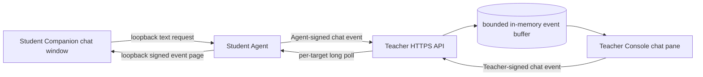

# 一对一课堂聊天：设计

## Design Specification

### 1. Purpose Statement

教师与单名学生需要在活动课堂里持续交换简短文字消息。学生收到消息时，聊天面板出现在屏幕右下角，但不改变当前程序的键盘焦点；学生可以忽略面板继续作业，也可以点击后回复。

### 2. Aesthetic Direction

采用 **工业实用风格**：清楚、克制、像课堂工作工具。复用现有 Avalonia Fluent 主题和 Veyon Campus 配色，不增加装饰动画或新的品牌视觉。

### 3. Color Palette

| 用途 | 颜色 |
| --- | --- |
| 面板背景 | `#F3F6F9` |
| 消息区与输入区 | `#FFFFFF` |
| 主文字 | `#172B4D` |
| 教师发送消息与主要操作 | `#0B69C7` |
| 学生发送消息与状态强调 | `#1C645D` |
| 边框与分隔线 | `#D7E0E8` |

这些颜色沿用当前 Teacher/Companion 界面；项目品牌样式覆盖通用 UI 风格默认值。

### 4. Typography

Windows 桌面端使用 `Segoe UI` 显示英文和数字，使用 `Microsoft YaHei UI` 显示中文，遵循系统 DPI 与文字缩放。消息正文 13–14 px，辅助状态 11–12 px。

### 5. Layout Strategy

学生端使用独立的小型非模态窗口，固定在主显示器工作区右下角，约 380 × 520 px，距工作区边缘 16 px。顶部是窄标题栏和会话状态；消息流占据主体区域；输入框固定在底部。双方消息用左右对齐和浅色块区分，不使用居中弹窗。课堂通知、教师回复与私聊共用这一沟通窗。

教师端把学生选择器和当前对话放进现有课堂互动页；选择项显示学生名、电脑名、座位位置和未读数，下面显示选中对话。新消息只更新对应线程，不切页、不移动教师输入焦点。

## 用户流程

1. 活动课堂和每台学生 Agent 的有效授权建立后，学生或教师都可以发起聊天。
2. 教师从当前课堂学生列表选择一台电脑；学生从 Companion 托盘菜单或主窗口打开聊天。学生端不能选择目标电脑。学生主动打开时允许正常激活窗口。
3. 同一 `SessionId` 与同一规范化目标始终映射到同一条对话。双方同时首次发送时仍归入同一线程，不需要先完成额外握手。
4. 新的教师消息到达时，Companion 在右下角显示或更新聊天窗口，窗口首次显示不激活、不获取键盘焦点。学生点击面板/输入框后，窗口按正常交互取得焦点。
5. 新的学生消息到达时，教师端增加对应学生的未读提示；教师正在看的页面和输入焦点保持不变。
6. 下课、Teacher 重启或 Student Agent/Companion 重启后，旧对话和临时消息失效。

## 组件边界

- **Student Companion** 展示对话、保留当前进程内的最近消息、发送文字；新消息用非激活窗口提示。
- **Student Agent** 继续持有 SYSTEM 权限和设备身份。Companion 只提交正文；Agent 从当前签名授权中填入校区、Session、目标和签名，不接受 Companion 指定任意目标或地址。
- **Teacher Console** 从活动课堂目标和现有座位标签构造列表，按目标发消息并消费同一课堂事件流。
- **Teacher HTTPS API** 使用现有端口、配对/Agent 身份、目标授权、签名校验、重放去重和长轮询；不开放新端口，也不转发到 CloudBase。
- 本版的一对一聊天在 Teacher Console 与 Student Companion 提供；配对手机继续支持现有求助/课堂通知，不加入完整聊天界面。

## 事件与对话标识

- 新增双向 `ClassroomChatMessage` 事件。每条消息有唯一 `EventId`；`CorrelationId` 保存对话标识；`Target` 始终是单一规范化学生目标；`Message` 为纯文本，沿用 500 字符上限和 16 KiB 签名封装上限。
- 对话标识由 `SessionId` 与规范化 `Target` 经带固定用途前缀的 SHA-256 派生为 Guid。此标识用于关联和去重，不作为秘密或授权凭据；服务端仍必须验证活动 Session、已固定 Agent 公钥、授权目标和事件签名。
- 新增学生端 `ClassroomChatDelivered` 回执，关联教师消息的 `EventId`。它只表示 Student Companion 已收到并加入当前会话，不表示学生已打开窗口或读过消息；不实现已读回执。
- 学生首次发言由 Agent 按当前授权创建签名事件；Teacher 首次发言由 Teacher Console 以校区密钥签名。重复提交沿用原 `EventId`，Teacher 缓冲按事件 ID 去重。

## 投递、容量与生命周期

- Teacher API 接收事件后沿现有教师桌面轮询和 Student Agent HTTPS 长轮询投递。事件有效期沿用 2 分钟；超过有效期的未投递消息不作为离线消息补发。
- 教师端消息状态显示“已提交/等待学生端确认/未送达”；Student Companion 对教师消息自动回传“已收到”回执。学生消息的成功状态只表示 Teacher API 已接收，不声称教师已读。
- 聊天文本和对话 UI 状态仅保存在 Teacher/Companion 进程内存。每条对话最多保留最近 200 条。服务端把聊天投递与求助/通知分开计数，最多保留 32768 条/课堂、256 条/目标；过期聊天事件会在队列整理时移除，聊天仅保留到 2 分钟事件有效期，不离线排队。满额时拒绝并显示可重试错误。下课或进程重启时清除。
- 学生与教师每台目标电脑分别最多发送 30 条/分钟；自动投递回执最多 60 条/分钟并按原消息去重。超出时显示节流状态，不静默丢弃。
- Agent 必须在原有签名授权回执中声明 `classroom-chat.v1`。Teacher 验证已固定 Agent 公钥和能力字段后才确认授权；缺少字段、缺少该能力或未实现授权端点的旧 Agent 会被判为不支持，Teacher 撤销其未确认的课堂事件授权，不接入求助、教师回复、全班通知或私聊通道。须先将学生端更新到包含当前 Agent 的版本。此协商复用现有 39174 端口和原回执签名，不新增端口或独立探测接口。

## 安全与失败处理

- 当前活动课堂、签名逐台授权、已固定 Agent 身份、教师 HTTPS 证书指纹和 Session/Target 绑定均为硬性条件。
- 学生 Companion 不能在请求中设置目标、校区、Session 或会话标识；Agent 只允许当前课堂授权范围内提交。
- 教师消息不能通过配对手机 API 任意指定 IP；本版仅提供桌面 Teacher Console 的学生列表入口。
- 对话切换、下课、授权撤销、目标移出课堂或身份轮换时，清除相关内存会话并拒绝旧消息。
- 发送超时显示“状态未确认”，可用同一 EventId 重试；明确拒绝或目标不支持时显示原因。任何 API 接受状态都不标成“已读”。

## Windows 非抢焦点实现

Companion 使用 Avalonia `Window.ShowActivated = false`，并在每次由后台新消息显示窗口时通过 Win32 `SetWindowPos` 使用 `SWP_NOACTIVATE` 和普通 Z 序置于前方；不使用全局 Topmost。用户从托盘主动打开或点击窗口后允许正常激活。Avalonia 的 `ShowActivated` 控制窗口首次显示时是否激活，[Avalonia API](https://api-docs.avaloniaui.net/docs/P_Avalonia_Controls_Window_ShowActivated)；Win32 `SWP_NOACTIVATE` 指定定位窗口时不激活，[Microsoft SetWindowPos 文档](https://learn.microsoft.com/en-us/windows/win32/api/winuser/nf-winuser-setwindowpos)。

## 验证策略

- 协议检查覆盖双方签名、会话/目标隔离、确定性对话 ID、事件重放、速率、长度、容量、失效和能力协商。
- 本机 HTTPS 集成检查确认教师发起、学生发起、双端并发首次发送、长轮询投递、送达回执、超时重试、下课撤销，以及旧 Agent 被拒绝并提示更新学生端。
- Windows 现场验收确认 Edge/全屏应用保持前台和键盘焦点、右下角窗口可见、用户点击后可输入，以及多屏/DPI/托盘启动行为。
- 源码检查和构建不能替代 Windows 双机、真实校园网与教师/学生交互验收。
