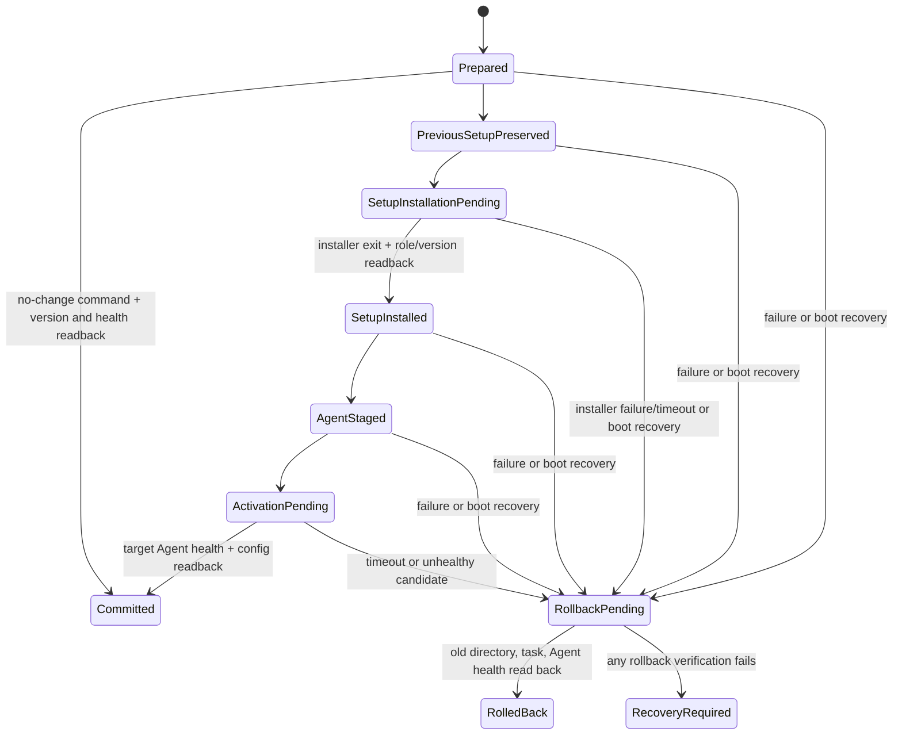

# Cloud updates and installers design

## Boundaries

1. **CloudBase package distribution** stores small versioned campus configuration ZIPs (the current code and shared environment support schema v3–v6) and enforces the 64 KiB limit. The v6 migration and API/OPA deployment were completed after a pre-deployment backup. Live v5/v6 acceptance remains an open project task; the runner requires an interactive administrator session and cleans up each synthetic package. Current evidence belongs in the project task list and dated records, not this design document.
2. **Release discovery** is a separate public read API. Release rows contain role, semantic version, architecture, signed manifest, artifact object key, size, SHA-256, and publication time. Writes are limited to a developer/admin path with service credentials.
3. **Release artifacts** use GitHub Releases for app updates and primary downloads. GitCode Releases may mirror role ZIPs for manual mainland downloads after large-file upload is verified. CloudBase stores only signed metadata and returns a small GitHub redirect response; installer bytes are neither uploaded to CloudBase storage nor passed through its HTTP function. External attachments are verified before the version is advertised.
4. **Teacher self-update** compares semantic versions, verifies the pinned developer RSA signature and the downloaded artifact digest, then delegates replacement to a fixed Updater/Inno Setup command and restarts after success.
5. **Student rollout** follows the documented two-signature model: Developer signature authenticates the installer; the campus Teacher key authenticates the selected rollout command. Teacher downloads each release once and serves it through a LAN-only file endpoint. Student Agent reuses TCP 39174 for small command and result messages; a distinct bounded LAN file endpoint carries the installer.
6. **Teacher heartbeat** is campus-level, daily, and keyed by the published package identity. The server derives campus ownership from `packageId`, uses Asia/Hong_Kong calendar dates, and performs an idempotent daily upsert rather than incrementing a global counter.

## Release manifest

The signed canonical payload binds:

```json
{
  "schemaVersion": 1,
  "product": "VeyonCampus.StudentSetup",
  "role": "StudentSetup",
  "version": "0.4.41",
  "architecture": "win-x64",
  "fileName": "VeyonCampus-Student-Setup-0.4.41-win-x64.exe",
  "sizeBytes": 123456789,
  "sha256": "UPPERCASE_HEX",
  "downloadUrl": "https://..."
}
```

The API adds `signature` and publication time outside the signed canonical fields. The app pins the public key; the private key is held only by the release process. The client accepts only HTTPS download URLs from the configured release origin, expected role/product, `win-x64`, positive bounded size, well-formed SemVer, and a valid signature. Stable latest-version lookup does not perform a downgrade.

## Teacher and Student update flow

```mermaid
sequenceDiagram
    participant T as Teacher Console
    participant C as CloudBase update API
    participant D as GitHub Release (optional GitCode ZIP mirror)
    participant L as Teacher LAN file endpoint
    participant A as Student Agent
    participant U as Student Updater / Inno Setup
    T->>C: GET published Student release metadata
    C-->>T: signed manifest + API redirect URL
    T->>C: GET artifact redirect
    C-->>T: 302 external release URL
    T->>D: HTTPS download once; verify release and digest
    T->>L: cache validated setup executable
    T->>A: campus-signed update-command (version, digest, expiry, nonce)
    A->>T: GET bounded artifact from Teacher LAN
    A->>A: verify both signatures, digest, role, version, expiry and replay state
    A->>U: fixed silent setup command
    U-->>A: installed version / failure result
    A-->>T: authenticated update result
```

`39174` remains the small-message control endpoint. The local file endpoint binds only to active private IPv4 interfaces, serves one opaque route, and is opened only for a rollout. The Student Agent does not accept a shell command, executable path, URL origin, or setup switches from the Teacher message. Source stages the new Agent in versioned ProgramData, switches the protected task, exits the old process and starts the new task through the bundled helper; on start or health failure, the helper restores the old task and verifies old-version health. The SYSTEM helper still uses its loopback `/health` check for local rollback. Teacher network readback sends a fresh campus-signed status request and verifies the Student Agent's RSA-PSS/SHA-256 response, request nonce, campus, pinned per-host identity, and terminal version readback before reporting success.

### Atomic StudentSetup + Agent rollout

The current Teacher-pushed source now implements a joint StudentSetup + Agent transaction. The update path keeps the prior StudentSetup tree, versioned Agent executable, and previous task action until the candidate passes health readback. The state journal, boot recovery task, and watchdog are implemented; Windows 10/11 task ACL, failure-injection, restart-recovery, and two-machine acceptance remain open. Do not describe the feature as Windows-accepted until those gates pass.

2026-10-20 source follow-up adds status protocol v4. A trusted preflight response advertises `StudentUpdateProtocolVersion=1`; after sending an update, Teacher queries the same command ID and requires a signed `committed`, `rolledBack`, or `needsReview` journal state plus exact current/previous/target version binding. The transport also handles a signed `notFound` as unconfirmed rather than success. No-change commands write a committed transaction record so every accepted update command has a durable terminal result. The teacher UI shows `已回滚` only when the previous StudentSetup and Agent versions are read back exactly. Old Agents without v4 remain readable through v1/v2/v3 fallback, but the new Teacher refuses remote update and asks for a complete local StudentSetup installation first.

The update transaction uses a SYSTEM-protected journal at `ProgramData/VeyonCampus/StudentUpdateTransactions/<campus-hash>/student-update-transaction.json` and a same-volume `Program Files/Veyon Campus/UpdateRecovery/Student/<command-id>/Previous` directory for the prior StudentSetup files. It records command ID, current/target StudentSetup and Agent versions, the signed manifest's fixed installer file name, configuration fingerprint, signed manifest digest, helper PID/start time, state, and recovery result. Paths are derived from fixed roots and the command ID instead of accepted from the journal. The journal is atomically written before each active filesystem or scheduled-task mutation. It contains no private keys or signed command body.

The state marks the next operation that may be interrupted, not proof that it finished. Recovery re-reads the role marker, task action and ACL, process health, target versions, and configuration fingerprint before deciding whether to commit or restore.



Before moving the StudentSetup directory, the updater validates the existing role marker, task target, ACLs, available space, and all signed artifacts. Before the first active directory change, it registers and reads back a SYSTEM startup recovery task and a one-minute watchdog. Both call the previous, version-isolated ProgramData Agent in recovery-command mode, so the recovery executable remains available even when the candidate StudentSetup tree is incomplete. It writes each next phase before its mutation and moves the previous app directory on the same volume. The old Agent stays running from its ProgramData version directory. Inno's prepare phase stops only interactive processes under the StudentSetup install/recovery roots before replacing files; the candidate StudentSetup must then pass role and version readback.

The new Agent is copied to its versioned ProgramData directory and compared against the StudentSetup payload. Task switching is itself wrapped in rollback so an ACL or task readback error cannot leave the startup task pointing at a partially activated candidate. The helper waits for the old process to exit, starts the candidate and verifies local health with the expected version and configuration fingerprint. A durable helper PID/start-time lease prevents the watchdog from racing an active helper; recovery acquires the global mutex before inspecting it and stops a helper only after its 10-minute bound plus exact path and start-time verification. The full installer has a 10-minute execution bound. If Agent exits while Inno remains active, recovery verifies the process image against this transaction's protected staging path, stops it, and waits up to 30 seconds before changing active files. If exit cannot be verified, recovery preserves all materials and marks the transaction for review. Only the health result commits both components. Teacher still requires its separate signed network readback and pinned identity before reporting success.

On installer failure, Agent stage/activation failure, timeout, helper interruption, or reboot, recovery uses the journal to choose one safe outcome: finalize only a candidate that passes version/configuration health checks, otherwise restore the previous task and StudentSetup directory, start the previous Agent, and verify both. If restoration cannot be verified, retain the old executable, backup directory, journal, and logs; report `needs-review` and do not delete recovery material. The boot task handles restarts before or after task activation; the watchdog handles a live-session helper crash, including a candidate that cannot start its own code.

StudentSetup's Inno file list must not use `restartreplace`: a locked-file replacement queues for a future reboot and cannot be treated as a committed candidate. It must fail so the active transaction restores the previous tree.

The complete rollout order, failure matrix, version-skew plan, and release gates are maintained in [学生端更新可靠性计划](../../docs/学生端更新可靠性计划.md). Full-package atomic acceptance is a hard prerequisite for the file-level incremental implementation. Binary deltas remain a later phase and must reconstruct and verify the exact signed target files before using the same transaction.

Each Agent creates a persistent RSA identity on first SYSTEM startup and stores its private PKCS#8 key in `agent-identity.json` beside the protected campus configuration. Its DACL grants access only to SYSTEM and local Administrators; `SecureTree` preserves this private ACL across configuration repair. Updating the Agent binary leaves this file in place. The Student setup verifier displays the full public-key fingerprint. Teacher stores a canonical public key and fingerprint in the current user's LocalAppData, keyed by `(campusId, normalized target)`. A signed response carries the canonical public key, canonical payload, and signature; status payloads bind the teacher's nonce, while update payloads bind the signed `commandId`, campus, expected StudentSetup version, Agent version, and restart state. A changed key never replaces a pin automatically.

The current Teacher no longer sends a remote update command to an older Agent that lacks v4 atomic-status capability, even if that Agent can verify an older campus-signed command. The target must first be manually upgraded with the complete StudentSetup installer and then pass a new signed, pinned-identity preflight. Plaintext legacy results never count as success. A Teacher-mediated first-use or rotation dialog lists each target and full fingerprint and requires explicit approval. Operators should compare against the fingerprint shown by Student setup where available. Trust-on-first-use over the same LAN cannot detect an active first-contact key substitution; subsequent substitutions are detected because the pinned key must match. Core checks cover response signature/canonicalization, nonce/command binding, key pin persistence, rejection of implicit key rotation, and unpinned legacy bootstrap handling. Windows SYSTEM identity, task/ACL operations, process restart, firewall, and multi-device acceptance remain open.

### Update phase timing

TeacherConsole measures signed release lookup separately from the local package-cache lookup/download and verification. The summary reports the signed package size, cache-hit state, elapsed time, and download throughput when network bytes were fetched. This preparation measurement is separate from the per-student transaction.

Each Student update command has a local sidecar at `ProgramData/VeyonCampus/WebsitePolicy/<campus-hash>/student-update-phase-timings/<command-id>.json`. The sidecar records only the random command ID, known phase names, UTC start/end, monotonic elapsed time, transferred bytes, hash CPU time, and success state. It excludes campus IDs, host names, IPs, paths, URLs, and credentials. It is capped at 16 phases per command, 32 KiB per record, and 128 retained records. It is atomically replaced under a SYSTEM/Administrators-only ACL and is independent of the transaction journal; a timing failure is ignored by the update path.

The Agent exposes the timing record only through `POST /v1/update-timings`, requiring a fresh campus-signed v4 status request bound to the update `commandId`. The returned payload is signed by the persistent Agent identity; Teacher verifies the signature against its pinned key, plus campus, nonce, command ID, timestamps, and field bounds before showing it in the per-device update row. Older Agents may return 404 and remain on the existing full-package compatibility behavior. The timing endpoint does not take the update apply lock, so it can report progress while installation is active. It is a local LAN read and does not upload telemetry to CloudBase.

The displayed Teacher receipt interval currently measures from the terminal-status polling window to its signed terminal readback; when the Student accepted an asynchronous update, this includes the remaining update wait and should be read as end-to-end confirmation time. Windows field runs are still required to establish P50/P95 baselines and validate the measured intervals.

## Teacher heartbeat

The Teacher sends one record per campus per UTC+8 calendar day containing only a stable random local publisher instance identifier, `packageId`, Teacher app version, Student release version, and a bounded configured-computer count. The HTTP API verifies the campus identity through the package mapping and upserts by `(campus_id, day_hkt)`. The random identifier is HMACed server-side and is not retained in raw form. No user name, phone suffix, hostname, IP, or student-level identifier is accepted.

## Implementation order

1. Preserve and record the verified anonymous package API end-to-end evidence.
2. Add role-specific Inno Setup definitions and produce setup `.exe` artifacts on a Windows build runner while keeping a directory artifact for diagnosis.
3. Add release metadata/storage schema and anonymous latest-release read API; keep release writes private.
4. Add signed manifest verification, Teacher version comparison, download, and self-update handoff. Release manifest schema v3 declares Application Policy and Student System Policy capability versions; new clients query `/v3/releases/latest`, while `/v1` and `/v2` keep their earlier canonical signatures for installed clients.
5. Add Teacher LAN cache/server and signed update command; add Student Agent verification, SYSTEM Updater handoff, per-device health readback, and Agent binary rollover. The Agent now signs status and update results with a persistent per-machine identity key; Teacher pins the key by campus and target and fails closed on changed keys. Windows SYSTEM acceptance remains required before closing the task.
6. Add campus-level Teacher heartbeat and UTC+8 idempotent aggregation.
7. Run code-level checks here, then require Windows installer and two-machine acceptance before marking the corresponding roadmap tasks complete.

## Security and recovery checks

- RSA-PSS/SHA-256 release signatures are verified against a pinned public key; TLS and SHA-256 are also checked.
- Student status protocol v4 binds the requested command ID and transaction state to a fresh campus-signed nonce response; Teacher verifies the pinned per-device identity and exact old/new versions before showing a terminal result.
- Teacher and StudentSetup updates require both policy capabilities. Before replacing a StudentSetup or SYSTEM Agent, the updater checks protected local application/system-policy state and refuses a release missing any capability required by active or pending state.
- Package IDs, file names, URLs, version strings, sizes, command lifetimes, and nonces are validated before use.
- Update metadata and downloads are no-store; short-lived URLs are not written into logs.
- Staging and updater files live under a protected ProgramData directory; writes use a temporary file and atomic rename.
- Inno Setup receives only constant silent switches and a validated setup path. The interactive application self-update helper preserves and restores the prior role directory on installer failure. The Teacher-pushed Student path now has source-level joint rollback and recovery, but Windows failure-injection and live-machine acceptance remain mandatory before enabling incremental updates.
- Cloud package publishing credentials and developer signing secrets remain server-side; no CloudBase login is needed for package consumers or campus heartbeat.
