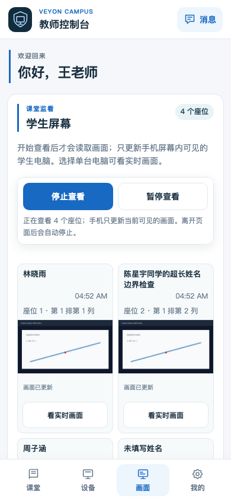
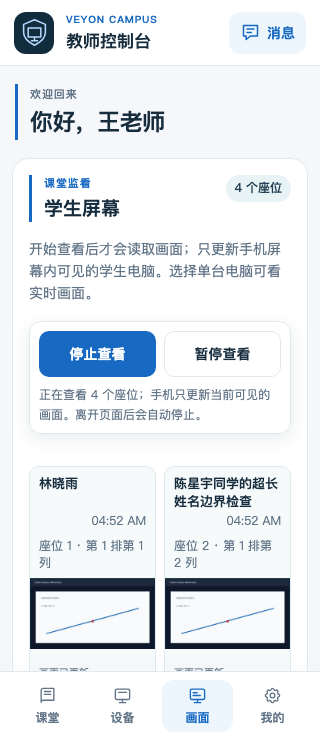
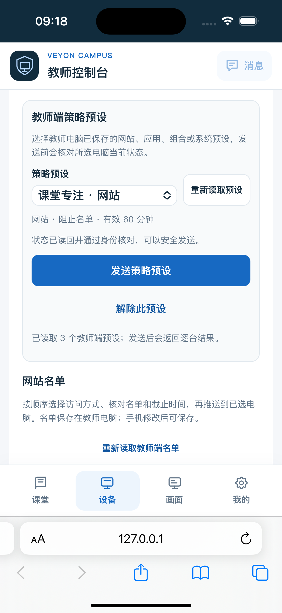
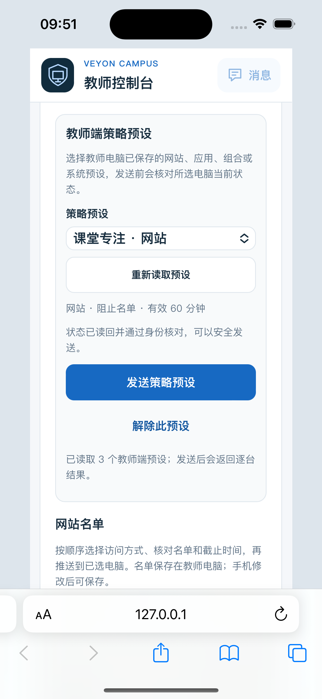

# 手机画面页预览

截图使用项目当前的 PWA HTML、JavaScript 和 CSS，通过 Chrome DevTools 手机视口生成：390×844 和 320×740 CSS px。会话、课堂名单和 API 响应均为本地模拟数据；屏幕图像是合成示意图，不含真实学生信息，也不代表真实 Veyon 采集结果。

两种视口下文档宽度均与视口宽度一致；预览包含 4 张双列 16:9 画面卡片。窄屏姓名最多显示两行，更新时间另起一行；完整姓名仍保留在元素文本和 `title` 中。真实 Android/iOS 浏览器、证书信任、教师 API 和学生屏幕仍需现场验收。

2026-10-27 新增的策略预设卡片另用 iPhone 15（iOS 17.5）Simulator Safari 检查，CSS 视口为 393×852；教师会话、策略预设和签名状态均由本地 mock API 提供。预览确认预设摘要、可发送状态和两个操作按钮在该视口内可读且没有明显横向溢出；它不证明真实教师 API、学生 Agent 策略交付或实体手机证书信任。

2026-10-27 继续在同一 iPhone 15 Simulator Safari 会话中检查 320px 窄屏：外层 Safari 视口为 393×852 CSS px，预览 wrapper 把实际 PWA 放入 320×852 CSS px 的 iframe，接口仍由本地 mock API 提供。预设选择器在窄屏下占满一行，刷新按钮移到下一行；截图中预设名称和按钮均完整可见，卡片没有明显横向裁切。该模拟不代表实体手机、真实教师 API 或策略下发结果。

